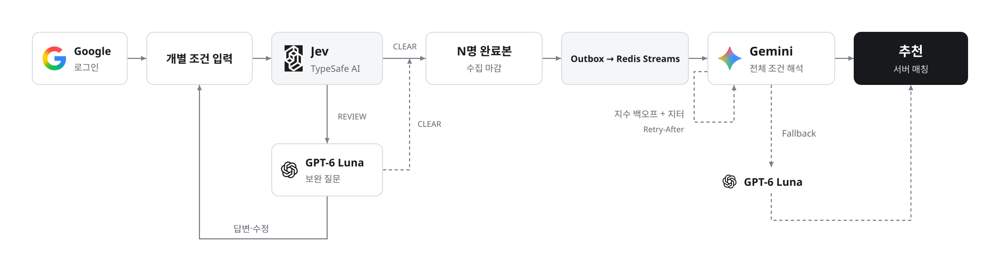

# meet-me-server

[](https://github.com/meet-me-duo/meet-me-server/actions/workflows/ci.yml)

> 조건은 자연어로, 후보 계산은 결정론적으로.

여러 사람의 시간과 장소 조건을 모아 **서로 다른 날짜·시간의 일정 후보를 제안하는 일정 조율 서비스**의 백엔드입니다.
참여자는 시간표를 반복해서 채우는 대신 가능한 시간과 장소를 문장으로 입력합니다. AI가 조건을 구조화하고,
서버가 시간 교집합·장소 적합성을 계산해 후보를 선별합니다.

## 입력에서 추천까지



1. 주최자는 Google/Kakao로 로그인해 방을 만들고 참여 링크를 공유합니다. 참여자는 계정 또는 검증된
   게스트 소유권으로 본인 입력을 관리합니다.
2. 참여자가 자연어 조건을 입력하면 Jev가 확인이 필요한지 판단합니다. 필요한 경우 GPT-6 Luna가
   보완 질문을 만들고, 참여자는 답을 선택하거나 원문을 직접 수정합니다. 저장과 확인 완료는 구분합니다.
3. 수집이 마감되면 확인을 마친 전체 입력을 하나의 배치로 고정합니다. Gemini가 전체 조건과 장소 그룹을
   구조화하며, 재시도 가능한 장애에는 제한된 재시도와 Luna fallback을 사용합니다.
4. 서버가 후보를 계산합니다. 주최자가 하나를 확정하면 모든 참여자가 같은 결과를 조회합니다.

추천은 서로 다른 연속 시간창을 최대 세 안(A/B/C)으로 보여줍니다. 세 안은 비교해 고르는 시간 선택지이며,
표시상의 우열을 뜻하지 않습니다. 같은 시간창의
방식·장소·참석 조합은 세부 선택지로 묶고 나머지 시간안도 조회할 수 있습니다. 후보를 선별할 때의
참석 인원·명시 선호 기준과 화면에 제시하는 시간안의 의미는 구분합니다.
방 설정이 온라인이면 온라인만, 대면이면 대면만, 둘 다 허용하면 두 방식을 검토합니다.
부분 참석 시간안에는 실제 가능한 인원과 제외 이름을 함께 표시합니다.

이 흐름은 통합 개발본 기준입니다. 개인 확인의 운영 활성화와 실제 공급자 검증 상태는
[배포 완료 기준](deploy/APPROVED_RELEASE_PIPELINE.md)과 [외부 설정 안내](docs/USER_INTERVENTION.md)에서 구분합니다. 조건부 대체는 한 참여자의 한 단계까지
지원하며, 해석 실패나 지원하지 않는 복합 조건을 참석 가능한 것으로 추정하지 않습니다.
조건을 만족하는 후보가 없으면 후보 없음으로 알립니다.

## 설계에서 지킨 경계

- **AI 해석과 결정론적 계산:** AI는 시간·장소 조건을 구조화하고, 참석 가능 집합과 시간안은 서버 규칙으로 계산합니다.
  같은 구조화 입력은 같은 결과를 만듭니다.
- **저장과 비동기 처리:** PostgreSQL의 불변 입력·작업·Outbox를 기준으로 Redis Streams에 작업을 전달합니다.
  Worker는 처리 소유권을 확인해 중복 실행을 막고, 전달 계층 장애에서도 저장한 원문을 보존합니다.
- **본인 입력과 권한:** 계정과 검증된 게스트 소유권을 구분하고 다른 참여자의 원문을 보호합니다.
  공유 링크만으로 주최자 권한을 부여하거나 기존 참여 기록을 자동 병합하지 않습니다.

Kotlin·Java 17, Spring Boot, PostgreSQL·Komapper·Flyway, Redis Streams, Docker·AWS와 GitHub Actions를 사용합니다.
구조와 선택 이유는 [Architecture](docs/ARCHITECTURE.md)와 [ADR](docs/ADR.md)에 정리했습니다.

## 로컬 실행

JDK 17, Docker/Compose가 필요합니다. 외부 연동 설정은 [.env.example](.env.example)과
[설정 안내](docs/USER_INTERVENTION.md)를 참고하고 비밀값은 저장소에 남기지 않습니다.

```shell
docker compose up -d postgres redis
./gradlew bootRun --args='--spring.profiles.active=local'
```

API는 `http://localhost:8080`에서 실행됩니다. Windows에서는 `./gradlew` 대신 `.\gradlew.bat`을 사용합니다.

## 로컬 품질 검사

새 클론에서 다음 명령으로 Git 훅을 활성화합니다. 기존에 별도 훅 경로를 사용하면 두 훅을 기존 체인에서 호출합니다.

```shell
git config --local core.hooksPath .githooks
```

| 시점 | 검사 |
| --- | --- |
| 커밋 전 | Kotlin 또는 빌드 설정을 스테이징하면 해당 Git 스냅샷으로 `ktlintCheck`를 실행합니다. |
| 푸시 전 | 푸시할 브랜치의 커밋으로 `detekt architectureTest`를 실행합니다. ArchUnit은 컴파일된 코드의 Domain·Application 의존 방향을 검사합니다. |
| PR 및 develop/main CI | detekt, ktlint, 빌드, ArchUnit을 포함한 전체 테스트가 Quality Gate에 포함됩니다. |

```shell
./gradlew ktlintCheck detekt architectureTest
./gradlew --no-daemon ktlintCheck detekt assemble test
```

detekt는 직접 작성한 main/test Kotlin의 과도한 중첩, 빈 조건문, 예외 처리 등 선택한 규칙을 검사합니다. Kotlin 2.3.21 분석기와 맞춘 detekt 2.0.0-alpha.3을 고정했습니다. 기존 위반 4건은 `config/detekt/baseline.xml`에 개별 기록했으며, 새 위반은 빌드를 실패시킵니다. 기존 항목을 고칠 때 해당 항목도 삭제합니다. 런타임 동작과 기능 요구사항은 기존 단위·통합 테스트에서 검증합니다.

## API와 상세 문서

| 환경 | Swagger UI | OpenAPI JSON |
| --- | --- | --- |
| Local | [localhost:8080/swagger-ui](http://localhost:8080/swagger-ui/index.html) | [localhost:8080/v3/api-docs](http://localhost:8080/v3/api-docs) |
| Production | [api.meet-me.co.kr/swagger-ui](https://api.meet-me.co.kr/swagger-ui/index.html) | [api.meet-me.co.kr/v3/api-docs](https://api.meet-me.co.kr/v3/api-docs) |

운영 API 계약은 실행 중인 OpenAPI를 기준으로 확인합니다.

- [제품 요구사항](docs/PRD.md) · [Frontend Handoff](docs/FRONTEND_HANDOFF.md)
- [배포 완료 기준](deploy/APPROVED_RELEASE_PIPELINE.md) · [외부 설정 안내](docs/USER_INTERVENTION.md)
- [구현 계획](implementation_plan.md) · [격리 V2 계약](docs/EXPERIMENTAL_INPUT_EVIDENCE.md)
- [프론트엔드 저장소](https://github.com/meet-me-duo/meet-me-web) · [흐름도 디자인 원본](https://www.figma.com/design/1Y3BUYKbKiMQEemQ1rnoIq?node-id=11-2)
