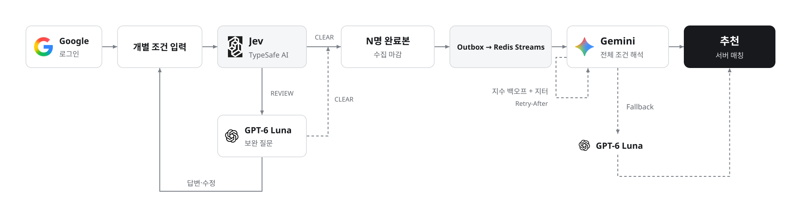
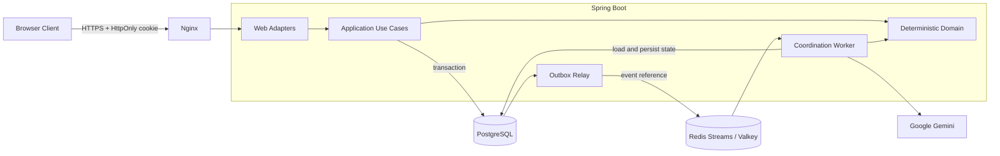

# meet-me-server

[](https://github.com/meet-me-duo/meet-me-server/actions/workflows/ci.yml)

> 조건은 자연어로, 후보 계산은 결정론적으로.

여러 사람의 시간과 장소 조건을 모아 **Plan A/B/C 일정 후보를 제안하는 AI 기반 일정 조율 서비스**의
백엔드입니다. Gemini는 사용자의 비정형 문장과 장소 근접 그룹을 구조화하고, 시간 교집합·장소 그룹·후보
순위와 최종 상태 전이는 서버의 결정론적 도메인 로직이 담당합니다.

이 저장소는 백엔드, AWS 인프라와 CI/CD를 포함합니다. 프론트엔드는 별도 프로젝트에서 개발합니다.

이번 통합 릴리스는 Google/Kakao 로그인과 계정 소유권, 개인 입력 확인과 보완 질문, 전체 입력 분석을
함께 통합합니다. 아래는 구현 흐름이며 운영 연결 완료를 뜻하지 않습니다. 최종 공식 Figma 흐름도는
사용자가 승인한 보완 Luna 경로를 반영합니다. 현재 후보는 미배포 상태입니다.



[최종 Figma 원본](https://www.figma.com/design/1Y3BUYKbKiMQEemQ1rnoIq?node-id=11-2)의 승인된 SVG를 저장소에 포함했습니다. 보완 질문만 Luna로 변경했으며 전체 분석은 Gemini와 Luna fallback을 유지합니다.

- **API 문서**
  - [운영 Swagger UI](https://api.meet-me.co.kr/swagger-ui/index.html)
  - [OpenAPI JSON](https://api.meet-me.co.kr/v3/api-docs)
- **제품 요구사항:** [PRD](docs/PRD.md)
- **기술 구조:** [Architecture](docs/ARCHITECTURE.md)
- **주요 결정:** [ADR](docs/ADR.md)

> 운영 API 계약은 실행 중인 OpenAPI 문서를 기준으로 봅니다. 통합 검토안의 배포 완료를 뜻하지 않습니다.

## 제품이 해결하는 문제

기존 일정 조율 도구는 참여자가 시간표를 반복해서 채워야 하고, 복합적인 시간·장소 조건을 표현하기
어렵습니다. meet-me는 다음 흐름으로 입력 부담과 조율 과정의 사회적 마찰을 줄입니다.

1. 주최자는 Google/Kakao로 로그인해 방을 만들고 참여 링크를 공유합니다. 참여자는 계정 또는 검증된
   게스트 소유권으로 본인 입력에 접근합니다. 로그인만으로 기존 게스트 참여를 자동 연결하지 않습니다.
2. 참여자의 개인 원문을 먼저 저장한 뒤 비동기로 확인합니다. 목표 연결은 Jev가 전체 입력의 확인 필요
   여부를 판단하고, 충분히 명확하면 통과시키며, 정상적인 불확실성이나 확인 필요가 있을 때만 보완 질문을
   GPT-6 Luna로 생성하는 흐름입니다. 기술 오류를 질문 필요 판정으로 바꾸지 않습니다.
3. 질문이 있으면 본인이 선택하거나 원문을 직접 수정해 재검사합니다. 저장과 제출 완료는 다르며 현재
   원문이 최종 `CLEAR`로 수용되어야 완료입니다. 취소·실패·미응답은 완료로 세지 않습니다.
4. N명의 완료 상태를 모으고 수집을 마감하면 해당 시점의 완료본을 하나의 불변 배치로 고정합니다.
   다른 참여자의 조건은 후보 생성 전까지 공개하지 않습니다. 전체 LLM에는 선택·수정 내용을 반영한
   N명의 완료 원문을 보냅니다. 수정 전 원문과 질문·선택 이력은 DB에 보존하며 별도 대화록으로 모두
   전송하지 않습니다. 개인별 장소 분류 결과를 합쳐 전체 해석을 대신하지 않습니다.
5. 서버가 시간·장소 조건을 결정론적으로 계산해 Plan A/B/C를 종류별 최대 한 장으로 제안합니다.
   전체 분석은 비동기로 처리하고 클라이언트는 상태와 결과를 조회합니다.
6. 주최자가 하나를 확정하면 모든 참여자가 같은 결과를 조회합니다.

### 개인 확인과 전체 분석의 재시도

개인 확인의 Jev 분류와 Luna 질문 생성은 기존 15초를 공유합니다. 자동 재시도 대신 허용된 실패에 한해 사용자가
명시적으로 재시도하며, 답변·직접 수정은 새 원문 버전의 재검사입니다. 최종 전체 분석은 재시도 가능한
Gemini 장애에 한해 최대 4회 시도하고 `Retry-After`가 없으면 지수 backoff와 full jitter를 적용합니다.
남은 실행 시간과 예약이 허용할 때 Luna fallback을 최대 1회 사용합니다. 동일 작업의 무제한 재전송은
허용하지 않으며 지속 장애는 원문을 보존한 `ANALYSIS_DELAYED`로 구분합니다.

### 통합 검증 상태와 지원 경계

- 개인 보완은 GPT-6 Luna Responses 단일 요청이며 Standard(`service_tier=default`)·low reasoning·출력 최대2,048토큰을 명시합니다. count·자동 재시도·개인 단계 fallback은 없습니다. 실제 Standard 처리·15초 내 응답률·질문 의미 품질은 무료 회귀와 구분해 미검증으로 남깁니다.

- Google/Kakao·소유권, 질문 API·답변·재검사, 웹 화면과 영속 예산 구현을 server/web develop에 통합했습니다.
  무료 회귀와 CI는 실제 운영 OAuth 로그인·callback·서명키 설정 및 새 모델의 의미 품질·지연 검증과 구분합니다.
- Jev 전체 입력 분류의 운영 연결을 준비합니다. 별도 원본48 실험에서 검증한 시각 관련성 및
  `AM/PM/NOT_STATED/UNRESOLVED` 판단은 시간대 보완 실험이며, `NO_PERIOD_QUESTION`만으로
  입력 전체를 `CLEAR`로 승인하지 않습니다. 모임 길이·날짜 경계·최종 일정 해석은 전체 분석에 남깁니다.
- 검토된 운영 가격 근거·방 예산·단위·confidence 임계값이 없으면 개인 확인과 관리형 AI 예산은 기본
  OFF·`UNCONFIGURED`·전송 거부입니다. 개발 평가 한도를 운영 비용 승인으로 사용하지 않습니다.
- 최종 조건 추출의 실제 Luna 4/4 검증과 이전 무료 회귀는 개인 Jev 판단·질문 생성·답변·로그인을
  포함한 운영 전체 흐름의 실검증을 대신하지 않습니다. 추가 실모델 호출은 이번 통합 준비에 포함하지 않습니다.
- main행 검토 PR은 서버 [#136](https://github.com/meet-me-duo/meet-me-server/pull/136)과 웹 [#34](https://github.com/meet-me-duo/meet-me-web/pull/34)입니다. main 병합은 기존 자동 운영 게시·배포를 촉발하므로 서버의 새 OAuth/RS256·typed secret·V11–V17 대상 준비와 웹의 호환 배포 순서를 먼저 확인해야 합니다. 기존 main의 읽기 전용 preflight 성공을 새 대상 준비 완료로 사용하지 않습니다. 검증된 소스 통합만으로 운영 AI 기능을 활성화하지 않습니다.
- 단일 참여자의 명시적인 기본 시간과 한 단계 대체 시간을 지원합니다. 여러 조건부 참여자, 연쇄·순환
  대체는 안전 제외와 `PARTIAL` 사유로 남깁니다. 해석 실패·구조화 결과 누락을 참석 가능으로 추정하지 않습니다.

### 병합 전 비용과 운영 준비

10원은 달성된 고정 상한이나 새 결제 승인이 아닙니다. 2026-10-20 공식 Standard 가격의
Gemini 출력 $3.75/백만 토큰과 Luna 출력 $0.50/백만 토큰을 **조건부 계산**에 사용하면 다음과 같습니다.
Gemini 가격은 2026-12-31까지이며 이후 재검토가 필요합니다.
([Gemini 가격](https://ai.google.dev/gemini-api/docs/pricing),
[Luna 모델 가격](https://developers.openai.com/api/docs/models/gpt-6-luna))

| 요청 범위 | 출력 요청 한도 | 출력만의 조건부 최대 비용(USD) |
| --- | --- | --- |
| 개인 Luna 질문 1회 | 2,048 | 0.001024 |
| 최종 Gemini 1회 | 32,768 | 0.122880 |
| 최종 Luna fallback 1회 | 32,768 | 0.016384 |
| 최종 분석 한 invocation의 최대 4+1회 | 각 32,768 | 0.507904 |

이는 실제 사용량 예측·실청구·모임 전체 상한이 아닙니다. 전체 입력·schema·reasoning/캐시·서비스 tier·
세금/환전·개인 Jev/Luna 검사와 새 correction/HOST invocation을 별도로 계산해야 합니다. 최종 Luna는
검증된 요청의 `service_tier`를 생략한 상태이며 개인 Luna의 명시적 `default`와 다릅니다. 응답의 실제 tier는
확인되지 않았습니다. 검증한 최종 prompt/schema와 두 최종 출력 한도는 그대로 보존했습니다.

현재 입력 제한은 개인500/방10,000 Unicode code point·최대50명입니다. 개인 Luna의 전송 전 검사는
전체 요청16,384바이트이고, 입력4,096토큰 검사는 **응답 usage를 받은 뒤** 수행합니다. 최종 요청은 실제
전송 바이트를 고정·해시 검증하지만 32MiB capture 제한은 청구 토큰 상한이 아닙니다. 대표 입력의
26–77KB 오프라인 측정이나 최대 모델 context 전량의 $6.52 계산으로 실용적 방 cap을 확정하지 않습니다.
정확 모델의 전체 요청 토큰과 유효 가격/만료를 결속한 operation 최대액 근거가 필요합니다.
입력을 포함한 한 invocation의 조건부 산식은 `(0.75×Gemini 입력 합계 + 3.75×Gemini 출력 합계 +
0.10×Luna 입력 + 0.50×Luna 출력)/1,000,000`입니다. 이때 출력은 과금되는 reasoning을 포함하며
캐시·tier 등 계약 차이는 별도 반영해야 합니다. 기존 usage 기반 추정 지표나 고정 환산율은 이 근거를 대신하지 않습니다.

관리형 예산은 승인된 최종 `PRIMARY` 최대액의4배와 `FALLBACK` 최대액의 합을 신규 개인 예약에서 보호합니다.
가상 보호분을 실제 hold로 중복 계상하지 않으며 같은 예약의 replay에도 다시 청구하지 않습니다.
이는 미래 최종 invocation 한 번의 여유이고 반복 실행 전체의 비용 보장이 아닙니다. cap 부족·만료·근거
누락은 전송 전에 거부합니다. `usageComplete=true`도 완전 청구 증거가 아니므로 production의
`completeBill()`은 현재 `null`을 유지합니다. 낮은 usage로 hold가 풀리는 운영 정산은 아직 지원하지 않아
누적 예약 때문에 정상 요청도 중단될 수 있습니다. 임의 가격으로 환급하지 않습니다.
HTTP gate는 usage 관측만 전달합니다. 실제 완전 청구 증거를 공급하고 해당 예약의 `settle()`을 호출하는
운영 소비자도 아직 연결되지 않았으므로 resolver 하나를 추가하는 것만으로 정산이 완성되지 않습니다.

Jev 기본 confidence는 `null`입니다. 검토된 development60/holdout60/보강16의 gold는 실측 예측이 아니며
과거 다른 모델의0.8/0.1을 운영 임계값으로 재사용하지 않습니다.
([평가 범위](docs/evaluation/issue123-classification-evaluation/README.md),
[공급자 confidence 설명](https://docs.typesafe.ai/confidence))

OAuth 콘솔 설정은 사용자 완료 상태입니다. 남은 확인은 기존 runtime typed 설정 전달·RS256 파일의
UID10001 가독성/읽기 전용 mount·V11–V17 적용 및 복구 준비입니다. 기존 main preflight는 V1–V10만
확인했습니다. 이 실행기의 GitHub 연결은 secret 메타데이터 endpoint 조회를 허용하지 않으며 새 대상의
host 증거도 아직 없습니다. 운영 AI 정책은 `UNCONFIGURED`·OFF를 유지합니다. 코드/CI 완료를
운영 준비 완료로 표시하지 않으며 main 병합이 자동 게시·배포를 촉발하기 전에 이 차이를 해소해야 합니다.
OFF는 기존 legacy 최종 분석 동작을 보존하므로 전체 AI의 전역 중지 스위치가 아닙니다. 관리형 보호가
적용되지 않은 기존 호출을 이 예산으로 계상했다고 주장하지 않습니다.

| 후보 | 의미 |
| --- | --- |
| **Plan A** | 전원이 참석 가능한 시간과 오프라인 장소 조건을 모두 만족하는 최적안 |
| **Plan B** | 전원이 참석 가능한 온라인 대안 |
| **Plan C** | 전원 교집합이 없을 때 최소 2명을 유지하는 최대 참석자 차선안 |

AI가 최종 후보를 선택하지 않습니다. 동일한 구조화 입력은 항상 동일한 후보를 만들며, 동률도 공통 가능
총시간·가장 이른 시작·안정적인 내부 식별자 순으로 해소합니다.

## 백엔드 설계 하이라이트

### 1. AI와 핵심 의사결정의 경계

- Gemini Structured Output을 닫힌 조건 유니온으로 제한하고 공급자 응답을 서버에서 다시 검증합니다.
- LLM이 좌표, 후보 점수와 최종 선택을 만들지 못하게 합니다.
- 인접 장소에는 같은 `AREA_n` 키를 부여하고, 멀리 떨어진 장소는 다른 키로 구조화합니다.
- 시간 교집합, 장소 그룹 교집합과 Plan A/B/C 계산은 프레임워크 독립적인 Domain에서 수행합니다.
- 구조화 성공 후 일부 의미 조건만 반영할 수 없으면 `PARTIAL`, 공급자 기술 장애가 지속되면 입력을 보존한
  `ANALYSIS_DELAYED`로 분리합니다.

### 2. 유실과 중복 전달을 견디는 비동기 파이프라인

참여자의 제출 요청에서 외부 AI를 호출하지 않습니다. 원본 제출은 불변 버전으로 먼저 저장하고, 입력 수집
종료 시점의 최신 버전만 하나의 방 전체 배치로 고정합니다.

- PostgreSQL 트랜잭션 안에서 조율 작업과 Outbox를 함께 기록합니다.
- Relay가 작업 참조만 Redis Streams로 발행하고 Worker가 PostgreSQL에서 원문을 조회합니다.
- PostgreSQL의 처리 lease와 상태를 기준으로 중복 실행을 막습니다.
- Redis Pending 또는 데이터 유실 뒤에도 PostgreSQL에서 작업을 재발행할 수 있습니다.
- 첫 전달을 포함해 5회 실패한 poison message는 PostgreSQL에 먼저 영구 실패를 기록한 뒤 참조형 DLQ로
  이동합니다.

Redis는 전달과 호출 제한을 담당하지만 영구 비즈니스 데이터의 최종 기준은 PostgreSQL입니다.

### 3. 계정과 게스트 소유권

- 서버가 256비트 불투명 guest credential을 다음 속성의 cookie로 발급합니다.
  `Secure HttpOnly; SameSite=Lax; Path=/api`
- 원문 credential은 응답 body나 브라우저 저장소에 노출하지 않고 PostgreSQL에는 SHA-256 digest만 저장합니다.
- 방 소유권이 확인된 `HOST`만 마감·재분석·후보 확정을 수행합니다.
- 공유 초대 코드는 방 접근 수단일 뿐 참여자 또는 주최자 권한이 아닙니다.
- 계정의 방 소유권과 검증된 게스트 소유권을 구분합니다. 다른 기기 재로그인과 명시적 게스트 연결은
  소유권을 다시 검사하며 이름이나 이메일의 일치만으로 참여 기록을 병합하지 않습니다.
- 상태 변경 요청은 정확한 허용 Origin을 검증하고 Redis 기반 호출 제한을 적용합니다.
- 로그에는 원본 자연어·cookie·좌표·외부 API key를 기록하지 않습니다.

### 4. Aggregate 우선 헥사고날 아키텍처

```text
com.meetme.server
├── meetingroom/{domain,application,adapter}
├── participant/{domain,application,adapter}
├── submission/{domain,application,adapter}
├── coordination/{domain,application,adapter}
├── shared
└── config
```

각 Aggregate가 자신의 Domain, Use Case, Port와 Adapter를 함께 소유합니다. 의존 방향은
`adapter → application → domain`이며 Domain은 Spring, Komapper, Redis와 외부 SDK를 알지 못합니다.
Web DTO, 외부 공급자 DTO, Domain 모델과 Komapper 영속 Record도 분리합니다.

## 시스템 구조



## 기술 스택

- **Language:** Kotlin 2.3.21, Java 17
  - null 안전성과 명확한 도메인 모델, 안정적인 JVM 생태계
- **Framework:** Spring Boot 4.1.1, Spring MVC, Validation
  - 동기 JDBC 기반 유스케이스와 HTTP 경계 구성
- **Persistence:** PostgreSQL 18, Komapper JDBC 7.0.0, Flyway
  - SQL 제약·트랜잭션 중심 데이터 정합성과 명시적인 스키마 이력
- **Async / Rate limit:** Redis Streams, ElastiCache Serverless for Valkey
  - 비동기 전달, Pending 복구, DLQ와 공개 API 호출 제한
- **AI / Place:** Jev 1.14 개인 분류, GPT-6 Luna 개인 보완, Gemini 3.8 Flash 전체 분석과 Luna fallback
  - 개인 확인 필요 판단과 필요한 보완 질문을 구분하고, 전체 원문의 조건·장소 그룹 구조화는 마감 뒤 수행
- **API:** springdoc-openapi, RFC 9457 Problem Details
  - 실행 코드에서 생성되는 프론트엔드 계약과 언어 중립 오류 코드
- **Test:** JUnit 5, Spring Boot Test, Testcontainers
  - 순수 Domain부터 실제 PostgreSQL·Redis 통합 경계까지 검증
- **Observability:** Actuator, Micrometer Prometheus, JSON logs
  - health·지표와 상관관계 ID 기반 운영 진단
- **Infrastructure:** Docker, Nginx, Terraform, AWS
  - 재현 가능한 이미지·인프라와 관리형 영구 데이터 서비스
- **CI/CD:** GitHub Actions, AWS OIDC, ECR, SSM
  - 장기 AWS Access Key 없이 main CI 성공 commit을 자동 배포

## 운영 배포

제출 MVP는 비용과 구현 복잡도를 고려해 서울 리전의 단일 EC2에서 Nginx와 Spring Boot 컨테이너를
실행합니다. 영구 데이터와 작업 전달 계층은 호스트 수명주기에서 분리했습니다.

- **Compute:** EC2 `t4g.small`, ARM64 애플리케이션 이미지
- **Data:** RDS PostgreSQL 18 `db.t4g.micro`, Single-AZ, 7일 자동 백업
- **Stream / Cache:** ElastiCache Serverless for Valkey
- **Edge:** Route 53, ACM exportable certificate, Nginx TLS reverse proxy
- **Artifact / Deploy:** ECR image digest, S3 release contract, Systems Manager
- **Secrets:** RDS managed secret와 SSM Parameter Store `SecureString`
- **IaC state:** versioning·암호화를 적용한 S3 backend와 native lock file

배포는 다음 순서를 따릅니다.

```text
main merge
  → CI: ktlintCheck + assemble + test + 운영 구성 회귀 검사
  → CI 성공 commit의 SHA로 ARM64 image build·ECR push
  → 같은 image로 Flyway migration 선실행
  → SSM을 통한 EC2 application 교체
  → app·Nginx health 및 공개 /healthz·/v3/api-docs 검증
```

GitHub Actions는 OIDC로 AWS 임시 자격 증명을 발급받습니다. 배포는 tag가 아닌 image digest를 고정하며,
실패하면 이전 digest로 애플리케이션을 되돌립니다. Flyway migration은 자동 downgrade하지 않으므로 운영
스키마는 이전 애플리케이션과 호환되는 단계적 변경을 우선합니다.

## 테스트와 검증 전략

- **Domain:** 시간대/DST, 연속 시간 교집합, 장소 호환 그룹 교집합, Plan A/B/C와 동률 규칙
- **Application:** 트랜잭션 경계, 최신 제출 고정, 중복 종료·확정의 멱등성과 권한 분기
- **Persistence:** H2 대신 Testcontainers PostgreSQL에서 Flyway fresh/upgrade와
  실제 제약 검증
- **Async:** 중복 Stream 전달, 처리 lease, Pending 회수, 재발행과 poison DLQ 순서
- **External adapters:** Gemini schema·응답 상한·재시도와 Kakao 다중 페이지·동명 장소·timeout 계약
- **Web / Security:** cookie 속성, Origin, 타인 입력 비공개,
  401/403/409/429/503과 OpenAPI 계약
- **Architecture:** 소스 경로와 package 일치, Domain 프레임워크 독립성과 역방향 의존 방지
- **Deployment:** ARM64 image, raw secret 전달, 비루트·read-only 컨테이너와
  실제 Nginx 기동 회귀 검사

핵심 동시성·보안·외부 Adapter 테스트는 정상 사례만 확인하지 않고 의도적인 결함을 주입해 기존 테스트가
이를 탐지하는지도 검증합니다.

## API

공개 MVP API는 방 생명주기, 참여, 조건 제출·복원, 분석 재요청, 후보 조회·확정과 결과 조회를 제공합니다.
필드·enum·nullable 여부와 오류 응답은 README에 복제하지 않고 실행 코드에서 생성되는 Swagger/OpenAPI를
계약으로 사용합니다.

| 환경 | Swagger UI | OpenAPI JSON |
| --- | --- | --- |
| Local | [localhost:8080/swagger-ui](http://localhost:8080/swagger-ui/index.html) | [localhost:8080/v3/api-docs](http://localhost:8080/v3/api-docs) |
| Production | [api.meet-me.co.kr/swagger-ui](https://api.meet-me.co.kr/swagger-ui/index.html) | [api.meet-me.co.kr/v3/api-docs](https://api.meet-me.co.kr/v3/api-docs) |

프론트엔드 구현 시 cookie, Polling, 공개 상태와 오류 처리 규칙은
[Frontend Handoff](docs/FRONTEND_HANDOFF.md)를 함께 참고합니다.

## 로컬 실행

### 요구 환경

- Java 17+
- Docker와 Docker Compose
- 저장소에 포함된 Gradle Wrapper

### 1. PostgreSQL과 Redis 실행

```shell
docker compose up -d postgres redis
```

### 2. 선택적인 외부 연동 설정

애플리케이션은 외부 key 없이도 기동하고 정형 시간 입력 흐름을 실행할 수 있습니다. 자연어 분석과
Gemini 장소 호환 그룹까지 확인하려면 `.env.example`을 참고해 실행 프로세스에 다음 환경 변수를 주입합니다.

```properties
GEMINI_API_KEY=
```

실제 값은 Git, 채팅, Issue, PR과 로그에 남기지 않습니다. 로컬 보관이 필요하면 Git에서 제외된
`.env.local`을 사용하고 IDE Run Configuration 또는 현재 terminal session에서 애플리케이션 프로세스에
전달합니다.

### 3. 애플리케이션 실행

```shell
./gradlew bootRun --args='--spring.profiles.active=local'
```

Windows PowerShell에서는 다음 명령을 사용합니다.

```powershell
.\gradlew.bat bootRun --args="--spring.profiles.active=local"
```

로컬 API는 `http://localhost:8080`, Prometheus 지표는 `http://localhost:8080/actuator/prometheus`에서
확인할 수 있습니다.

## 검증

```shell
./gradlew --no-daemon ktlintCheck assemble test
```

Windows PowerShell:

```powershell
.\gradlew.bat --no-daemon ktlintCheck assemble test
```

## 구현 범위와 다음 단계

### 제출 MVP에 포함

- 로그인 없는 방 생성·참여와 브라우저 세션 기반 HOST 권한
- 자연어·수동 가능 시간 제출과 최신 입력 복원
- 비동기 Gemini 시간·장소 그룹 구조화
- 결정론적 Plan A/B/C·`NO_MATCH`·`PARTIAL` 계산
- 분석 지연 재요청, 후보 확정과 결과 공유
- Redis 호출 제한, 30일 데이터 정리와 Prometheus·JSON 로그
- Terraform AWS 인프라와 main 기반 자동 CI/CD

### Post-MVP 또는 운영 준비 과제

- Google·Kakao 로그인과 Google Calendar 연결·방별 ON/OFF
- 실제 좌표·이동시간 검증이 필요할 때 지도 공급자 재선정
- Grafana Cloud 중앙 로그·지표·대시보드와 자동 알림
- 합의된 성능 목표 기반 부하 테스트
- 이전 image digest rollback과 RDS 시점 복구 리허설
- 다중 인스턴스·무중단 배포 요구 발생 시 ECS·ALB 재평가

현재 상태와 완료 근거는 [Implementation Plan](implementation_plan.md), 사용자 개입이 필요한 외부 설정은
[User Intervention Guide](docs/USER_INTERVENTION.md)에서 추적합니다.
