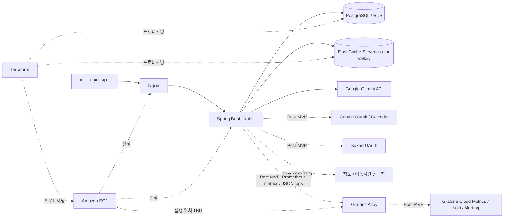

# Architecture: meet-me-server

> **문서 상태:** Draft  
> **대상 시스템:** AI 기반 스마트 일정 조율 서비스의 백엔드  
> **저장소:** `meet-me-duo/meet-me-server`  
> **관련 문서:** `docs/PRD.md`, `docs/ADR.md`

## 계정·소유권 경계

사용자 승인 #109는 기존 익명 제출 모드에서 계정 HOST로 전환하는 후속 버전이다. account 영역의 application port 뒤에 Google/Kakao OIDC, RSA JWT, Redis 회전 세션, JDBC 영구 계정 저장을 둔다. Domain에는 공급자·HTTP·Redis 타입을 노출하지 않는다. 계정 생성은 provider+subject unique 및 transaction으로 보호하고 이메일 자동 연결을 하지 않는다. login-only 공급자 토큰은 검증 뒤 폐기하며 Calendar 지속 grant/암호화 저장은 별도 범위다.

participants는 account user 또는 guest session 정확히 하나를 소유자로 가진다. 인증된 account가 있으면 guest cookie로 권한을 보충하지 않는다. 명시적 claim은 room row lock 아래 이중 증명·계정 충돌을 확인하고 기존 participant owner만 원자 변경한다. 방·제출·역할 식별자는 보존한다. 인증 context를 application port로 읽으며 기존 소유권 경계에 연결한다. 내 모임 목록은 PostgreSQL의 현재 계정 HOST·MEMBER 소유권을 기준으로 읽고 기존 cleanup 기준30일을 expires_at으로 계산한다. 2026-10-28 사용자 요청으로 ADR-051의 HOST 전용 목록 범위만 참여 목록까지 확장하며 인증·명시적 연결·권한 경계는 유지한다. AccountRoomArchivePort의 조회 조건은 역할·생성 시각 범위·이름·커서이며 JDBC adapter에서 계정 조건과 보존 조건을 항상 함께 적용한다. HTTP adapter는 KST 생성일과 불투명 커서를 application 값으로 변환하고 Domain에는 HTTP 형식을 노출하지 않는다. 자세한 계약은 [내 모임 목록 API](ACCOUNT_ROOM_HISTORY_API.md)를 따른다.

Auth start/callback은 browser-bound single-use state·PKCE S256·OIDC nonce를 사용한다. provider issuer/audience/kid/signature/time 검증 뒤 서비스 Refresh를 cookie로만 발급하고 fixed frontend callback으로 돌아간다. Redis 회전·가족 폐기는 atomic script로 처리하며 실패 시 갱신을 허용하지 않는다. 서비스 RS256 private key는 mount된 외부 secret file, 검증 current/previous public key는 JWKS로 주입한다. 설정 없는 환경에서 임시 운영키를 만들지 않는다. 실제 앱/키/배포 및 운영 로그인은 별도 검증이다.

계정·소유권은 ADR-051과 위 계약을 기준으로 하며 아래 익명 제출 MVP 구조보다 우선한다. 외부 설정은 [운영 안내](USER_INTERVENTION.md)를 따른다.

## 1. 목적과 범위

이 문서는 `meet-me-server`의 기술적 구조, 컴포넌트 책임, 의존성 방향과 외부 시스템 경계를 정의한다. 이 저장소는 백엔드만 포함하며 프론트엔드는 별도 저장소에서 개발한다.

현재 확정되지 않은 선택은 임의로 확정하지 않고 **TBD**로 표시한다. 확정된 결정 중 향후 구현에 큰 영향을 주는 내용은 `docs/ADR.md`에도 기록한다.

## 2. 기술 스택 요약

| 영역 | 선택 | 상태 |
| --- | --- | --- |
| 언어 | Kotlin 2.3.21 | 확정 |
| JVM | Java 17 | 확정 |
| 빌드 | Gradle 9.7.1 Wrapper, Kotlin DSL | 확정 |
| 애플리케이션 프레임워크 | Spring Boot 4.1.1 | 확정 |
| 애플리케이션 구조 | 단일 모듈, 패키지 기반 헥사고날 아키텍처 | 확정 |
| 주 데이터베이스 | PostgreSQL | 확정 |
| 데이터 접근 | Komapper JDBC | 확정, 구체 의존성 버전은 구현 시 고정 |
| DB 스키마 마이그레이션 | Flyway | 확정 |
| 로컬·테스트 데이터베이스 | Docker Compose PostgreSQL, Testcontainers PostgreSQL | 확정, H2 미사용 |
| 인메모리 데이터 저장소 | Redis 호환 ElastiCache Serverless for Valkey | 제출 MVP의 Streams·호출 제한·DLQ 운영 배치 확정, Post-MVP Refresh Token TTL·백업 정책 TBD |
| 리버스 프록시 | EC2의 Nginx | TLS 종료, API 라우팅, 요청 제한과 헬스체크 담당 |
| 사용자 접근 | 제출 MVP는 전원 익명 브라우저 세션, Post-MVP는 주최자 Google·Kakao 로그인 | 제출 MVP 주최자 권한은 방 생성 세션에 귀속. RS256 Access/Refresh와 OAuth는 Post-MVP |
| 자연어 파싱 | `gemini-3.8-flash` Structured Output, Google GenAI Java SDK 1.72.0 | 고정 stable ID, 조건 유니온과 256KiB 응답 상한 |
| 운영 데이터베이스 | Amazon RDS for PostgreSQL | 확정 |
| Infrastructure as Code | Terraform | 확정 |
| 운영 컴퓨팅 | Amazon EC2 `t4g.small` | 제출 MVP 단일 인스턴스, ECS 전환 가능성을 컨테이너 경계로 보존 |
| 이미지 레지스트리 | Amazon ECR | 이미지 digest 기반 배포 |
| 장소 호환 판정 | 제출 MVP는 Gemini Structured Output | 방 전체 명시 장소의 `AREA_n` 근접 그룹과 대표 지역명만 AI가 구조화하고 서버가 그룹 교집합 계산. 지도·좌표 공급자는 Post-MVP TBD |
| API 계약 문서 | Swagger/OpenAPI, springdoc-openapi 3.1.0 | 확정 |
| 시간대 | IANA Zone ID, MVP `Asia/Seoul` | 저장·계산 경계 확정, 사용자 선택은 MVP 이후 |
| 국제화 | Spring MessageSource, BCP 47 locale, MVP `ko-KR` | 기반 도입 확정, 추가 언어 TBD |
| 관측성 | 제출 MVP는 Spring Boot Actuator·Micrometer Prometheus 지표와 JSON 표준 출력, Grafana Alloy·Cloud Metrics·Loki·Alerting은 Post-MVP | MVP 로컬 기반 확정, 외부 전송은 후속 범위 |

## 3. 시스템 컨텍스트



### 외부 경계

- **프론트엔드:** 제출 MVP는 익명 방 생성·참여, 필수 자연어 입력·본인 복원, 비동기 상태와 읽기 전용 후보·확정을 담당한다. 입력 수동 타임테이블·상태·복원·전송은 제거한다. Post-MVP 로그인·Calendar는 별도 범위다.
- **Google/Kakao:** Post-MVP에 meet-me 사용자 인증을 제공한다. Google Calendar 연동은 meet-me 인증을 완료한 사용자에게만 제공하며 Google의 별도 Calendar 동의 범위가 필요하다.
- **Google Gemini:** 자연어 조건과 방 전체 명시 장소의 근접 호환 그룹·대표 지역명을 구조화한다. 좌표, 최종 시간·참여자·플랜 선택은 만들지 않는다.
- **지도 공급자 (Post-MVP TBD):** 제출 MVP에서는 호출하지 않는다. 실제 좌표·이동시간 검증이 제품 요구가 될 때 공급자와 결제 방식을 다시 결정한다.
- **AWS:** 애플리케이션 런타임과 운영 PostgreSQL을 제공한다.
- **Grafana Cloud (Post-MVP):** Alloy가 전송한 애플리케이션·Worker 지표와 로그를 관리형 Metrics 및 Loki에 저장하고 Grafana-managed Alerting으로 운영 알림을 평가한다. 제출 MVP는 계정·전송 자격 증명 없이 애플리케이션의 Prometheus endpoint와 JSON 표준 출력까지만 제공한다.

### 제출 MVP 접근 모드

- Wanted AI Champion 심사·투표용 배포는 소셜 로그인 없이 공개한다.
- 서버는 첫 방 생성 또는 참여 시 32바이트 암호학적 난수로 익명 브라우저 자격 증명을 발급한다. 원문은 API 호스트 전용 `Secure HttpOnly; SameSite=Lax; Path=/api` 쿠키로만 전달하고 PostgreSQL에는 SHA-256 digest만 저장한다. 수명은 발급 시점부터 고정 30일이며 사용에 따라 연장하거나 자동 회전하지 않는다.
- 방 생성 세션은 첫 참여자와 `HOST` 역할을 함께 소유하며, 같은 세션만 마감·재분석·후보 확정 같은 주최자 명령을 수행한다.
- 공유 링크는 방 진입 수단일 뿐 참여자 또는 주최자 권한 증명이 아니다.
- 공유 링크와 공개 방 API는 내부 UUID 대신 128비트 난수를 base64url로 인코딩한 22자 초대 코드를 사용한다.
- Google·Kakao OAuth, 서비스 JWT/Refresh Token과 Google Calendar endpoint·adapter는 제출 MVP에서 활성화하지 않고 Post-MVP에 구현한다.
- 제출 기간 종료 후 인증 모드 전환은 자동 날짜 조건이 아니라 명시적인 배포 설정과 회귀 테스트를 거쳐 수행한다.

## 4. 헥사고날 아키텍처

### 의존성 원칙

의존성은 외부 어댑터에서 애플리케이션과 도메인 방향으로만 향한다. 핵심 일정 매칭 규칙은 Spring, Komapper, Redis, Gemini SDK, OAuth SDK, 지도 SDK에 직접 의존하지 않는다.

```text
Inbound Adapter
  -> Inbound Port / Use Case
    -> Domain
    -> Outbound Port
      <- Outbound Adapter
```

### 내부 영역

- **Domain:** 모임, 참여자, 일정 입력 모드, 자연어 시간 조건, Calendar 불가 시간, 실제 날짜형·주간 반복형 방 전용 가능 시간과 추가 불가 시간, 장소 조건, 일정 후보와 Plan A/B/C 계산 규칙을 표현한다. 모임 생성자는 항상 주최자 역할을 가진 첫 번째 참여자이며 예상 참여 인원에 포함된다. 예상 참여 인원은 설정 시 2명 이상이고, 후보 생성에는 최소 2명의 고유 참여자 제출이 필요하다.
- **Application:** 유스케이스를 조합하고 트랜잭션 및 처리 순서를 조정한다.
- **Inbound Ports:** 방 생성, 참여, 조건 제출·본인 최신 입력 조회, 지연된 방 분석 재요청, 매칭 실행, 최종 확정과 같은 시스템 진입점을 정의한다.
- **Outbound Ports:** 데이터 저장, 캐시, 자연어 파싱, OAuth, 캘린더 조회, 좌표 변환과 같은 외부 의존성을 추상화한다.

핵심 도메인은 다음 네 Aggregate 경계를 사용한다.

- `MeetingRoom`: 방 설정, 입력 수집 상태, 종료 정책·원인과 탐색 날짜 범위를 소유한다.
- `Participant`: 방별 참여와 `HOST`·`MEMBER` 역할 및 익명 브라우저 세션 소유권을 표현한다.
- `Submission`: 참여자별 제출 head와 최신 불변 제출 버전을 소유한다. 과거 버전은 PostgreSQL에 보존하되 Aggregate를 불필요하게 키우지 않는다.
- `CoordinationRun`: 마감 시 고정한 제출 배치, 조율 작업 상태, 후보 품질·목록과 최종 확정을 소유한다.

Aggregate 사이 불변식과 여러 저장소를 묶는 원자성은 Application 서비스와 PostgreSQL 제약으로 조정한다. 한 방의 참여자·제출 전체를 `MeetingRoom` 안에 적재하지 않아 동시 제출 시 거대한 Aggregate 경합을 피한다. 소셜 `User`와 공급자 계정은 제출 MVP Aggregate에 포함하지 않고 Post-MVP 경계로 유지한다.

### 어댑터 영역

- **Web Adapter:** HTTP 요청 검증, 인증 주체 해석, DTO 변환과 응답 직렬화를 담당한다.
- **Persistence Adapter:** Komapper JDBC로 PostgreSQL에 접근하고 영속 `Record`와 도메인 모델 간 변환을 담당한다.
- **Redis Adapter:** Redis Streams 기반 비동기 작업 전달을 구현한다. 인증 상태·캐시 등 추가 책임은 확정된 범위에만 구현한다.
- **AI Adapter:** Gemini 요청·응답과 도메인에서 사용하는 구조화 결과 사이를 변환한다.
- **OAuth Adapter (Post-MVP):** Google·Kakao 로그인 공급자별 차이를 내부 인증 포트 뒤로 숨긴다.
- **Calendar Adapter (Post-MVP):** Google Calendar 이벤트를 절대 불가 시간으로 변환한다.
- **Place Group 경계:** 제출 MVP에서는 Gemini adapter가 `SPECIFIC_PLACE`에 배치 내부 `AREA_n` 키와 대표 지역명을 부여한다. Application은 이를 공급자 독립 값으로 변환하고 Domain은 문자열 그룹의 교집합만 계산한다. Geo Adapter는 Post-MVP 후보로 남긴다.

### 모듈 구성 원칙

- 도메인 모델에는 프레임워크 애너테이션과 외부 SDK 타입을 노출하지 않는다.
- 도메인 Aggregate·Entity·Value Object, Web DTO, 외부 공급자 DTO와 Komapper 영속 `Record`를 분리한다.
- Komapper 애너테이션과 KSP 매핑 정의는 `adapter.output.persistence` 내부의 `Record`와 별도 매핑 정의에만 둔다. 도메인 모델에는 Komapper 타입이나 애너테이션을 노출하지 않는다.
- 영속 타입은 DDD Entity와 혼동하지 않도록 `Entity` 대신 `Record` 또는 `Row` 접미사를 사용하고, 명시적인 Mapper로 도메인 모델과 변환한다.
- 포트는 실제 교체 가능성이나 테스트 경계가 있는 외부 의존성에만 둔다.
- 방 생성 유스케이스는 모임과 주최자 역할의 첫 참여자 생성을 하나의 트랜잭션으로 처리한다. 주최자도 조건 제출 상태를 가지며 예상 참여 인원 계산에서 제외하지 않는다.
- MVP는 단일 Gradle 모듈에서 `meetingroom`, `participant`, `submission`, `coordination` Aggregate를 최상위 기능 패키지로 두고, 각 패키지 아래에 `domain`, `application`, `adapter` 헥사고날 경계를 둔다. 전역 `domain`, `application`, `adapter` 최상위 패키지는 사용하지 않는다.
- 각 Aggregate의 `application.port.input`은 시스템 진입 유스케이스를, `application.port.output`은 실제 외부 교체 또는 독립 테스트 가치가 있는 의존성을 정의한다. Aggregate를 조정하는 유스케이스는 주된 상태 변경을 소유하는 Aggregate의 Application 계층에 둔다.
- 각 Aggregate의 `adapter.input.web`은 HTTP 진입점을, `adapter.output.persistence`와 `adapter.output.integration`은 영속성과 외부 서비스 연동을 구현한다. 여러 Aggregate에서 사용하는 ID·시간 값, 기술 중립 생성기 계약과 공통 HTTP 오류·게스트 쿠키 같은 횡단 기술 계약만 `shared`에 두며 Aggregate별 저장소·Record·Mapper는 `shared`로 올리지 않는다.
- 소스 경로와 package 선언의 일치, 네 Aggregate별 세 계층의 존재, Domain의 프레임워크 독립성과 Domain·Application의 Adapter 비의존은 아키텍처 테스트로 검증한다.
- 규모와 독립 배포 필요성이 확인되기 전에는 멀티 모듈로 분리하지 않는다.

## 5. API 계약과 Swagger

Swagger/OpenAPI 문서를 별도 프론트엔드 저장소가 사용하는 공식 API 계약으로 취급한다.

- 모든 공개 Controller 엔드포인트에 `@ApiResponse`를 추가한다.
- 각 엔드포인트가 실제로 반환하는 성공 및 주요 오류 응답을 문서화한다.
- 요청·응답 DTO와 공개 필드에는 `@Schema`를 추가하여 의미와 제약을 설명한다.
- 도메인 모델과 영속성 Entity는 API 스키마로 직접 노출하지 않는다.
- API 변경 시 구현, OpenAPI 문서와 계약 검증 테스트를 함께 갱신한다.
- API의 상태와 오류 코드는 locale에 관계없이 안정적으로 유지한다. 서버가 제공하는 사용자 노출 메시지는 `Accept-Language`를 BCP 47 locale로 해석해 MessageSource에서 조회하며 MVP는 `ko-KR`로 fallback한다.
- 후보 조회 응답은 계산의 기준인 언어 중립 구조화 시간 후보와 표시용 자연어 요약을 함께 제공한다. 자연어 요약은 응답 시 구조화 결과에서 MessageSource 템플릿으로 생성하며 LLM 출력이나 영속 데이터의 기준으로 사용하지 않는다.
- 인증된 참여자는 `GET /api/rooms/{inviteCode}/candidates`로 확정 전 후보를 조회한다. `PARTIAL`의 참여자 표시 이름·실패 원문·미반영 사유는 별도 HOST 전용 `GET /api/rooms/{inviteCode}/candidates/unapplied-inputs`에서만 제공한다. 방 응답은 제출 전 고지를 위한 `input_disclosure_policy=HOST_ON_PARTIAL_RESULT`를 포함한다.
- HOST는 `POST /api/rooms/{inviteCode}/candidates/{candidateId}/confirmation`으로 후보를 확정하고, 참여자는 `GET /api/rooms/{inviteCode}/result`로 확정 결과를 조회한다. 같은 후보의 재요청은 멱등하게 성공하고 다른 후보의 중복·동시 요청은 `409`로 거부한다.
- 절대 시각은 ISO 8601 offset을 포함해 직렬화하고 방 응답에는 IANA Time Zone ID를 별도 필드로 제공한다.
- 방 생성 요청의 `search_start_date`, `search_end_date`는 지역 날짜 쌍이며 둘 다 전달하거나 둘 다 생략해야 한다. 둘 다 생략하면 서버가 방 생성 시점의 `Asia/Seoul` 날짜를 시작일, 14일 뒤를 배타적 종료일로 확정한다.
- 명시된 탐색 범위는 양수이며 최대 31일이어야 한다. 이 검증은 Web DTO에만 의존하지 않고 방 생성 유스케이스와 도메인 값 객체에서도 보장한다.
- 방 조회 응답은 기본값 적용 여부와 무관하게 확정된 두 날짜를 항상 반환한다. OpenAPI `@Schema`에는 생략 시 오늘부터 14일이라는 기본값을 기재하여 프론트엔드가 생성 화면에 동일한 안내를 표시할 수 있게 한다.
- 방은 주최자 명시 또는 기본값 적용인 범위 출처를 보존·응답한다. 이 값은 탐색 범위 설명과 자연어 날짜 확장에 사용하며 수동 입력 UI를 요구하지 않는다.
- 공개 방 API는 `POST /api/rooms`, `GET /api/rooms/{inviteCode}`, `POST /api/rooms/{inviteCode}/participants`, `POST /api/rooms/{inviteCode}/close`를 사용한다. 내부 방 UUID와 참여자 UUID는 URL이나 응답에 노출하지 않는다. 생성자는 `host_display_name`, 일반 참여자는 `display_name`을 공백 제거 후 1~50자로 제공한다.
- 수동 마감에서 자동 조건이 아직 충족되지 않았고 `confirm_early`가 거짓이면 `409 EARLY_CLOSE_CONFIRMATION_REQUIRED`와 현재 현황을 반환한다. 클라이언트가 같은 endpoint에 `confirm_early=true`로 다시 요청하면 서버가 조건을 다시 평가한 뒤 마감한다. 이미 닫힌 방에 대한 동일 주최자 요청은 현재 마감 결과를 반환한다.
- 오류 응답은 RFC 9457 `application/problem+json`을 사용하고 locale과 무관한 `code`, MessageSource로 만든 `detail`, 검증 오류의 `field_errors`를 확장한다. 검증 실패는 `400`, 세션 누락·만료·위조·회수는 `401`, 유효한 다른 세션의 주최자 명령은 `403`, 알 수 없는 초대 코드는 `404`, 상태 충돌과 조기 마감 재확인은 `409`를 사용한다.
- 입력 제출·조회·수정 API는 인증된 서비스 사용자 또는 비로그인 참여자의 게스트 자격 증명을 참여자 소유권으로 해석한다. 게스트 자격 증명은 암호학적으로 안전한 난수로 생성한 브라우저 단위 불투명 bearer 값이며 `Secure HttpOnly` 쿠키로만 전달한다. 하나의 게스트 브라우저 세션은 여러 방의 참여자 레코드와 연결할 수 있지만 `(guest_browser_session_id, room_id)` 조합은 유일해야 한다. 응답 JSON, URL과 JavaScript가 읽을 수 있는 브라우저 저장소에는 노출하지 않는다. 공유 초대 링크만으로는 제출 조회·수정 권한을 부여하지 않는다.
- 본인 조회의 legacy raw_text는 nullable이며 PUT 성공은 non-null이다. revision·locale·created_at·editable을 유지하고 manual_available_times는 deprecated 항상 []이다. 수동 원본을 응답 DTO로 변환하지 않는다. 소유권·정상 입력 비공개는 유지한다.
- 공개 상태 계약은 최소한 분석 지연을 뜻하는 `ANALYSIS_DELAYED`를 구분해야 한다. 이 상태의 방 단위 재분석 요청은 인증된 주최자에게만 허용하고 같은 고정 배치에 대해 멱등하게 처리한다.
- 로그인과 Refresh 성공 응답은 15분 Access Token과 만료 정보를 response body로 반환하고, 회전된 Refresh Token은 response body나 JavaScript가 읽는 일반 응답 헤더가 아니라 `Set-Cookie` 헤더의 API 호스트 전용 `Secure HttpOnly; SameSite=Lax; Path=/api/auth` 쿠키로만 전달한다. `Domain`은 지정하지 않고 `Max-Age`는 미사용 14일과 토큰 패밀리 잔여 절대 수명 중 짧은 값으로 설정한다. 클라이언트는 Access Token을 이후 요청의 `Authorization: Bearer` 헤더에 넣고, Refresh 요청에서는 쿠키를 자동 전송한다. Refresh·로그아웃처럼 이 쿠키로 권한을 행사하는 상태 변경 요청은 정확한 프론트엔드 Origin 허용 목록을 통과해야 하며 누락되거나 일치하지 않는 `Origin`은 거부한다. CORS credential 허용도 같은 명시적 Origin 목록에만 적용하고 wildcard를 사용하지 않는다. 정확한 body 필드명은 API 구현 시 정한다.

Spring Boot에서 Swagger UI와 OpenAPI 명세는 `springdoc-openapi-starter-webmvc-ui` 3.1.0으로 생성한다.

## 6. 핵심 데이터 흐름

### 6.1 소셜 로그인

1. 주최자는 방 생성 전에 Google 또는 Kakao 인증 흐름을 완료한다.
2. 백엔드는 공급자가 발급한 인증 결과를 검증한다.
3. 공급자와 공급자 사용자 식별자를 기준으로 서비스 사용자를 조회하거나 생성한다.
4. 백엔드는 서비스 API 호출에 사용할 인증 수단을 발급한다.
5. 일반 참여자는 서비스 로그인 없이 공유 링크로 방에 참여할 수 있다. 유효한 게스트 브라우저 세션 쿠키가 없을 때만 서버가 새 불투명 자격 증명을 생성하여 `Secure HttpOnly` 쿠키로 전달하고, 이후 여러 방의 참여·본인 제출 조회·수정 요청에서 같은 세션을 검증한다.
6. 같은 게스트 브라우저 세션이 이미 참여한 방에 다시 접근하면 새 참여자를 만들지 않고 기존 참여자를 반환한다. 한 브라우저에서 같은 방의 여러 게스트를 구분하는 흐름은 제공하지 않는다.

meet-me 서비스는 15분 수명의 RS256 JWT Access Token과 암호학적으로 안전한 불투명 Refresh Token을 발급한다. JWT 헤더의 `kid`로 검증 공개키를 선택하고 현재 private key 하나만 서명에 사용한다. 교체 시 이전 public key는 이미 발급된 Access Token의 15분 수명과 허용 clock skew가 모두 지난 뒤 제거한다. Private key는 저장소·이미지·로그에 넣지 않고 환경별 비밀 저장소에서 주입하며 검증용 public key 집합과 분리한다. Access Token은 로그인·갱신 response body로 전달하고 프론트엔드는 영구 브라우저 저장소에 보관하지 않은 채 이후 요청의 `Authorization: Bearer` 헤더로 전송한다. 서버는 요청마다 Redis를 조회하지 않고 Access Token의 서명과 만료를 검증한다. Refresh Token은 `Set-Cookie`의 `Secure HttpOnly` 쿠키로만 전달하며 원문은 서버에 저장하지 않는다. 서버는 Refresh 해시, 사용자·토큰 패밀리 참조, 회전·폐기 상태를 Redis TTL로 관리한다.

Refresh Token은 마지막 정상 사용으로부터 14일 동안 유효하지만 토큰 패밀리의 절대 수명은 최초 로그인부터 30일이다. 갱신할 때 기존 Refresh Token을 폐기하고 새 값의 미사용 TTL을 14일로 시작하되 패밀리의 남은 절대 수명을 넘기지 않는다. 폐기된 토큰의 재사용이 감지되면 해당 토큰 패밀리를 폐기한다. Redis 장애 중에는 갱신이 실패하고 Redis 데이터 유실 시 기존 Refresh 세션은 무효화되어 재로그인이 필요하지만 영구 사용자·방 데이터는 유실되지 않는다. 운영 프론트엔드와 API는 같은 상위 사이트의 서브도메인에 배치한다. Refresh 쿠키는 `Secure`, `HttpOnly`, `SameSite=Lax`, `Path=/api/auth`를 사용하고 `Domain`을 생략해 API 호스트 전용으로 제한한다. 매 발급·회전의 `Max-Age`는 미사용 14일과 토큰 패밀리의 남은 절대 수명 중 짧은 값이다. Refresh·로그아웃 요청은 명시적 프론트엔드 Origin과 정확히 일치할 때만 허용하며 누락·불일치 Origin을 거부한다. 이 Post-MVP 소셜 로그인 경계에서는 별도 synchronizer 또는 double-submit CSRF token을 추가하지 않는다. 일반 로그아웃은 요청의 Refresh Token이 속한 현재 기기 패밀리만 Redis에서 폐기하고 Refresh 쿠키를 만료시킨다. 별도의 인증된 모든 기기 로그아웃은 사용자와 연결된 모든 Refresh Token 패밀리를 폐기하고 현재 쿠키도 만료시킨다. Redis에는 사용자별 활성 패밀리를 찾을 수 있는 인덱스를 두되 일반 API 요청의 Access Token 검증은 Redis를 조회하지 않는다. 따라서 두 로그아웃 이후에도 기존 Access Token은 최대 15분 동안 유효할 수 있다. 서비스 로그아웃은 Google·Kakao 계정 연결이나 Calendar grant를 폐기하지 않는다.

Google·Kakao가 발급한 공급자 Refresh Token은 meet-me 서비스 Refresh Token과 다른 비밀정보다. Calendar 재사용 등에 필요한 공급자 토큰은 Redis TTL에 두지 않고 PostgreSQL의 암호화된 grant로 영구 보관하며 암호화 키 관리와 공급자별 갱신·폐기 절차는 TBD다. 게스트 자격 증명은 로그인 토큰과 분리된 하나의 브라우저 세션으로 여러 방의 참여를 소유하며 cookie 수명·범위·Origin 방어는 ADR-036을 따른다. 공유 링크는 방 진입 수단일 뿐 제출 소유권 증명이 아니다. Google Calendar 동의는 meet-me 서비스 로그인과 별도의 권한이지만 인증된 서비스 사용자만 시작할 수 있다.

### 6.2 Google Calendar 불가 시간 수집 (Post-MVP)

1. 애플리케이션은 참여자가 meet-me에 로그인했는지 확인하고, 비로그인 게스트의 Calendar 연동 요청은 거부한다.
2. 인증된 사용자가 Google Calendar 연동에 필요한 동의 범위를 승인한다.
3. Calendar ON 제출 또는 수정 요청을 접수할 때 Calendar 어댑터가 합의된 조회 기간의 일정을 가져온다. 화면 미리보기 등 그 이전 조회 결과는 매칭의 기준 스냅샷이 아니다.
4. 어댑터는 Google Calendar 응답을 서버 내부의 `calendar_blocked_times` 형식으로 변환하고 조회 완료 시각과 함께 해당 불변 제출 버전에 스냅샷으로 저장한다.
5. 로그인한 개인 계정의 Calendar 연결·일정 조회 상태와 현재 참여 중인 방의 적용 상태를 분리한다. 일정을 불러왔더라도 해당 참여자가 현재 방에 제출한 최신 모드가 `MANUAL_AVAILABILITY`이면 Calendar 데이터는 매칭에 사용하지 않는다. 주최자나 다른 참여자는 이 모드를 대신 변경할 수 없다.
6. Calendar를 연결한 참여자 본인이 현재 방에서 최초 ON하려 하면 프론트엔드는 Calendar에 등록된 불가 일정 외 범위가 모두 후보가 될 수 있음을 확인하는 팝업을 참여자·방당 한 번 표시한다. 확인 후 본인이 제출한 `schedule_input_mode=CALENDAR` 자체를 서버의 명시적 사용 의사로 보며 별도 `acknowledged` 필드는 요구하지 않는다.
7. Calendar ON 참여자는 자연어 없이도 `CALENDAR` 모드의 유효한 Calendar 스냅샷과 선택적인 `additional_blocked_times`만으로 제출할 수 있다. Calendar 불가 시간이 없어서 빈 배열인 스냅샷도 유효하며, 이 경우 탐색 범위 전체가 다른 참여자의 조건에 의해 좁혀질 수 있는 기준 구간이다. Calendar 조회에 실패하여 유효한 스냅샷을 만들지 못하면 Calendar ON 제출은 접수하지 않으며, 정확한 오류 UX는 연동 실패 정책에서 확정한다.
8. Calendar OFF 사용자와 게스트는 자연어로 제출한다. 종료된 수동 가능 입력을 Post-MVP Calendar 구현에 자동 재도입하지 않는다.
9. 애플리케이션은 조건 제출 시 선택적인 자연어와 일정 입력 모드별 정형 시간 구간을 함께 검증하고 저장한다.
10. 입력 수집 종료와 방 전체 제출 배치 고정 시에는 Google Calendar를 다시 호출하지 않고, 참가자별 최신 제출 버전에 이미 저장된 Calendar 스냅샷만 사용한다.

Calendar 어댑터는 Google API DTO와 토큰을 내부 도메인에 노출하지 않는다. Google OAuth grant는 인증된 서비스 사용자에게만 연결하며 게스트 브라우저 세션이나 방별 게스트 참여자에는 연결하지 않는다. 인증 범위, 조회 기간, 동기화 방식, 토큰 저장 정책과 연동 실패 시 사용자 흐름은 TBD다.

### 6.3 참여자 조건 제출

1. 제출 MVP PUT은 필수 문자열 raw_text만 사용한다. 수동 호환 필드는 생략·[]·null만 허용하고 nonempty는 400 SUBMISSION_MANUAL_AVAILABILITY_UNSUPPORTED다. 슬롯 요소를 변환하지 않고 최상위 타입·배열 크기만 검사한다. 다른 타입·unknown은 VALIDATION_FAILED다.
2. 애플리케이션은 Payload의 형식과 방 참여 권한을 검증한다.
3. Application은 ECMAScript trim 후 1~500 Unicode 코드포인트와 최신 방 합계 10,000을 검증한다. 빈 값은 SUBMISSION_INPUT_REQUIRED이며 실패는 revision·인원·마감·DB를 변경하지 않는다. 정확한 trim 집합은 PRD Rule 1을 따른다. 신규 버전은 수동 구간 없이 저장한다.
4. 참가자의 제출·수정 트랜잭션은 Gemini 작업을 만들지 않는다. 예상 참여 인원수의 고유 참여자 제출 접수, 제출 마감 또는 주최자의 수동 마감으로 입력 수집을 종료한다.
5. 종료 트랜잭션은 외부 Calendar 호출 없이 참가자별 최신 제출 버전 식별자와 그 버전에 저장된 Calendar 스냅샷을 하나의 불변 방 전체 제출 배치로 고정한다. 자연어가 하나 이상이면 배치당 하나의 논리적 구조화 작업과 Outbox 이벤트를 함께 기록하고, 자연어가 하나도 없으면 Gemini 작업 없이 결정론적 매칭 작업을 시작한다.
6. Outbox relay는 원문이 아닌 이벤트 ID와 방 전체 제출 배치 ID를 Redis Stream에 발행한다. Worker는 PostgreSQL에서 배치와 최신 원문을 다시 조회한다.
7. Worker는 불투명 참조값과 원문·방 시간대·locale을 Gemini에 전달한다. legacy null은 AI에서 제외하고 매칭에서 안전한 미반영으로 처리한다. 수동 구간과 실명은 AI에 보내지 않는다.
8. 애플리케이션은 요청·응답의 입력 참조값과 개수가 일치하는지 확인하고 참가자별 AI 출력을 독립적으로 서버 스키마에 재검증한다. `SPECIFIC_PLACE`는 원문 질의, `AREA_n` 키와 대표 지역명을 저장하고 같은 키의 대표 이름 일치 여부를 배치 단위로 검증한다. LLM 좌표는 계속 거부한다.
9. Gemini 성공 시 유효 조건·조건별 미반영 사유를 저장하고 매칭한다. MatchingProcessor는 legacy 슬롯 전용 미반영을 구조화 결과로 기록하며 사유·run·후보 변경을 Application 트랜잭션으로 묶는다.
10. 기술적 재시도가 소진되면 입력과 고정 배치를 유지한 채 방을 `ANALYSIS_DELAYED`로 전이하고 매칭을 시작하지 않는다. 주최자의 방 단위 재요청은 같은 배치를 대상으로 새 Outbox 이벤트를 멱등하게 발행한다.

입력 수집이 열려 있거나 ADR-046의 별도 수정 라운드에서 원래 배치에 포함된 참여자이면 자신의 제출을 수정할 수 있다. 정규화한 원문이 기존 원문과 같으면 revision·시각·locale을 유지하며, 내용이 바뀐 수정은 새 불변 버전과 최신 버전 참조를 만든다. Calendar ON 수정에만 새 Calendar 조회가 발생하며 참가자별 Gemini 작업은 만들지 않는다. 종료 시점의 배치 스냅샷에 포함되지 않은 구버전은 구조화하거나 매칭에 사용하지 않는다.

신규 입력 경로의 수동 DTO 변환·정규화·저장은 종료한다. 기존 ManualAvailability·Record·Mapper는 구 데이터 복원 경계로 유지한다. 구 수동 테이블·불변 버전은 보존하며 collecting 중 본인 자연어 수정은 새 버전으로 저장한다.

탐색 범위 출처와 날짜는 보존하고 자연어 날짜 확장에 사용한다. 종료된 격자 종류 판별에는 사용하지 않는다.

참여자 요청은 외부 AI 응답과 매칭 계산을 기다리지 않는다. 입력 수집 종료 상태, 방 전체 제출 배치와 Outbox 이벤트는 같은 PostgreSQL 트랜잭션에 기록한다. Phase 5는 Outbox 기록과 호출 가능한 처리 서비스까지 제공하고 Redis Streams relay·consumer는 Phase 8에서 연결한다. `GET /api/rooms/{inviteCode}/submission`은 본인 최신 Payload와 revision·locale·수정 가능 여부를 반환하며 `POST /api/rooms/{inviteCode}/analysis/retry`는 HOST가 같은 고정 배치의 지연 분석을 멱등하게 재요청한다.

### 6.4 일정 매칭

1. 예상 참여 인원수의 제출 접수, 제출 마감 또는 수동 마감 중 먼저 충족된 조건으로 입력 수집을 종료한다.
2. 종료 시점의 고유 참여자 제출이 2개 미만이면 방을 `INSUFFICIENT_PARTICIPANTS`로 종료하고 후보 생성 작업을 시작하지 않는다.
3. 입력 수집 종료 시점의 방 전체 제출 배치 구조화가 종결되면 PostgreSQL에서 모임과 참여자의 유효한 정형 조건을 조회한다.
4. 도메인 서비스가 자연어에서 구조화된 요일·지역 시간 조건을 `[searchStartDate, searchEndDate)` 안의 실제 날짜별 구간으로 확장하고 `ZoneRules`를 적용한다.
5. 성공적으로 해석된 원문 입력에 AVAILABLE 조건이 없으면 탐색 범위 전체를 기준으로 UNAVAILABLE를 차감한다. 검증 실패가 있고 유효 AVAILABLE이 남지 않은 입력은 빈 가능 구간으로 처리한다(ADR-058). 구조화 결과 누락도 빈 가능 구간이며 `STRUCTURED_RESULT_MISSING` 진단을 활성 run 게시 트랜잭션 안에서 보존한다. 유효 AVAILABLE이 남는 일부 조건 실패는 유효 시간과 불가 차감을 유지하고 선호 점수는 제외한다. `UNSUPPORTED_CONDITIONAL_CONSTRAINT`, `AMBIGUOUS_TIME_CONSTRAINT`, `AMBIGUOUS_INPUT`은 남은 AVAILABLE과 관계없이 기존 안전 제외를 유지한다. raw_text=null legacy 슬롯 전용은 빈 가능 구간·LEGACY_MANUAL_ONLY_UNSUPPORTED로 처리한다.
6. 원문 있는 legacy 수동 값도 계산에 관여하지 않는다. 원문 없는 참여자는 빈 가능 구간으로 전체 인원에 남겨 전원 참석 Plan A/B와 부분 참석 Plan C 의미를 유지한다. Calendar 차감은 Post-MVP 경계다.
7. 고정된 후보 격자로 양자화하거나 임의 길이로 자르지 않고 교차·차감 후 남은 모든 연속 시간 구간을 그대로 시간 후보로 유지한다.
8. Gemini가 구조화한 각 특정 장소의 `area_key`와 공통 `area_name`을 검증한다.
9. 한 참여자의 `area_key` 대안은 합집합으로, 관련 참여자들의 장소 그룹은 문자열 키 교집합으로 계산한다.
10. 이동 제약 또는 미확정 표현만 있는 조건 분기는 계산 가능한 오프라인 영역을 만들지 않으며 온라인 후보로 fallback할 수 있다.
11. 전원·오프라인 Plan A, 전원·온라인 Plan B, 최대 참석자 Plan C 순으로 후보를 계산한다.
12. 계산된 실제 날짜별 구간을 구조화 후보로 저장한다. 여러 날짜에 공통인 요일·시간대는 결과 표현에서 묶을 수 있지만 반복 일정 규칙으로 저장하지 않는다.
13. 자연어 조건 실패 또는 legacy 슬롯 전용 미반영이면 PARTIAL을 저장하고 사유별 제출 ID 합집합으로 반영·전체·미반영 수를 집계한다. 빈 후보는 NO_MATCH이고 HOST는 nullable 원문·사유를 조회할 수 있다.
14. 후보 조회 시 구조화 결과를 입력으로 손실 없는 요약 형태를 선택하고 MessageSource 템플릿 기반 자연어 요약을 생성한 뒤 결과 및 주최자 전용 미반영 입력을 주최자에게 제공한다.

제출 MVP는 Kakao Local을 포함한 지도 API를 호출하지 않는다. Gemini는 방 전체의 명시 장소를 비교하여 인접 역 또는 대략 2km 이내의 실용적인 만남 근방에 같은 `AREA_n` 키를 부여하고, 서로 멀면 다른 키를 부여한다. 참여자 내부 키 집합은 대안이고, 대면 후보는 참여자 사이 키 교집합이 있을 때만 생성한다. 기존 Kakao 단계에서 `ANALYSIS_DELAYED`가 된 실행은 V7 migration으로 재개 단계를 `STRUCTURING`으로 바꿔 새 Gemini 계약으로 다시 처리한다.

Plan A, B, C는 종류별 최대 한 후보로 저장하고 카드 안에 모든 유효 실제 시간 구간을 둔다. Plan C는 전원 시간 교집합이 없을 때만 최소 2명을 유지하며 `N-1`, `N-2` 순으로 탐색한다. 동률은 공통 가능 총시간, 가장 이른 시작, 정렬된 내부 참여자 식별자 순으로 해소한다. 정상 계산 후 후보가 없으면 작업은 빈 후보 집합으로 `COMPLETED`되고 공개 상태는 `NO_MATCH`다.

LLM은 좌표, 실제 매장, 최종 후보 또는 후보 시간 요약을 만들지 않는다. 애플리케이션이 Gemini 장소 그룹을 저장한 뒤 결정론적 Domain 계산은 외부 API를 호출하지 않고 시간과 장소 키 교집합, 참여자 조합과 순위를 계산한다. 자연어 요약은 구조화 후보에 없는 날짜·시간을 추가하거나 Calendar로 제외된 구간을 가능한 것으로 표현해서는 안 된다. 같은 고정 배치의 구조화 결과는 PostgreSQL에 고정하여 재현하며, 여러 종료 조건이나 중복 작업 전달이 동시에 발생해도 방마다 하나의 매칭 실행만 유효해야 한다.

Gemini 프롬프트는 AVAILABLE/UNAVAILABLE·명시 대안·하드 제외·부드러운 선호를 구분하고, 자정 넘김은 날짜별 `24:00`/`00:00` 구간으로 나누도록 지시한다. 시간·장소 연결을 표현할 수 없는 평평한 스키마에서 조건부 대안을 독립 시간·장소의 곱집합으로 만들지 않고 위 미반영 사유와 빈 조건을 반환하도록 한다. 결과 요약은 구조화 UTC 구간을 방 ZoneRules의 다음 지역 날짜 경계에서 나눈 뒤 `24:00` 끝점을 보존하여 기존 날짜 압축을 적용한다. 반복 패턴 요일 밖에 실제 구간이 있으면 날짜를 직접 나열하여 불규칙 구간과 overnight의 다음 날짜를 숨기지 않는다. 원래 구조화 시간 구간과 저장 후보는 변경하지 않는다.

자연어 요약 정책은 외부 서비스나 Spring에 의존하지 않는 언어 중립적인 요약 형태를 먼저 선택한다. 반복 요일·시간 조건이 있는 후보에 대해 실제 가능 날짜를 나열할 때 필요한 날짜 참조 수와 완전 제외 또는 일부 축소된 모든 예외의 날짜 참조 수를 비교한다. 예외 수가 실제 가능 날짜 수보다 적으면 `PATTERN_WITH_EXCEPTIONS`, 같거나 많으면 더 명시적인 `EXPLICIT_OCCURRENCES`를 선택한다. 특정 날짜 조건, 불규칙한 후보 또는 모든 예외를 표현할 수 없는 경우에도 `EXPLICIT_OCCURRENCES`를 선택한다. 명시 날짜 표현은 날짜별 정렬된 시간 구간 목록이 같은 날짜를 그룹화한다. 전부 비연속이면 날짜 목록과 시간을 한 번만 표시하고, 연속 날짜는 시작·종료 날짜와 `매일`로 압축하며, 한 날짜의 복수 구간은 `또는`으로 연결한다. 월 경계에서는 양쪽 월을 표시한다. 동률에서 실제 날짜 나열을 우선하여 모호성을 줄인다. 선택된 요약 형태를 애플리케이션 렌더러가 `ko-KR` 문구로 생성하며, 이 내부 렌더러를 위한 형식적인 outbound port는 만들지 않는다.

### 6.5 최종 결과 확정

1. 인증된 주최자가 제안된 후보 중 하나를 선택한다.
2. 후보 집합이 `PARTIAL`이면 주최자는 후보 아래에서 참여자 표시 이름, 실패 원문과 미반영 사유를 확인한다. 원문은 실행 가능한 마크업이 아닌 이스케이프된 일반 텍스트로 제공한다.
3. 미반영 원문은 설명 정보일 뿐 수정 대상이 아니다. 서버는 다른 참여자 원문 수정·재처리 포트와 별도 `acknowledged` 입력을 제공하지 않는다.
4. 프론트엔드는 `PARTIAL` 상태를 이용해 확정 버튼을 `부분 결과로 확정`처럼 표시하지만 기존과 같은 한 번의 확정 요청을 사용한다.
5. 서버는 해당 후보가 현재 모임에 속하며 아직 유효한지 검증한다.
6. 최종 선택을 PostgreSQL에 저장한다.
7. 확정 결과를 참여자가 조회할 수 있게 하되 미반영 원문은 주최자 외의 참여자에게 공개하지 않는다.

### 6.6 상태 모델과 공개 진행 상태

입력 수집, 비동기 조율 작업, 후보 품질과 최종 확정은 하나의 `RoomStatus`에 섞지 않고 각각의 책임에 맞는 PostgreSQL 상태로 관리한다. 프론트엔드에는 이 상태들을 조합한 단일 공개 진행 상태를 제공하되, 공개 진행 상태 자체를 별도의 영구 비즈니스 상태로 중복 저장하지 않는다. 제출 MVP는 프론트엔드가 상태 조회 API를 Polling하는 방식으로 갱신하며 서버는 SSE·WebSocket 연결을 제공하지 않는다. 프론트엔드는 종결 상태에 도달하거나 분석 지연 응답을 받으면 Polling을 중단한다.

| 책임 | 기준 상태 | 의미 |
| --- | --- | --- |
| 방 입력 수집 | `COLLECTING`, `CLOSED` | 최초 입력 수집의 기준이다. `CLOSED`는 불변이며 별도 OPEN 수정 라운드의 cohort만 자기 입력을 수정할 수 있다. |
| 마감 원인 | `EXPECTED_PARTICIPANTS`, `DEADLINE`, `MANUAL` | 가장 먼저 수집을 종료한 원인을 `closed_at`과 함께 기록한다. |
| 고정 배치 조율 작업 | `QUEUED`, `STRUCTURING`, `MATCHING`, `COMPLETED`, `ANALYSIS_DELAYED`, `DEAD_LETTERED` | Redis 전달과 무관하게 PostgreSQL이 작업 진행과 실패의 기준이다. 자연어가 없는 배치는 `STRUCTURING`을 건너뛴다. |
| 후보 집합 품질 | `COMPLETE`, `PARTIAL` | 후보가 모든 유효 입력을 반영했는지, 일부 자연어 조건이 미반영되었는지를 나타낸다. |
| 최종 확정 | `confirmed_candidate_id`, `confirmed_at` | 값의 존재 여부로 최종 후보 확정을 표현한다. 같은 후보 재요청은 멱등 성공하고 다른 후보 경합은 먼저 커밋된 확정을 유지한다. |

공개 진행 상태는 다음 우선순위로 계산한다.

1. 확정 후보가 있으면 `CONFIRMED`다.
2. 입력 수집 중이면 `COLLECTING`이다.
3. 입력 수집이 종료되었고 고유 제출이 2개 미만이면 `INSUFFICIENT_PARTICIPANTS`다.
4. 조율 작업이 `ANALYSIS_DELAYED` 또는 `DEAD_LETTERED`이면 사용자에게는 `ANALYSIS_DELAYED`로 제공하고, 내부 실패 차이는 운영 지표와 로그에서 구분한다.
5. 조율 작업이 완료되었고 후보가 비어 있으면 `NO_MATCH`다.
6. 후보 집합이 `PARTIAL`이면 `READY_WITH_WARNINGS`, `COMPLETE`이면 `READY`다.
7. 그 밖의 종료 후 대기·구조화·매칭 구간은 `ANALYZING`이다.

입력 수집 종료 트랜잭션은 `CLOSED`, 마감 원인, 종료 시점의 최신 제출 배치와 필요한 Outbox 이벤트를 원자적으로 기록한다. 예상 참여 인원·데드라인·수동 마감이 경합해도 하나의 종료만 성공해야 한다. 재분석은 같은 불변 배치를 사용하여 조율 작업과 시도 이력만 갱신하고 입력 수집 상태를 변경하지 않는다. `PARTIAL`은 분석 작업 실패 상태가 아니라 생성된 후보 집합의 품질이므로 `ANALYSIS_DELAYED`와 동시에 성립하지 않는다.

### 입력 보존 수정 라운드 (ADR-046)

- `input_revision_rounds`는 최초 마감과 분리된 OPEN/CONSUMED 상태와 영속 request ID·원래 payload·operation 결과를 저장한다. `meeting_rooms.active_run_id`가 현재 결과를 지정하며 timestamp/UUID 정렬은 마이그레이션 backfill에만 사용한다. same-room 복합 FK와 하나의 OPEN round unique index로 다른 방 참조와 중복 활성 라운드를 막는다.
- `POST /api/rooms/{inviteCode}/reopen`은 HOST의 미확정 completed NO_MATCH/PARTIAL 결과에서만 라운드를 연다. 방·초대·참가자·입력·설정·최초 closed_at을 유지한다. 새 참가자나 최초 배치에 없는 제출은 받지 않는다. `POST /api/rooms/{inviteCode}/analysis`는 현재 라운드를 소비한다. source batch와 최신 cohort version 집합이 같으면 REUSED이며 작업을 생성하지 않는다. 변경 또는 명시적 force_reparse는 독립 새 batch/run/Outbox를 원자적으로 생성한다.
- 이번 복구 API는 본인 원문과 기존 언어 중립 미반영 사유를 사용한다. 불확실한 특정 구절이나 LLM 해석 미리보기는 현재 응답에 없으므로 해당 안내를 만들려면 별도 API 계약 확장이 필요하다.
- correction PUT은 round UUID와 읽은 자기 revision을 요구하며 소유권·현재 상태를 검증한 다음 no-op를 판단한다. owner GET은 마감 이후에도 원문을 반환한다. 수정 저장은 AI를 호출하지 않는다. 역사 버전 복원은 요청된 정확한 version ID만 사용하며 새 head로 대신하지 않는다.
- 모든 상태 writer는 room → exact run 순으로 잠근다. OPEN 라운드 또는 활성 pointer와 다른 run의 후보 조회·확정·worker 게시·재시도는 허용하지 않는다. 오래된 worker는 새로운 외부 호출 없이 no-op 처리된다. 확정 결과는 보호한다.
- 공개 room 응답의 viewer.context_id는 현재 세션이 소유한 방 참여자의 opaque UUID이며, 미참여·익명·만료 세션은 null이다. 같은 이름·역할인 다른 세션의 자기 원문 캐시를 구별하는 hint로 사용하고 권한 증명으로 사용하지 않는다. raw credential, guest-session ID나 다른 참여자의 ID는 추가하지 않는다. viewer identity 전환과 401/403은 state_version과 별도로 캐시를 정리해야 하며, 이 field가 없는 구 응답만으로는 같은 이름·역할의 세션 교체를 안전하게 구별할 수 없다.
- 공개 room/candidates/owner 응답은 REPEATABLE_READ snapshot을 사용하고 room.version을 state_version으로 반환한다. 라운드 generation은 라운드를 식별하고 state_version은 같은 generation 안의 open/consume/publish/confirm도 정렬한다. owner 원문의 별도 revision 및 세션별 cache scope가 함께 필요하다.
- 새 논리 correction run은 방 수명 동안 3회로 제한한다. replay·REUSED·rollback은 소비하지 않으며 기술 실패로 환불하지 않는다. 기존 지연 분석 retry의 물리 호출은 별도이므로 이 한도는 USD/물리 호출 상한이 아니다. 3회 후에도 OPEN/저장은 가능하며 변경 없는 REUSED는 허용하지만 새 run은 409이다. 새 HOST 경로는 기존 Redis 429/503 fail-closed 제한을 적용한다.
- 기존 close는 CLOSED 200 no-op, analysis/retry는 delayed-only를 유지한다. 복구 쓰기는 새 클라이언트만 지원하며 rollout은 roll-forward를 전제로 한다. retention은 최초 closed_at의 기존 30일을 유지하고 active pointer와 round를 먼저 지운 뒤 run/batch를 지운다.

## 7. 데이터 저장 원칙

### 시간대와 locale

- 방은 IANA Time Zone ID를 필수로 가진다. MVP 방 생성 유스케이스는 `Asia/Seoul`만 허용하지만 도메인은 특정 지역의 고정 offset 문자열에 의존하지 않는다.
- deadline, 생성·수정·확정 시각과 계산된 후보의 실제 시점은 UTC `Instant`로 저장하고 방의 Zone ID를 함께 사용해 표시 시간을 계산한다.
- 자연어에서 추출한 지역 날짜·시간과 반복 조건은 방 Zone ID와 함께 보존한다. 후보 생성 시 해당 날짜의 `ZoneRules`를 적용해 DST offset 변화가 반영된 `Instant`로 확장한다.
- 자연어 시간 조건의 종료 시각 `24:00`은 `LocalTime` 값으로 축소하지 않고 다음 지역 날짜 `00:00`의 배타적 경계로 보존한다. 시작 시각에는 `24:00`을 허용하지 않으며, 실제 `Instant` 확장 시 다음 날짜의 `ZoneRules`를 적용한다.
- 방은 `[searchStartDate, searchEndDate)` 형식의 지역 날짜 탐색 범위를 필수 데이터로 가진다. 요청에서 생략된 기본 범위도 방 생성 트랜잭션에서 계산하여 명시적으로 저장한다. 이 범위는 자연어 시간 조건을 실제 날짜로 확장하고 Calendar 불가 시간을 검증하는 근거 기간이며 후보 생성은 이를 벗어나지 않는다.
- 방은 탐색 범위 출처를 주최자 명시 또는 기본 14일 적용으로 구분해 저장한다. 이 출처는 방 전용 가능 시간과 추가 불가 시간의 실제 날짜형·주간 반복형 계약을 결정하며 날짜 값만 비교해 추론하지 않는다.
- locale은 BCP 47 태그로 표현하며 시간대와 분리한다. 제출 버전에는 입력 locale을 기록하고 도메인 enum, 상태, 실패 사유와 오류 코드는 언어 중립적인 값으로 저장한다.
- 사용자 노출 문자열을 영속 도메인 데이터로 저장하지 않는다. 후보의 실제 날짜별 구간은 구조화 데이터로 저장하고 자연어 요약은 조회 시 생성한다. MVP message bundle은 `ko-KR`를 제공하고 추가 bundle로 언어를 확장한다.
- DST gap 안의 존재하지 않는 지역 경계 시각은 해당 전환의 다음 유효 시각으로 이동한다. DST overlap의 지역 구간은 시작 경계에 이른 실제 Instant가 되는 offset, 종료 경계에 늦은 실제 Instant가 되는 offset을 적용하여 반복된 실제 구간을 누락하지 않는다. 변환 결과는 UTC `Instant` 반개구간으로 고정하며 비어 있거나 역전된 구간은 거부한다.

### PostgreSQL

- 사용자와 소셜 계정 연결
- 모임과 참여자, 참가자별 방의 최신 Calendar 사용 ON/OFF를 나타내는 일정 입력 모드
- 원본 제출의 불변 버전, 최신 버전 참조와 처리 상태 메타데이터
- 로그인 사용자, 게스트 브라우저 세션과 방별 참여자 소유권을 연결하는 메타데이터. 하나의 게스트 브라우저 세션은 여러 방별 참여자를 가질 수 있지만 같은 방에는 하나만 연결한다. 게스트 자격 증명 원문은 저장하지 않고 SHA-256 digest와 고정 30일 만료·회수 상태만 저장한다.
- 입력 수집 종료 시점의 최신 버전 참조와 제출 시점 Calendar 스냅샷을 고정한 방 전체 제출 배치, 자연어가 있을 때만 생성되는 논리적 Gemini 작업 상태와 호출 시도 메타데이터
- 정형화된 시간 조건, 이동 제약, 미확정 장소 표현과 지도 검색의 정규화 스냅샷
- 일정 입력 모드, Calendar 불가 시간, 실제 날짜형·주간 반복형 방 전용 가능 시간·추가 불가 시간과 탐색 범위 출처
- 미반영 조건의 사유, 부분 결과의 반영 범위와 주최자 공개용 원문 참조
- 계산된 플랜 후보와 최종 확정 결과
- AI 호출 비용 측정을 위한 사용량 메타데이터

PostgreSQL을 비즈니스 데이터의 최종 기준으로 사용한다. 구체적인 테이블과 값 객체 매핑은 도메인 모델 확정 후 설계한다.

### Komapper JDBC 영속성 경계

- MVP의 PostgreSQL 접근은 Spring MVC의 블로킹 요청 모델과 일치하는 Komapper JDBC를 사용하고 R2DBC를 혼용하지 않는다.
- `application.port.output`의 저장소 계약은 도메인 타입과 유스케이스에 필요한 동작만 노출하며 Komapper의 `JdbcDatabase`, `QueryDsl`, 생성 메타모델과 예외 타입을 노출하지 않는다.
- `adapter.output.persistence`는 테이블 행을 나타내는 불변 Kotlin `data class`를 `*Record`로 정의하고 `@KomapperEntityDef` 기반 별도 매핑 정의로 KSP 메타모델을 생성한다.
- 도메인 Aggregate·Entity·Value Object는 Spring, Komapper와 데이터베이스 컬럼 구조를 알지 못한다. `*RecordMapper`가 DB 원시 값·영속 enum과 도메인 Value Object 사이를 명시적으로 변환한다.
- Web 요청·응답 DTO와 OAuth·Calendar·Gemini·지도 공급자 DTO는 영속 `Record`로 재사용하지 않는다. Web DTO는 Application Command·Result로, 영속 `Record`는 Domain으로 각각 경계에서 변환한다.
- Komapper의 스키마 생성 기능을 애플리케이션 스키마 관리에 사용하지 않는다. 실제 스키마의 기준은 Flyway SQL이며 Komapper 매핑은 Flyway 스키마와의 통합 테스트로 검증한다.
- 방 마감, 최신 제출 배치 고정과 Outbox 기록 같은 원자적 유스케이스의 트랜잭션 경계는 Application 서비스의 공개 유스케이스 메서드에 Spring `@Transactional`을 적용하여 정의한다. 같은 메서드에서 호출하는 Komapper JDBC 작업은 Spring이 관리하는 동일 트랜잭션에 참여한다. Domain과 outbound persistence port에는 Spring 트랜잭션 타입을 노출하지 않으며, 단일 조회처럼 원자적 쓰기 경계가 필요 없는 메서드에는 관성적으로 애너테이션을 붙이지 않는다.

Komapper 7.0.0과 KSP 2.3.12를 고정하고 Kotlin 2.3.21, JRE 17, Spring Boot 4.1.1 관리 DataSource·트랜잭션에서 KSP 생성과 PostgreSQL 통합 테스트를 검증했다. Komapper 7.0.0이 사용하는 coroutine 1.11.0 API와 Spring Boot 4.1.1 기본 BOM의 1.10.2가 런타임 호환되지 않으므로 `kotlin-coroutines.version`을 1.11.0으로 명시한다.

공식 근거: [Komapper Overview](https://www.komapper.org/docs/overview/), [Komapper Entity Classes](https://www.komapper.org/docs/reference/entity-class/), [Komapper Spring Boot Starters](https://www.komapper.org/docs/reference/starter/)

### Flyway

- 모든 스키마 변경은 버전 관리되는 Flyway 마이그레이션으로 수행한다.
- 로컬과 운영 환경은 같은 마이그레이션 순서를 적용한다.
- 이미 공유되거나 적용된 마이그레이션은 수정하지 않고 새 버전으로 변경한다.
- 배포 환경에서 ORM의 자동 DDL 변경에 의존하지 않는다.

### Redis

Redis 도입, Redis Streams를 통한 비동기 작업 전달과 제출 MVP 공개 API의 호출 제한을 확정했다. meet-me Refresh Token 상태·TTL은 Post-MVP 인증에서 사용한다. 다음 추가 후보는 실제 필요성이 확인된 범위만 사용한다.

- meet-me 불투명 Refresh Token의 해시, 사용자·토큰 패밀리 참조, 회전·폐기 상태와 TTL
- 제출 MVP의 방 생성·참여·제출·주최자 명령 호출 제한 카운터
- 향후 별도 필요성이 확인될 때만 도입할 짧은 수명의 중복 요청 방지 키, 분산 락과 읽기 캐시

비동기 작업은 PostgreSQL Transactional Outbox와 Redis Streams Consumer Group을 결합한다. 작업 Stream key는 `meetme:coordination:work:v1`, Consumer Group은 `coordination-workers-v1`, DLQ Stream은 `meetme:coordination:dlq:v1`을 사용한다. 비즈니스 상태와 작업 요청을 같은 PostgreSQL 트랜잭션에 기록하고, relay가 이벤트 ID·제출 배치 ID·이벤트 유형만 Stream에 발행하며, Worker는 처리 성공 후 ACK하고 원본 Stream entry를 삭제한다. Outbox의 `PENDING`, `PUBLISHED`, `PROCESSED`, `DEAD_LETTERED`, 처리 lease와 전달 횟수가 Redis와 무관한 기준이다. 중복 전달은 PostgreSQL lease와 상태 전이로 한 번만 실행하고, 2분 이상 Pending인 entry를 회수한다. Redis 유실을 대비해 2분 이상 `PUBLISHED` 상태로 남고 처리 lease가 끝난 Outbox를 같은 참조로 재발행한다.

Gemini의 제한된 기술적 재시도 소진은 poison message가 아니라 `ANALYSIS_DELAYED` 전이 경로다. Worker는 PostgreSQL에 방 전체 배치의 실패 분류와 시도 메타데이터를 기록하되 매칭을 시작하지 않고 원본 Stream 메시지를 ACK한다. 이 실패는 지표와 구조화 로그로 관측하며 Redis DLQ에는 넣지 않는다. 제출 MVP에서는 예상하지 못한 AI 비용과 장애 중 재시도 폭주를 피하기 위해 `ANALYSIS_DELAYED` 자동 재시도를 하지 않는다. 주최자의 방 단위 재분석 요청만 같은 고정 배치를 참조하는 새 Outbox 이벤트를 멱등하게 만든다.

Redis DLQ는 역직렬화 실패, 존재하지 않는 참조, 반복되는 불변식 위반 또는 같은 메시지에서 Worker가 계속 중단되는 poison message에만 사용한다. 첫 전달을 포함해 동일 메시지의 처리가 총 5회 실패하면 PostgreSQL Outbox와 `CoordinationRun`에 `DEAD_LETTERED` 영구 상태를 먼저 기록하고, 이벤트 ID·방 전체 제출 배치 ID·실패 분류·전달 횟수만 별도 Redis Stream에 추가한 뒤 원본을 ACK한다. 이 전달 횟수는 Gemini 논리 작업 안의 API 재시도 횟수와 별도로 센다. 원문, 사용자 식별자, Calendar 일정과 공급자 응답은 DLQ에 저장하지 않는다. DLQ는 30일 또는 최근 10,000건 중 먼저 도달한 기준으로 trimming한다. 운영자는 `--meetme.operations.replay-dead-letter-event-id=<UUID>` 시작 인자로 한 이벤트를 명시해 PostgreSQL 상태와 Outbox를 원자적으로 재대기시킨 뒤 인자를 제거한다.

Redis 장애나 데이터 유실이 영구 비즈니스 데이터 또는 반드시 실행해야 하는 작업의 유실로 이어지지 않아야 한다. 미전달·미완료 작업은 PostgreSQL Outbox의 상태, 처리 lease와 재발행으로 복구한다. Stream과 DLQ는 전달·운영 신호이며 최종 기준이 아니다.

제출 MVP 호출 제한은 Redis의 원자적 고정 구간 카운터를 사용한다. 기본값은 방 생성 IP·세션당 시간당 10회, 참여 IP·세션당 시간당 30회, 제출 세션당 분당 30회, 마감·재분석·확정 세션·방 조합당 분당 5회이며 환경 설정으로 조정한다. 키에는 원 IP나 쿠키를 저장하지 않고 SHA-256 digest만 사용한다. Redis 장애 시 방 생성과 비용 유발 주최자 명령은 `503`으로 차단하고 참여·제출은 PostgreSQL 접수를 유지한다.

Redis Pub/Sub은 비동기 비즈니스 작업에 사용하지 않는다. 향후 상태 변경의 실시간 알림처럼 메시지를 놓쳐도 PostgreSQL 상태 조회로 복구 가능한 보조 알림에만 사용할 수 있다.

### 개인정보

Google Calendar에서 수집한 일정과 자연어에서 구조화한 장소 그룹도 개인정보로 취급한다. 제출 MVP는 장소 좌표를 수집하지 않으며 `집`, `회사`, `학교 근처` 같은 개인 기준 표현에도 별도 좌표를 만들지 않는다. 종료된 방은 `closed_at`, 종료되지 않은 방은 `created_at`부터 30일이 지나면 제출 원문·일정·장소 그룹·후보·Outbox 이력을 함께 삭제한다. 만료되고 어떤 참여자도 참조하지 않는 게스트 세션도 삭제한다. Post-MVP 공급자 토큰과 지도 좌표의 보관·폐기 정책은 해당 연동 전에 별도로 확정한다.

정상 반영된 참여자 조건은 주최자에게도 공개하지 않는다. 예외적으로 Gemini 응답 성공 후 의미·스키마·도메인 검증에 실패하여 후보 생성에 반영하지 못한 원문만 제출 전 고지를 전제로 결과 생성 후 주최자에게 공개할 수 있다. 기술적 전체 장애인 `ANALYSIS_DELAYED`에서는 모든 원문을 주최자에게 공개하지 않는다. 각 참여자는 로그인 여부와 관계없이 본인 증명을 거쳐 자신의 최신 제출만 조회할 수 있다. 원문은 다른 참여자용 결과, 로그, 지표와 Redis 메시지 payload에 포함하지 않는다.

## 8. Google Gemini 연동

- 자연어 파싱은 고정 stable ID `gemini-3.8-flash`를 사용한다.
- AI Adapter는 Google GenAI Java SDK 1.72.0을 고정한다. SDK 요청·응답·예외 타입은 Adapter 내부에만 두고 Application outbound port의 공급자 독립 타입과 실패 분류로 변환한다.
- 자연어 파싱 결과는 추가 속성을 금지한 JSON Schema 기반 Structured Output으로 제한한다. 입력별 최대 32개 조건과 전체 UTF-8 응답 256KiB를 서버에서도 재검증한다.
- AI에는 `raw_text`만 전달하며 Calendar 불가 시간, 방 전용 가능 시간과 추가 불가 시간 격자 입력을 전달하거나 칸 단위로 재구성하게 하지 않는다.
- AI Adapter는 방 전체 제출 배치에서 비어 있지 않은 최신 `raw_text`만 배치 내부 불투명 참조값으로 구분하고, 각 입력 locale과 방 Time Zone ID를 파싱 문맥으로 전달한다. 자연어가 없는 참여자는 AI 요청에서 제외하며 결과는 요청한 입력 참조값별 언어 중립 서버 스키마와 지역 날짜·시간 값으로 변환한다.
- 입력별 `referenceDate`는 고정 제출 버전의 `createdAt`을 방 시간대로 변환한 지역 날짜다. Worker 시각·탐색 시작일과 분리하여 같은 버전의 재시도·재분석에서도 보존한다. 상대 주는 이 기준일을 포함하는 월요일~일요일이며 특정 날짜 예외를 매주 반복하는 요일 조건으로 바꾸지 않는다.
- 자연어 전체의 부모 시간·날짜 예외·정정·부정·독립 장소 해석은 Gemini Structured Output의 책임이다. Adapter는 원문 정규식을 두 번째 의미 판정기로 사용하거나 유효한 공급자 SUCCESS 조건을 다른 시간으로 덮어쓰지 않는다. 공급자 `AMBIGUOUS_TIME_CONSTRAINT`도 원문 패턴으로 SUCCESS로 복구하지 않는다. Prompt는 일반 부모 구간·명시 오전/오후·24시간·정오/자정과 시작만 있는 호환 자식의 종료 상속을 안내한다.
- Matcher는 AVAILABLE 합집합에서 UNAVAILABLE을 차감한다. 따라서 특정 날짜 시작 예외는 반복 기본과 해당 날짜의 제외 prefix로 구조화하도록 요청한다. 이 중첩은 정상적인 축소 표현이며 구조적 모순이 아니다. 참조값·결과 개수·32조건·날짜 유효성/요일 일치·시간 경계·조건 필드·배치 area_key/area_name 일관성 검증은 서버에 유지한다. 독립 시간·장소 조건의 공존 자체로 조건 결합을 추정하지 않는다.
- Prompt는 원문 전체의 정정·부정과 표현 가능한 조건을 보존하고, 종료를 특정할 수 없는 모호성이나 flat schema로 표현할 수 없는 시간·장소 결합에는 미반영 사유를 반환하도록 요구한다. 구조적으로 유효한 모델 출력이 원문 조건을 누락했는지는 서버 구조 검증만으로 보장하지 못한다. 합성 provider fixture는 결과 보존과 결정론적 매칭 검증이며 실제 모델의 자연어 정확성 근거는 고정 기대값에 대한 별도 실제 평가로 보고한다.
- 참가자 제출·수정에는 파싱 작업을 생성하지 않는다. 입력 수집 종료 시 고정한 방 전체 제출 배치에 자연어가 하나 이상 있을 때만 하나의 논리 파싱 작업을 생성한다. 자연어가 전혀 없으면 Gemini를 건너뛰고 정형 일정 입력으로 결정론적 매칭을 시작한다.
- 신규 원문은 ECMAScript trim 후 필수 1~500 Unicode 코드포인트이고 방 합계는 10,000이다. legacy null은 복원 전용으로 Gemini에 전달하지 않으며 초과 원문은 자르지 않는다.
- 논리 파싱 작업은 Gemini 최초 1회와 최대 3회 기술 재시도 뒤 OpenAI `gpt-6-luna` 폴백 1회로 제한한다. NETWORK/TIMEOUT/명시적 일시 RATE_LIMIT/SERVER만 재시도·폴백한다. typed 오류 code/status가 문자열보다 우선하며 단순 429/RESOURCE_EXHAUSTED는 quota로 보수적으로 구분한다. 인증·권한·결제·비일시 quota·잘못된 요청·설정·응답 검증 오류는 재시도하지 않는다. 성공한 PARTIAL/NO_MATCH/AMBIGUOUS는 기술 오류가 아니다.
- 재시도는 Full Jitter 지수 백오프를 적용한다. `Retry-After`가 없으면 재시도 순서대로 `0~1초`, `0~2초`, `0~4초` 범위에서 지연하며, 유효한 `Retry-After`는 논리 작업에 남은 시간 안에서 우선한다. 호출별 timeout은 Gemini 최대 15초·Luna 최대 27초를 admission 뒤 실제 남은 예산으로 줄인다. Worker 진입 시 단일 monotonic 60초 deadline을 시작하며 Luna 27초·완료 3초를 먼저 예약해 Gemini 단계는 backoff/claim 대기를 포함해 최대 30초다. Application port의 AnalysisInvocationBudget을 processor와 두 adapter가 공유하고 durable Gemini admission도 같은 예약값을 사용한다. 시작 기준 Gemini admission 30초·공급자 완료 57초·최종 게시 60초 경계는 도달 시 거부한다. 4회×15초와 backoff를 모두 보장하지 않는다. 공급자 HTTP와 결과 게시 경계에서 deadline을 검사하며 SDK 중첩 retry와 연결 재전송을 끈다.
- 응답은 자연어가 있어 요청에 포함된 불투명 참조값의 개수와 집합이 일치해야 하며 참가자별 항목을 독립적으로 검증한다. 배치 전체의 기술적 재시도가 소진되면 입력과 고정 배치를 보존하고 `ANALYSIS_DELAYED`로 전이하며 매칭하지 않는다.
- 조건은 `TIME_WINDOW`, `SPECIFIC_PLACE`, `TRAVEL_CONSTRAINT`, `UNRESOLVED_PLACE` 유니온으로 저장한다. `SPECIFIC_PLACE`는 `query`, 배치 내부 `area_key`, 공통 `area_name`을 포함한다. 좌표는 스키마에 포함하지 않으며 조건 단위 검증 실패는 유효 조건과 분리해 미반영 사유로 보존한다.
- `TIME_WINDOW`의 시작과 일반 종료는 offset 없는 `HH:mm`을 사용하고, 종료에 한해서만 `24:00`을 다음 지역 날짜 시작의 배타적 경계로 허용한다. 날짜·시간 파싱 실패는 해당 조건의 검증 실패로 격리하고 방 전체 응답 실패로 승격하지 않는다.
- 2026-09-19 기준 stable `gemini-3.8-flash`를 `latest` alias 없이 고정해 예기치 않은 모델 교체를 피한다. low thinking, 최대 32,768 출력 토큰, 호출별 15초 제한을 사용한다.
- 호출 횟수, 입력·출력 토큰과 이미지 비용을 기록하여 모임별 AI 비용을 계산한다.

공식 근거: [Gemini 모델 목록](https://ai.google.dev/gemini-api/docs/models), [Gemini Structured Output](https://ai.google.dev/gemini-api/docs/structured-output), [Gemini API libraries](https://ai.google.dev/gemini-api/docs/libraries)

2026-09-08 기준 Google은 Java를 지원하는 Google GenAI SDK를 공식 프로덕션 SDK로 안내한다. 실제 구현에서는 검증한 버전을 고정한다.

## 9. 배포 아키텍처

### 로컬 개발

- Spring Boot 애플리케이션은 로컬에서 실행한다.
- PostgreSQL과 Redis는 Docker Compose로 실행한다. PostgreSQL 버전은 운영 RDS와 같은 major로 고정하되 정확한 major는 운영 데이터베이스 버전 선택 시 확정한다.
- 데이터베이스·Flyway·Komapper 통합 테스트는 H2를 사용하지 않고 격리된 PostgreSQL Testcontainers로 실행한다. Domain 단위 테스트와 포트 테스트 대역을 사용하는 Application 테스트는 데이터베이스 없이 실행하여 빠른 피드백을 유지한다.
- 외부 API 자격 증명과 환경별 설정은 저장소에 커밋하지 않는다.

### 운영 환경

- PostgreSQL은 Amazon RDS for PostgreSQL을 사용한다.
- AWS 인프라는 Terraform으로 생성하고 변경한다.
- 운영 domain은 `meet-me.co.kr`이며 프론트엔드는 `https://app.meet-me.co.kr`, API는 `https://api.meet-me.co.kr`를 사용한다. 루트 domain은 프론트엔드로 연결한다.
- DNS는 Amazon Route 53 Hosted Zone으로 관리한다. Terraform이 Hosted Zone을 생성한 뒤 등록기관인 가비아의 네임서버를 Route 53이 할당한 네임서버 4개로 교체한다.
- TLS 인증서는 AWS Certificate Manager의 exportable public certificate로 발급하고 DNS 검증 레코드와 Nginx 배포·갱신 경계를 Terraform 및 배포 자동화로 관리한다.
- 제출 MVP 애플리케이션과 Nginx는 단일 Amazon EC2 `t4g.small`에서 컨테이너로 실행한다. ALB와 NAT Gateway는 초기 토폴로지에 두지 않는다.
- 컨테이너 이미지는 Amazon ECR에 저장하고 tag가 아닌 image digest를 배포 기준으로 사용한다.
- 운영 PostgreSQL은 private subnet의 RDS PostgreSQL 18 `db.t4g.micro` Single-AZ로 시작한다.
- Redis Streams·호출 제한·DLQ는 ElastiCache Serverless for Valkey에 두고 EC2 수명주기와 분리한다.
- Terraform state는 versioning·암호화를 활성화한 전용 S3 backend와 native lock file로 관리한다. 환경은 별도 state key로 분리한다.
- RDS master password는 RDS가 관리하는 Secrets Manager secret을 사용한다. Gemini·OpenAI API key는 Terraform 값과 state에 넣지 않고 SSM Parameter Store `SecureString`에 사용자가 직접 등록한다. 기본 운영 prefix는 `/meet-me/production`이며 OpenAI 이름은 `/meet-me/production/secret/openai-api-key`, 앱 변수는 `OPENAI_API_KEY`다. GitHub production Environment Secrets에서 앱 키를 가져오는 경로는 사용하지 않는다. Kakao Local key는 제출 MVP 런타임에서 사용하지 않는다.
- Luna 통합 release는 공개 `runtime-provider-mode` 파일의 `gemini-luna-required`를 포함한다. release 자체의 renderer가 mode를 읽고 SecureString의 타입·비어 있지 않은 단일행 printable ASCII 값을 검증한 뒤 mode와 키를0600 환경 파일에 원자 교체한다. 실패하면 기존 파일을 유지하며 신규 OpenAI 조회·검증 경로의 키 값과 AWS 오류 본문은 출력하지 않는다. Compose raw env_file로 전달하고 container entrypoint도 server/migrate 시작 전에 required mode의 유효한 키를 요구한다. mode 파일이 없는 기존 release와 명시 `gemini-only`는 OpenAI를 조회하지 않는다. DB credential refresh는 현재 release의 동일 mode와 renderer를 사용한다.
- 이 전달 코드는 parameter 존재·실제 권한·유효 공급자 인증을 증명하지 않는다. 사용자 수동 등록과 운영 전달 확인은 별도 미완료 항목이다. 현재 runtime IAM 선언의 SSM prefix는 새 이름을 포함하지만 실제 적용은 조회 전 미확정이며 IAM/Environment 보호 정책을 자동 변경하지 않는다.
- RDS master password의 `AWSCURRENT` 버전이 바뀌면 EventBridge가 SSM Run Command로 EC2의 자격 증명 갱신 작업을 실행한다. 동일 작업을 5분마다 재확인해 이벤트 누락이나 일시 실패를 복구한다. 작업은 현재 release의 secret 값과 앱 컨테이너 설정을 비교하고 변경 시 `render-runtime-env.sh`로 환경 파일을 다시 만든 뒤 앱만 교체한다. 배포·롤백과 같은 파일 잠금을 사용하며, 비밀번호 값은 Terraform state·명령 출력·로그에 넣지 않는다. 앱 health가 정상일 때만 갱신 완료로 간주한다.
- 로컬 관리 작업은 MFA가 적용된 IAM 콘솔 세션의 `aws login` 임시 자격 증명을 사용한다. GitHub Actions는 장기 Access Key 없이 OIDC로 환경별 최소 권한 role을 사용한다.
- V8 배포는 설치된 `/opt/meet-me/guard/host-release-guard.sh`가 관리한다. deploy·호환 rollback·credential refresh·boot restart가 공통 잠금과 root 소유의 영속 manifest·선행조건·정확한 digest 승인 TSV를 검증한다. 모든 저장 release의 진입 script를 wrapper로 교체하고 구 파일 inode를 hard-link로 보존하여 열린 구 Bash FD가 있으면 중단한다. cmdline·credential은 검사 출력에 포함하지 않는다.
- 앱 전체를 중지하고 Docker 자동 재시작을 비활성화한 뒤 `V8_STARTED`와 sticky `input_revision_v8` marker를 원자적으로 영속화한다. 승인된 동일 이미지로 Flyway 실행·앱 교체·실제 Docker image와 health 확인을 완료해야 `current`와 `READY`를 기록한다. 실패 시 점검 상태를 유지하고 승인된 digest의 deploy로 roll-forward한다. Flyway downgrade·구 image 자동 fallback은 제공하지 않는다.
- Compose의 앱 restart는 `no`이며 모든 공통 launcher Compose 호출의 마지막 override가 승인된 APP_IMAGE와 이 정책을 강제한다. guarded boot unit은 고정 launcher의 restart를 호출한다. 실제 root 호스트 설치·systemd enable·외부 배포/refresh 중지·직접 Docker 권한 통제는 별도 운영 선행조건이며 저장소 검증만으로 완료되지 않는다. 절차와 잔여 한계는 [운영 안내](USER_INTERVENTION.md)를 따른다.
- `main` push CI의 정확 `head_sha`로 image와 run/attempt별 불변 release manifest를 게시한다. ADR-050에 따라 첫 V8→V9/V10 전환과 SQL/guard 실행 bundle 변경은 명시 승인으로 분리한다. main 읽기 preflight/deploy는 기존 게시물을 소비하고 다시 build하지 않는다. 성공 후 실제 Flyway history·READY·현재 digest·SQL/guard 지문을 root record에 저장하며, 같은 계약의 후속 main CI는 실제 상태를 재확인한 뒤 자동 배포한다. PR·`develop`·수동 CI와 실패한 CI는 자동 게시/배포하지 않는다. 기존 production 역할·보호규칙과 직렬화(cancel=false)는 유지한다.
- 앱이 중지된 `V8_STARTED`는 명시적 `resume`과 전환 승인으로만 재개한다. 신뢰 guard·sticky marker·규칙 중지·활성 명령 없음·정확한 DB 이력을 다시 검증하고, 새 불변 릴리스의 실행 가능 helper를 앱 중지 전에 검사한다. DB 이력은 승인 이미지의 격리된 읽기 전용 JVM으로 조회하며 구 앱을 시작하지 않는다. 일반 배포의 실행 중 앱 조건은 유지한다. 세부 경계는 [중단 전환 재개](../deploy/MAINTENANCE_RESUME.md)를 따른다.
- Issue #154는 ADR-050의 일반 자동 배포를 유지하면서 특별 전환의 승인·규칙 중지·drain·배포·검증·복원을 같은 pipeline으로 연결한다. 승인 전용 job은 AWS 권한을 갖지 않고 실제 배포는 기존 production OIDC 경계를 사용한다. 보호 환경의 실제 사용자 승인·같은 SHA/manifest/run/attempt를 검증하며 미구성 상태에서는 새 환경을 참조하지 않는다. 명령 전송 intent와 commandId·규칙 원래 상태를 영속 기록하고 응답 유실은 UNKNOWN으로 남긴다. 완료 증명은 runtime·전체 DB 이력·공개 API 계약·규칙 원래 상태·활성 명령 종료를 모두 요구하며 게시 또는 no-op 성공과 구분한다. 신규 IAM·환경 보호 설정은 구체 승인과 실제 재조회가 필요하며, 검증·배포 진행 상태는 implementation plan에 기록한다.
- 공개 API 기대 데이터는 실제 native 명세의 operation/property 이름을 독립 비교하고 archiveSha로 candidate에 묶는다. 실행 코드·승인 정책의 guard 지문은 그대로 검증하며 이 읽기 전용 데이터만의 변경으로 DB maintenance를 요구하지 않는다. 세부 상태·복구 경계는 [운영 pipeline 안내](../deploy/APPROVED_RELEASE_PIPELINE.md)를 따른다.

### 제출 MVP 토폴로지 선택 근거

| 항목 | EC2 | ECS |
| --- | --- | --- |
| 운영 모델 | 서버와 프로세스를 직접 관리 | 컨테이너 태스크 중심으로 관리 |
| 배포 구성 | 단순하게 시작 가능 | 이미지·서비스·태스크 정의 필요 |
| 확장 | 인스턴스 중심 | 서비스와 태스크 중심 |
| Nginx·Redis | 동일 인스턴스 배치 가능 | 별도 서비스 또는 관리형 대안 검토 필요 |

제출 MVP는 초기 트래픽과 월 예산을 우선하여 EC2를 선택했다. ECS는 다중 인스턴스, 자동 복구와 무중단 rolling deployment 요구가 생길 때 재평가한다. EC2의 단일 장애점과 운영 패치 부담은 수용하되 영구 데이터는 RDS, 휘발성 작업 전달은 관리형 Valkey, 이미지는 ECR에 분리하여 이후 ECS 전환 시 애플리케이션 이미지를 재사용한다.

## 10. 횡단 관심사

### 보안

- Gemini, OAuth, 지도 API와 AWS 자격 증명을 코드나 Git에 저장하지 않는다.
- 인증 공급자의 토큰은 필요한 최소 범위와 기간으로 취급한다.
- 방과 일정 API는 주최자·참여자 권한을 서버에서 검증한다.
- 제출 MVP의 방 생성과 주최자 전용 명령은 해당 방을 만든 익명 브라우저 세션에만 허용한다. 참여자의 제출 조회·수정에도 추측하기 어려운 본인 증명이 필요하며 공유 초대 링크만으로 허용하지 않는다.
- Post-MVP 전환 뒤에는 방 생성과 주최자 전용 명령을 로그인한 주최자에게만 허용한다. Google Calendar OAuth 시작·콜백과 토큰 저장도 인증된 meet-me 사용자에게만 허용하며 익명 브라우저 세션에 grant를 연결하지 않는다.
- 게스트 자격 증명은 암호학적으로 안전한 난수 생성기로 충분한 엔트로피를 갖게 만들고 `Secure HttpOnly` 쿠키의 `Set-Cookie`로만 전달한다. 서버는 원문 대신 단방향 해시를 저장하며 원문을 응답 본문, URL, 로그, metric label, Redis 메시지 또는 프론트엔드 `localStorage`·`sessionStorage`에 넣지 않는다.
- 운영 프론트엔드와 API는 같은 상위 사이트의 서브도메인에 배치한다. 게스트 쿠키 기반 상태 변경 요청은 `SameSite=Lax`와 정확한 프론트엔드 `Origin` 허용 목록을 함께 적용하고, 누락·불일치 Origin과 wildcard credential CORS를 허용하지 않는다. 이 경계에서는 별도 synchronizer 또는 double-submit CSRF token을 추가하지 않는다.
- 쿠키가 삭제·만료되거나 다른 브라우저·기기에서 접근하면 서버의 입력 데이터는 보존되지만 기존 게스트 소유권을 자동 복구하지 않는다. 만료·위조·회수된 쿠키는 새 방 생성이나 참여에서 새 세션으로 교체하지만 권한 필요 API에서는 `401`로 거부한다.
- 브라우저 단위 자격 증명이 유출되면 그 세션이 소유한 여러 방의 게스트 입력에 영향이 갈 수 있으므로 세션과 방별 참여의 조회는 항상 서버 소유권 검증을 거친다. 제출 MVP에서는 자동 회전을 제공하지 않고 서버의 회수 상태로 이후 사용을 차단한다.
- Google Calendar 토큰과 일정 데이터는 최소 권한 원칙에 따라 처리하고 로그에 노출하지 않는다.
- Grafana Cloud 전송 자격 증명은 실행 환경의 secret으로 주입하고 저장소, 애플리케이션 로그와 Alloy 로그에 남기지 않는다.

### 신뢰성과 실패 처리

- Gemini, Calendar, 지도 API 실패를 도메인 실패와 구분한다.
- Gemini 재시도는 하나의 방 전체 논리 파싱 작업 안에서만 수행하고 실제 시도 횟수와 비용을 기록한다. 비일시적 오류에는 재시도하지 않는다.
- 마지막 참여자 제출과 매칭 실행의 중복 요청을 안전하게 처리한다.
- 동시 제출은 방 상태를 조건부 갱신하거나 잠가 `N`번째 고유 참여자 제출까지만 원자적으로 접수하고 이후 제출에는 입력 수집 종료 오류를 반환한다.
- 데드라인 또는 수동 마감과 제출이 경합하더라도 종료 트랜잭션이 확정한 고유 제출 수가 2개 미만이면 후보 작업을 발행하지 않는다.
- 수정과 입력 수집 종료가 경합하면 트랜잭션 커밋 순서에 따라 수정본 접수 또는 종료 오류 중 하나만 성립해야 하며, 종료 트랜잭션이 고정한 배치 스냅샷만 구조화해야 한다.
- Calendar ON 제출·수정은 외부 조회 성공과 불변 제출 버전 저장이 모두 완료되어야 접수된다. 입력 수집 종료는 Google Calendar 가용성과 분리하고 최신 제출에 저장된 스냅샷만 사용한다.
- 후보 생성 실패 시 기존 제출 데이터는 보존하고 재계산 가능하게 한다.
- 기술적 재시도 소진은 `ANALYSIS_DELAYED`로 전이해 후보 생성을 중단하고 입력을 보존한다. 프론트엔드는 로딩을 종료하고 저장 완료·분석 지연 상태를 보여주며, 주최자는 참가자 재입력 없이 방 단위 재분석을 요청할 수 있다.
- Gemini 응답 성공 후의 의미·스키마·도메인 검증 실패만 유효한 나머지 조건으로 `PARTIAL` 결과를 생성하며 별도 사용자 알림이나 실패 참여자의 입력 재개를 요구하지 않는다.

### 관측성

- Spring Boot Actuator와 Micrometer로 JVM·HTTP 기본 지표 및 애플리케이션 지표를 만들고 `/actuator/prometheus`에 노출한다. 운영 프로필은 별도 관리 port와 loopback 기본 주소를 사용하며 Nginx 공개 라우팅에 포함하지 않는다.
- 애플리케이션과 Worker는 표준 출력에 JSON 구조화 로그를 기록한다. 서버가 생성한 상관관계 ID, HTTP method·경로 템플릿·상태·처리시간과 낮은 cardinality의 실패 분류만 기록한다. 요청 body, 원 URL 식별자, 쿠키와 인증 헤더는 기록하지 않는다.
- Grafana Alloy 수집, Grafana Cloud Metrics·Loki 전송, 대시보드와 Grafana-managed Alerting은 Post-MVP로 이관한다. 제출 MVP에서는 Grafana Cloud 계정·token·연락 채널을 요구하지 않는다.
- 핵심 애플리케이션 지표는 Gemini 배치 호출·종결 결과·처리시간·재시도, 미발행 Outbox의 최장 대기시간, Redis Pending 수·최장 대기시간과 DLQ 진입 수를 포함한다.
- 기존 Gemini 지표는 반환된 token 필드와 설정 환산율(기본 1 USD = 1,500 KRW)로 원화 추정 및 과거10원 목표 비교를 기록한다. 실시간 환율·청구서·예약 권한이 아니다. candidate 출력만 반환하는 legacy ParserUsage는 thought 출력 전체를 증명하지 않으므로 이 추정값으로 completeBill이나 승인 cap을 만들지 않는다. 사용자와 방 cap은 아직 합의되지 않았고 관리형 영속 예산의 승인 근거와 별도로 다룬다.
- 내부 분석 계측은 한 실행의 승인된 시도 수와 로컬 파서 dispatch 수를 별도로 기록한다. dispatch는 파서 진입 횟수이며 실제 HTTP 요청·공급자 수신·청구 건수를 증명하지 않는다. 재전달로 실행을 소유하지 못하거나 이미 완료된 결과를 재사용하는 경로는 새 실행 완료로 집계하지 않는다.
- `AnalysisExecutionObservation`은 enum 결과·provider, 경과 시간과 숫자 usage만 전달한다. `meetme.analysis.execution.*`는 실행 결과·시간을, `meetme.analysis.admitted.attempts`와 `meetme.analysis.parser.dispatches`는 승인/dispatch 수를, `meetme.analysis.attempts`는 provider별 `ADMITTED_ONLY`/`PARSER_DISPATCHED`를 기록한다. dispatch된 시도마다 `meetme.analysis.usage.observations`의 `field`와 `knowledge=KNOWN|UNKNOWN`으로 입력 token·출력 token·비용의 확인 범위를 나타낸다. `meetme.analysis.attempt.*` summary에는 확인된 값만 기록하며, 알려진 0과 미확인 null을 구별한다. 이 지표의 합계는 확인된 시도의 소계이며 미확인 시도가 있을 때 전체 비용으로 표시하면 안 된다.
- 기존 `meetme.gemini.batch.*`는 호환 지표로 남긴다. 새 실행 수와 기존 배치 수는 같은 종결의 두 표현이므로 합쳐서 세지 않는다. Gemini 배치 비용·원화 예산 판정은 dispatch가 하나 이상이고 모든 dispatch가 Gemini이며 모든 비용이 확인된 때만 합산한다. 재시도나 Luna의 비용이 미확인이면 마지막 성공 응답의 비용으로 전체를 대신하지 않는다. provider별 단가·timeout·재시도·영속 실행 계약은 바꾸지 않는다.
- 위 내부 계측은 #110의 첫 단위다. 2026-10-17 후속 위임으로 최소 운영 조회 API·웹 화면, 검증된 accountId의 명시적 운영자 allowlist·기본 거부·접근 감사를 구현한다. 일반 HOST·회원·게스트에게 새 조회 권한을 자동 부여하지 않는다. 감사 보존은 구성 가능하고 초기 목표는 30일이며 실제 계정 등록과 운영 설정 적용은 별도 확인한다. 조회 전 실제 계정 인가, 최소 노출, 감사 실패 시 보호 정보 미반환과 영속 이력의 한계를 유지한다.
- V14는 제한된 운영 접근 감사만 보존한다. V15는 승인에 명시적으로 연결된 파서 진입과 로컬 OkHttp call lifecycle만 원자적으로 보존한다. 비동기 제한 큐·전용 DB 대기 한도는 관측 저장이 파서 timeout/재시도 정책을 바꾸지 않도록 분리한다. 관측 부재는 미확인이며 provider 수신·청구 exactly-once를 뜻하지 않는다. 기존 시도 cascade 삭제를 따르고 기존 비즈니스 보존을 연장하지 않는다.
- 내부 지표는 프로세스 내 비영속 집계이며, 실행 중 프로세스가 중단되면 종결 관찰이 누락될 수 있으므로 영속 실행 이력이나 공급자 청구 원장으로 사용하지 않는다.
- 새 `outcome`은 `GeminiBatchProcessor`의 로컬 구조화 처리 경로의 종결이다. `COMPLETED`는 해당 경로의 정상 종결이며 후보 게시 성공이나 방의 READY/COMPLETE 상태를 보증하지 않는다. `ANALYSIS_DELAYED`도 현재 방 상태를 재조회한 값은 아니다. 최종 매칭 결과는 별도 matching 지표와 영속 상태로 확인한다. `elapsed`에는 동기 후속 matching 처리 시간도 포함된다.
- 지표 및 Loki label에는 `roomId`, `userId`, `batchId`, 원문, 요청 파라미터처럼 cardinality가 높거나 민감한 값을 사용하지 않는다. 진단에 필요한 상관관계 ID와 이벤트·배치 참조는 접근 통제된 로그 본문에만 넣고 원본 자연어·Calendar 일정·좌표·OAuth 토큰·외부 API 자격 증명은 기록하지 않는다.
- Post-MVP에도 Grafana·Loki·Prometheus를 자체 운영하지 않고 Grafana Cloud의 관리형 저장·조회·알림을 사용한다. Alloy 배치는 운영 컴퓨팅 선택 후 확정한다.
- MVP에서는 분산 tracing 저장소를 도입하지 않는다. 서비스 분리나 비동기 경로의 추적 필요성이 확인되면 OpenTelemetry와 Grafana Cloud Traces 도입을 별도 결정한다.
- 미반영 원문 열람은 주최자 전용 접근 제어와 감사 가능한 조회 경계를 갖는다.

공식 근거(2026-09-07 확인): [Spring Boot Metrics](https://docs.spring.io/spring-boot/reference/actuator/metrics.html), [Grafana Alloy 로그 수집](https://grafana.com/docs/grafana-cloud/observe-and-act/send-data/logs/collect-logs-with-alloy/), [Grafana-managed Alerting](https://grafana.com/docs/grafana/latest/alerting/alerting-rules/)

## 11. 테스트 경계

- 도메인 단위 테스트는 Spring 컨텍스트 없이 시간·장소 호환 그룹 교집합·Plan A/B/C 규칙을 검증한다.
- 시간 테스트는 구조화된 요일·시간 조건을 탐색 범위의 실제 날짜로 확장하고, 참여자 중 한 명이라도 가진 Calendar 불가 시간을 차감한 뒤 길이와 관계없이 남은 모든 연속 구간을 보존하는지 검증한다.
- 제출 계약은 ECMAScript trim·Unicode 길이·shim/거부·실패 무변경을 검증한다. legacy 빈 가능 구간·미반영·집계·NO_MATCH 사유·재시도와 수동 비간섭·기존 저장 후보·확정 보존을 검증한다. 자연어 교집합·UNAVAILABLE·탐색범위·24:00·DST 계약은 유지한다. Calendar 테스트는 Post-MVP다.
- 후보 표현 테스트는 자연어 요약이 구조화 후보와 의미상 동일하고 제외된 날짜·시간을 가능하다고 표현하지 않는지 검증한다. 예외 수가 실제 가능 날짜 수보다 적을 때만 패턴과 모든 예외를 사용하고, 동률·예외 우세·불규칙 후보에서는 실제 날짜 목록을 선택한다. 명시 날짜 요약은 연속 동일 일정, 비연속 동일 일정, 날짜별 상이 일정, 한 날짜 복수 구간과 월 경계 압축을 검증한다.
- 시간 테스트는 `Asia/Seoul`뿐 아니라 DST gap·overlap이 있는 대표 IANA Zone을 사용해 Zone ID 기반 계산 경계를 검증한다.
- API 계약 테스트는 locale과 무관한 코드, `Accept-Language` fallback, ISO 8601 offset과 Time Zone ID 필드를 검증한다.
- 애플리케이션 테스트는 포트의 테스트 대역을 사용해 유스케이스 흐름을 검증한다.
- 어댑터 통합 테스트는 PostgreSQL, Redis, HTTP 직렬화와 외부 API 계약을 각각 검증한다.
- Gemini 계약 테스트는 참가자 제출·수정 중 호출이 없고 마감 시 자연어가 있는 제출만 방 전체 논리 작업 하나에 포함되는지 검증한다. 전원이 정형 일정만 제출하면 Gemini 작업이 생성되지 않는지, Full Jitter의 범위와 재시도 분류, 제공된 자연어 길이 경계 및 배치 응답의 참조값 일치 여부도 검증한다.
- 제출 MVP 권한 테스트는 방 생성 익명 세션만 재분석·확정을 수행하고, `Secure HttpOnly` 익명 쿠키가 있는 참여자만 본인 최신 제출을 조회·수정하며 공유 링크·누락/위조 쿠키·다른 참여자의 자격 증명으로 권한을 얻지 못하는지 검증한다. Post-MVP에는 로그인한 주최자 권한과 계정 전환 회귀 테스트를 추가한다.
- Post-MVP Calendar 권한 테스트는 인증된 참여자만 OAuth와 저장된 grant를 사용하고 게스트의 OAuth 시작은 거부되는지 검증한다. 게스트 입력은 자연어이며 수동 가능 격자는 지원하지 않는다.
- Calendar 스냅샷 테스트는 ON 제출·수정 시점마다 조회 결과와 조회 시각이 해당 불변 버전에 저장되고, 입력 수집 종료에서는 Google Calendar를 호출하지 않으며 최신 제출 버전의 스냅샷만 사용하는지 검증한다.
- 보안 테스트는 게스트 자격 증명 원문이 응답 JSON·URL·로그·Redis·브라우저 스크립트 저장 계약에 노출되지 않고 PostgreSQL에는 SHA-256 digest만 저장되는지 검증한다. 게스트 쿠키 변경 요청은 정확한 허용 Origin만 처리하고 Origin 누락·불일치와 wildcard credential CORS를 거부하는지 검증한다. Refresh·로그아웃 테스트는 일반 로그아웃이 현재 패밀리만 폐기하고 다른 기기 패밀리는 유지하는지, 모든 기기 로그아웃이 사용자에게 속한 전체 패밀리를 폐기하지만 공급자 grant는 유지하는지 검증한다.
- 실패 흐름 테스트는 기술적 재시도 소진 시 `ANALYSIS_DELAYED`와 ACK가 기록되고 후보·주최자용 원문 공개가 생성되지 않는지, 주최자 재요청이 같은 고정 배치에 멱등한 새 작업을 만드는지 검증한다.
- 구체적인 TDD 절차, 테스트 명명, 커버리지와 CI 기준은 `.agents/rules/development.md`에서 별도로 관리한다.

## 12. 후속 의사결정

다음 항목은 질의응답을 통해 순차적으로 확정한다.

1. 운영 RS256 key provisioning·교체 절차
2. Google·Kakao 공급자 토큰 암호화 키 관리와 갱신·폐기 방식
3. Post-MVP Refresh Token Redis key·TTL과 운영 Redis 배치·백업 정책
4. Google Calendar 인증 범위, 조회 기간, 동기화 방식과 로그인 사용자 토큰 저장 정책
5. Gemini 모델 교체 시 한국어 조건 파싱과 장소 근접 그룹 회귀 평가·비용 기준
6. Post-MVP Calendar 추가 불가 시간의 입력 UX. 종료된 수동 가능 입력 재도입은 별도 제품·호환 계약 결정이 필요하다.
7. Post-MVP Alloy 배치, Grafana Cloud 보존·대시보드·알림 연락 채널과 임계값
8. MVP 이후 방별 시간대 선택 UI와 허용 Zone ID 정책
9. 추가 지원 언어, 사용자 선호 locale 저장 위치와 locale 결정 우선순위
10. 같은 기기에서 여러 사람이 같은 방에 참여할 때의 계정·세션 전환 UX
11. Post-MVP 실제 좌표·이동시간 검증을 위한 지도 공급자, 결제 방식과 Gemini 그룹 보정 정책


### 다양한 시간 추천 projection과 typed selection (#95, ADR-047)

기존 legacy matcher·candidates·final_confirmations와 별개로 결정론적 RecommendationProjector가 N/N-1/N-2 전체 조합의 실제 연속 창과 mode/장소/참석 variant를 만든다. primary는 최대 세 시간안이며 전체 대안은 손실 없는 cursor로 조회한다. 신규 분석의 legacy 결과와 recommendation_analyses/options/variants/참석 관계는 방→run 잠금 아래 하나의 PostgreSQL 트랜잭션으로 게시한다. Redis·LLM은 추천 순위나 최종 시각을 결정하지 않는다. V1~V8은 수정하지 않고 추천 V9와 invocation V10을 추가한다. 두 원본 SQL 바이트는 보존했다. 운영 Flyway 이력을 이 구현에서 조회·repair하지 않았다.

D2 명시 선호 집계는 PRD의 명시 선호 계약과 ADR-048을 따른다. 자연어 구조화에서 필수 제약과 선호를 분리하고 서버가 참석자별 최대1점·같은 차원 OR·여러 차원 AND·창 전체 충족을 계산한다. #99 통합에서 공통 live schema_version 3에 PREFERRED_TIME_WINDOW/PREFERRED_PLACE를 추가하고 두 공급자 prompt/validator와 조건 JSON 저장·복원을 함께 확장했다. v1/v2 저장 결과·비strict fixture는 선호 없음으로 복원하고 AVAILABLE은 하드 가능 조건으로 유지한다. 선호 시간 합집합을 실제 가능 창에 교차하고 두 선호 구간의 교집합으로 모든 의미 있는 공통 하위 창을 보존한다. 명시 선호 차원은 검색 범위에서 비어도 사라지지 않는다. 일부 조건 거부가 있는 참가자는 유효 조건과 선호 하위 창을 보존하되 선호 득점을 제외한다. live v3의 잘못된 하드 시간 조건은 AMBIGUOUS_TIME_CONSTRAINT로 안전 제외하여 불가 조건 누락으로 가능 범위를 넓히지 않는다. 현재 AVAILABLE을 선호로 추정하지 않고 공개 option/variant/confirmation API를 유지한다. 자정의 인접 구간은 연속 창으로 보존한다. 신규 A/B/C는 primary 표시 순서이고 기존 plan_type은 legacy 의미를 보존한다.

`GET recommendations`, `GET recommendations/alternatives`, `POST recommendations/{optionId}/confirmation`은 기존 참여·HOST·Origin·호출 제한 정책을 재사용한다. 방 응답 recommendation_protocol과 추천 envelope protocol의 정확한 지원 값은 diverse-time-v1이며 legacy는 null이다. typed 선택은 candidate FK와 분리한 recommendation_selections에 전체 분석/option/variant/start/end 튜플로 저장한다. 같은 방·분석·variant FK, 단일 창 containment, active analysis·CLOSED·OPEN round 없음과 구 확정 없음 검사를 적용한다. 결과는 실제 선택 시간과 별도 selection을 제공하며 신규 candidate_id는 null이다. 기존 candidates 읽기와 과거 확정은 유지하지만 신규 protocol의 구 candidate-only 확정은409로 거부한다.

CONFIRMED·capability·입력 수정·worker 보호는 두 확정 타입을 모두 인식한다. DB도 구 writer의 신규 분석 확정·확정 run/방 pointer 변경·수정 round 삽입을 거부한다. 보존기간 정리는 선택 관계를 먼저 제거한 뒤 pointer·run을 기존 순서로 삭제하며 분석 하위 관계는 cascade로 정리한다. 이는 구 V8 애플리케이션의 읽기나 lifecycle 호환을 보장하지 않는다. V9 migration 전에 앱 전체 writer/worker/retention을 중지하고 V9 호환 정확 digest만 허용하는 운영 검토가 필요하다. 기존 V8 guard의 호환 manifest나 기존 배포 승인을 V9로 자동 확대하지 않으며 이번 작업에서 운영 guard·권한·배포를 변경하지 않는다.

- #95 조회는 분석 전체 option을 hydrate하지 않고 primary최대3, 대안은 ordinal cursor의 limit+1, 확정/결과는 단일option을 SQL로 조회한다. total_options/has_alternatives는 분석 metadata count를 유지한다. 해당 option의 variant와 참석 membership만 읽고500행씩 게시하며 별도 option FK 조회 인덱스를 둔다.
### 제한된 Luna 폴백과 durable 실행 (ADR-049)

Gemini와 OpenAI Responses API의 outbound adapter는 동일 `NaturalLanguageBatchRequest`와 공통 prompt/schema/domain validator를 사용한다. OpenAI strict 형식은 nullable `rejection_code`를 required로 지정하고 null을 허용한다. 두 live 공급자는 같은 v3 required/nullable·추가 키 거부 계약을 사용한다. nullable/omitted 키의 기존 허용은 비strict v1/v2 fixture 호환 경로에서 유지한다. 거부·잘림·참조 누락/중복·크기 초과는 INVALID_RESPONSE로 처리한다. 선호·기타 개별 조건의 잘못된 enum·날짜·시간은 CONDITION_VALIDATION_FAILED/PARTIAL로 구분한다. live v3의 잘못된 하드 TIME_WINDOW는 AMBIGUOUS_TIME_CONSTRAINT로 구분하여 availability 계산에서 안전 제외한다. 두 공급자의 결과를 부분 혼합하거나 #93에서 삭제한 원문 lexical resolver·SUCCESS 덮어쓰기·AMBIGUOUS 복구를 재도입하지 않는다.

`analysis_invocations`는 run ID와 STRUCTURING version별로 owner token·최초 deadline·공급자별 호출 카운터·승자를 보존한다. room→exact run 잠금 아래 실행 및 시도 claim과 attempt 이력을 함께 커밋하고 동일 실행의 재전달은 새 공급자 호출을 시작하지 않는다. 프로세스 장애로 중단된 실행은 원래 deadline 만료 후 복구 scheduler가 입력과 batch를 보존하여 ANALYSIS_DELAYED로 종결한다. 결과는 활성 pointer·run version·수정 라운드·owner·admitted attempt·deadline 검사를 통과한 한 승자만 게시한다. matching의 legacy 후보·추천 projection·방 transition을 같은 트랜잭션과 deadline으로 제한한다. 조합·선호 하위 창 계산도 취소를 확인하며 게시 후 deadline 검사 실패는 후보와 projection 모두 롤백한다. 공급자 HTTP는 두 어댑터 모두 명시적 재시도·redirect 없는 OkHttp 전체 호출 timeout으로 본문 읽기까지 제한하며, timeout 또는 실패 시 연결을 취소한다. DB 저장 중 deadline 초과는 typed 예외로 트랜잭션을 롤백한 뒤 새 트랜잭션에서 지연 상태를 기록한다. HOST 지연 재시도는 새 run version의 별도 실행이며 공급자 exactly-once는 보장하지 않는다.

2026-10-07 사용자 승인된 30/27/3 배분은 기존 bounded-luna-v1의 단일60초·최대4+1·owner/noreset 계약 안의 조정이며 V10 SQL과 정책 identity를 유지한다. 상세 배분은 정확 HEAD와 평가 manifest로 추적한다. NaturalLanguageBatchRequest의 기존 direct-call 기본15초는 보존하고 production processor가 Luna에 명시적 남은27초 이하 값을 전달한다. 직접 adapter 평가도 의도한 caller timeout을 명시해야 한다.

Attempt에 provider/model/policy/invocation별 usage를 구분한다. 알 수 없는 usage 또는 가격은 null이며 Luna에는 Gemini 단가를 적용하지 않는다. 유효한 범위 밖 날짜 조건은 validator에서 보존하고 결정론적 matcher가 검색 기간에만 펼친다. AVAILABLE 여부는 조건을 버리기 전에 판단하므로 범위 밖 AVAILABLE-only가 전체 가능으로 바뀌지 않는다.

설정에는 `OPENAI_API_KEY` 변수 참조만 추가한다. 실제 비밀값과 운영 설정은 이 구현에서 읽거나 등록하지 않는다. 새 공급자로 원문을 전달하는 사용자 고지·처리 조건 검토와 운영 자격 증명 등록은 배포 준비의 별도 작업이며 개인 보관함 연결·별도 품질 평가를 운영 배포 승인으로 확대하지 않는다.


### LEGACY 방의 본인 모호성 보완 경계

공통 provider 계약은 기존 배치 응답의 nullable `clarification`에 최대1개 질문과 전체 수정본 A/B를 담는다. `schema_version=3`의 additive reader는 구 응답의 해당 필드 생략도 null로 읽는다. 공급자 SDK, HTTP timeout, invocation/attempt admission과 Worker는 변경하지 않는다. 질문 제안만을 위한 별도 LLM 호출은 없다. 명확한 문맥·부정·선호·원문 버전별 기준일은 보존하고 상대 날짜가 있는 선택지는 절대 날짜로 표현한다. 서버는 원문 regex로 의미를 덮어쓰지 않고 구절·길이·서로 다른 옵션·모호성 rejection과 빈 조건의 구조 계약을 검증한다.

V13 `submission_clarifications`는 불변 source version별 최초 proposal, 멱등 request/body, 답변 후 version과 최초 응답 snapshot을 보존한다. 저장은 기존 구조화 결과와 같은 트랜잭션이며 방 만료 정리는 FK cascade로 함께 삭제한다. 같은 원문에 답한 이력·답변으로 생성된 version은 재질문하지 않고 참여자·방당 최초 질문은 최대3개다. 무응답·취소는 안전 미반영을 유지하고 `AMBIGUOUS_INPUT`도 전체 가능 시간으로 확대하지 않는다.

ClarificationUseCase는 본인 소유권 확인 후 현재 활성 완료 배치·원본 version·OPEN 라운드·expected revision을 검증하고 기존 SaveSubmissionUseCase를 호출한다. room 잠금과 답변 provenance는 하나의 트랜잭션으로 묶는다. 저장·조회·작업 재생은 AI/Outbox를 만들지 않으며 HOST의 기존 `/analysis`만 새 분석을 고정한다. 질문 API의 본인 접근과 타인 모호성의 HOST 비공개는 기존 비모호성 미반영 공개와 구분한다. #109 공통 소유권 resolver와 CurrentAccountPort의 통합은 해당 세션 계약을 따르며 이 기능에서 계정/participant/auth/CORS 구현을 복제하지 않는다.

`RoomResponse.clarification_protocol=owner-clarification-v1`은 웹 기능 지원 표지이며 권한이 아니다. 웹은 표지가 없으면 새 질문 API를 호출하지 않는다. 질문은 방·viewer context별 캐시에 격리하고 room version·활성 분석·라운드 변경에 재조회한다. 오래된 답변·조회는 새 소유자의 상태를 복구하지 않으며 보완 UI의 직접 원문은 메모리에만 남긴다. native OpenAPI와 생성 웹 타입을 함께 검증한다. 실제 모델의 의미 정확성·비용·latency는 mock 계약/격리 PostgreSQL·브라우저 검증으로 증명하지 않는다.

웹의 소유자 query/cache와 답변 form 수명은 구분한다. form은 질문 ID·source revision·편집 round ID를 key로 사용하며 새 질문/라운드는 선택·직접 입력·operation·blocked 상태를 초기화한다. 이전 form의 늦은 POST는 새 질문 cache·알림·권한 callback을 변경하지 않는다. 같은 질문/라운드 query 재조회는 form을 유지한다.

### 제출 전 확인과 PRE_SUBMIT_V1 (ADR-053)

PostgreSQL의 candidate/check/execution/idempotent-operation을 개인 제출 전 확인의 기준으로 두며 기존 Submission version은 CLEAR accepted만 저장한다. `meeting_rooms.submission_protocol`은 기존 방 LEGACY, 신규 방 PRE_SUBMIT_V1을 구분한다. queue claim·비용 admission·완료 publish는 영속 세대와 room lock으로 fence하며 Redis 유실이 원문/검사 상태를 잃게 하지 않는다. 외부 provider는 개인 입력/context만 받는 별도 output port이다. 최종 분석은 전체 accepted frozen batch의 구조화·AREA 그룹·결정론적 매칭을 계속 수행한다.

조회/답변/취소/retry/멱등 replay 모두 현재 본인 소유권과 인증을 검사하고 no-store 응답을 쓴다. REPLACE_ONLY는 조회 권한을 얻지 않으며 candidate epoch/generation CAS로 제한된 대체만 수행한다. typed native OpenAPI와 web generated contract를 최종 통합한다. 신규 V16은 기존 SQL bytes를 보존하는 additive migration이며 정확 catalog·guard·DB upgrade 검증을 수행한다. runtime 인증 전달/키 mount·migration 승인·provider cap 검증이 준비되지 않으면 main 배포를 진행하지 않는다.

2026-10-17 runtime 준비본은 기본 OFF `meetme.precheck.provider.enabled`와 고정 Gemini3.8 GenerateContent/LOW/2048 profile을 사용했다. 개인 생성은 아래 2026-10-20 Luna 계약으로 대체한다. 전체 frozen request의 count1회 결과1..4096만 generation1회를 허용하고 둘은 공통15초/자동retry0을 공유한다. 기존 검사 admission6은 유지하며 최대 count6+generation6 HTTP를 operation별 관측한다. count값을 actual billed input으로 대체하지 않으며 known usage·unknown을 별도로 남긴다. 사전 제한·사후 usage 방어는 실제 청구 상한·의미 정확도·모임10원 보장이 아니다.

새 release의 `runtime-auth-mode=oauth-rs256-required`는 renderer의 typed OAuth/서명 경로·Origin 및 optional 기본 OFF flag 전달을 요구한다. RSA/JWKS는 고정 `/run/meetme-auth` read-only bind이며 없는 호스트 경로는 생성하지 않는다. marker/renderer/Compose를 current17 guard catalog에 묶고 historical14은 읽기만 지원한다. 기존 guard 승인·migration/drain·부분 signing 거부 정책은 바꾸지 않는다. 실제 Secret/파일/권한·OAuth·DB/운영 전환은 별도 사용자 작업이다.

### 2단계 분류·생성 경계 (ADR-054)

새 AmbiguityClassificationPort는 SDK와 독립인 원문/context→CLEAR/NEEDS_REVIEW/INDETERMINATE 계약이다. OpenAI Decisions 후보 adapter는 단일 holistic choice만 사용하며 자유 구간/질문·개인 구조화/AREA를 생성하지 않는다. standalone adapter의 자동 Spring 등록은 없고 TwoStagePreSubmissionCheckProvider가 명시 조합한다. 충분한 CLEAR만 통과하고 정상 유보·검토 필요는 기존 생성 검사로 재판정(CLEAR 가능), refusal/API 오류는 미완료다. 두 stage는 기존 provider 최대15초를 공유하고 기존 worker가 room/check/generation·owner/deadline 게시 fencing을 유지한다. 공개 API/SQL/web 구조는 확대하지 않는다.

기존 provider OFF와 별도 decision-routing OFF를 유지하며 selector만 켜거나 키만 있어도 default DENY budget 경계로 새 단계 호출을 허용하지 않는다. stage별 호출 전 검증된 quote/reservation이 필요하고 known/partial/unknown usage는 provider/model별로 기록한다. 기존 단일 provider 결과에는 terminal stage metadata만 둔다. 비용 불명·timeout·거부·유실을 무료로 환급하지 않는다. 공통 AiCallBudgetPort/default DENY·fake 검증과 실제 PG 원장/모든 최종 분석 dispatch 연결을 구분한다. 영속 구현은 다음 절을 따르며 실제 가격/coverage 증명·활성화 전에는 기존 HOST 실패 재시도의 운영 누적 비용 문제가 해결됐다고 주장하지 않는다. 실제 금액·quote·profile 검증과 durable 전체 목적 연결 전 유료 활성화를 보류한다. 분류기의 reason/confidence 일관성 위반·응답 계약 실패도 기술 실패이며 자동 생성 전환 사유가 아니다. 운영 minimumConfidence는 미확정이고 0.8은 과거 진단값이다.


### 관련 시각 중심의 시간대 보완 개발 후보

2026-10-20 통합 후보는 사용자 지시에 따라 개인 입력 전체의 분류 bean을 Jev로 연결한다. 기존
`PRECHECK_CLASSIFICATION/ordinal=1`을 재사용하며 모델 `jev-1.14.0`·공식 endpoint·16KiB 요청 한도를
새 physical profile에 고정한다. 기존 OpenAI 분류 profile의 가격 근거를 재사용하지 않는다. 원문·기준일·
검색 문맥을 그대로 전달하고 충분한 유일 최댓값만 CLEAR로 수용한다. 낮은 confidence와 동률은 raw 의미
판정·확률·confidence를 보존한 정상 유보이며 기존 질문 생성 단계가 재판정한다. managed 경로의 명시
threshold는 검토된 runtime policy와 일치해야 한다. 실제 운영값이 없으면 OFF·UNCONFIGURED·DENY다.

예약은 실제 요청 bytes와 결속하고 기존 gate의 단일 물리 claim·공유 deadline·게시 fence를 유지한다.
답변이 잘못되어도 유효 usage는 먼저 관측하며 이는 complete bill 정산이 아니다. 아래의 시각별 두 단계
진단은 전체 입력 분류와 별개이며 이번 연결에 포함한 것처럼 표시하지 않는다.

사용자 승인에 따라 기본 OFF·생산 등록 없는 별도 후보를 개발한다. ClockCandidateDetector는 원문 코드포인트 위치의 숫자 시각과 범위 단위 생략을 보존하는 lexical detector이며 의미를 정규식으로 결정하지 않는다. ClockRelevancePort는 가능한 일정에 영향을 주는 시작·종료·제외 경계와 배경 사건의 시각을 구분한다. 명확한 다른 대안이 있어도 모호한 관련 대안을 지우지 않는다. 선택한 관련 시각만 ClockPeriodPort의 AM/PM/NOT_STATED/UNRESOLVED Choice에 전달하며 확정된24시간 앵커에는 기간 선택을 새로 요구하지 않는다. 식사·퇴근·수업·수면의 개인 관습으로 빈 기간 정보를 채우지 않는다.

PeriodClarificationPolicy는 시각별 결과를 순수하게 합성한다. NOT_STATED 질문 대상과 UNRESOLVED/동률 HOLD를 별도 보존하고 기술 실패도 구분한다. NO_PERIOD_QUESTION은 전체 입력 CLEAR·제출·최종 구조화·매칭 허가가 아니다. 원문과 reference/timezone/표시 종료일·배타적 종료일/모임 길이는 항상 후속 전체 LLM에 그대로 전달한다. 너무 이른 시각은 즉시 보완에서 제외하여 전체 LLM 판단에 맡기며, 불참·유연한 위임·미래 일정 미정·길이 불일치를 시간대 질문으로 바꾸지 않는다. 이 범위에서 자유 구간이나 최종 일정·질문 문장을 생성하지 않는다.

Jev1.14.0 후보는 기존 endpoint/model 기본 OFF 옵션을 사용한다. relevance와 period는 입력별 여러 과제를 각각 한 HTTP에 묶고 입력 합성은 추가 모델을 사용하지 않는다. 실제 HTTP와 과제 수는 별도로 관측한다. strict JSON/UTF-8·원문 span·qid·확률/최댓값 검증을 적용하며 confidence는 보관할 증거이고 동작 임계값이 아니다. 유효 usage 관측은 답/문항 검증보다 먼저 정산 observer에 전달하고, 잘못된 답은 정산 뒤에도 실패로 남긴다. 불확실 usage·기술 오류는 중단하며 재시도·redirect·다른 공급자 폴백을 하지 않는다.

정오·자정·오전10~12 끝점·낮/점심 및 colon 표기의 미정 사항은 계약 고정 전에 보고한다. 미확정 계약과 소실된 과거 원장은 호출 권한이 아니다. 현재 원장 복구 전에는 새 누적 ledger를 만들지 않고 실제 평가를 차단한다. 원래48개는 이미 본 개발 세트이며 기존 gold와 새로운 관련성/이견 기록을 분리한다. 이 후보는 기존 worker·생산 budget·공개 API·Spring binding을 활성화하지 않는다.

### 영속 공통 AI 예산과 물리 전송 경계

아래는 구현 경계다. 합성 HTTP·PostgreSQL·Worker 회귀는 실제 모델 의미 효능, 청구 상한 또는 운영 활성화 검증을 대체하지 않는다.

ADR-055를 따른다. Application의 DurableAiBudgetService가 PostgreSQL room→현재 작업→budget 트랜잭션을 소유하고 JDBC adapter가 방 누적 settled/held·요청별 immutable quote·dispatch intent·usage/청구 이벤트를 보존한다. 예약과 실제 송신 권한은 구분한다. Trusted registry는 트랜잭션 안에서 네트워크를 호출하지 않는 사전 검증된 로컬 근거 조회다. CONFIGURED 정책과 실제 요청/profile이 결속될 때만 quote를 만들며 기본 UNCONFIGURED는 거부한다. 현재 production completeBill은 null로서 usage만으로 hold를 해제하지 않는다. HTTP gate는 observe만 호출하며 실제 청구 증거를 공급해 settle을 호출하는 운영 소비자도 연결되지 않았다. 독립적인 완전 청구 증거의 실제 공급·승인 없이 정산 연동 완료라고 주장하지 않는다.

신규 PRECHECK 예약은 같은 room lock에서 settled+기존/신규 physical hold+가상 최종 보호분이 cap의 strict 미만이어야 한다. 보호분은 같은 승인 정책의 FINAL_PRIMARY.maximumAmount×4+FINAL_FALLBACK.maximumAmount이며 정책/단위/만료/NUMERIC38을 검증한다. 한 요청의 두 child에는 한 번만 적용하고 금액0을 포함한 새 physical 예약에는 근거가 필요하다. 완전 replay는 새 소비가 아니며 FINAL_ANALYSIS 단건은 기존 physical hold만 예약한다. 보호분을 원장 hold나 청구 이벤트로 쓰지 않는다. 이는 미래 최종 invocation 한 번을 위한 보수적 여유이며 HOST/correction의 반복 전체나 실제 공급자 청구를 보장하지 않는다. 부족하면 기존 안전 거부를 유지하며 새 cap이나 가격을 자동 선택하지 않는다.

V17의 ai_room_budgets는 기존 방 HISTORICAL_UNKNOWN/신규 방 UNCONFIGURED다. 신규 방 생성과 초기 budget 행은 같은 트랜잭션의 trigger로 원자적이며 request-time lazy zero bootstrap이 없다. ai_budget_profiles는 구조 profile/policy/unit만 보관한다. 입력별 quote·payload/source/context 지문·usage/청구 근거는 방 소유 ai_call_reservations/ai_call_observations에만 두고 기존30일 방 삭제와 함께 cascade 삭제한다. 삭제 뒤 늦은 관측은 원장을 재생성하지 않는다.

새 meetme.ai.budget.enabled 기본 OFF는 기존 final 동작을 보존한다. 최초 ON 구성은 개인 분류/count/generation과 최종 Gemini/Luna의 다섯 operation에 같은 managed gate를 적용했다. 2026-10-20 Luna 전환 뒤 실제 경로는 개인 Jev/Luna와 최종 Gemini/Luna의 네 operation이며, PRECHECK_COUNT enum/profile은 역사 호환만 유지하고 개인 runtime에서 호출·예약하지 않는다. worker/processor는 DB 작업에서 도출한 내부 문맥을 전달하고 fence는 기존 kind별 소유권/상태/현재 version/마감을 재검증한다. adapter의 실제 body를 한 번 고정해 quote와 결속하고 연결 전 예약/dispatch CAS, 실제 request bytes 전 one-shot 검사를 분리한다. 숨은 같은-Call follow-up·SDK 두 번째 Call은 새 권한을 만들지 않는다. 내부 문맥은 provider JSON/header/query나 일반 로그/지표에 전달하지 않는다.

기존 개인15초·final60/Gemini15/Luna27/완료3초와 bounded4+1·질문/입력 상한을 유지한다. 신규 ON은 accepted bounded production composition을 지원하며 과거 nullable/unbounded 생성자 seam은 안전 거절한다. fallback key 공백만으로 정상 primary를 막는 새 조건은 없다. 알려진 token usage는 청구 증명이 아니고 late 금융 관측은 결과 게시 권한이 아니다. UNKNOWN hold는 자동 환급/재전송하지 않는다. 실제 금액·운영 confidence/가격·coverage 증명·소진 UX·과거 비용 조정과 실제 평가/활성화는 별도 남으며, 실행·평가 이력은 Git과 별도 Notion 기록에서 확인한다. 운영 DB/Secret/접근/Decisions 병합/배포는 수행하지 않는다.


### 제출 전 확인의 상태·경합·상한

candidate 저장은 제출 완료가 아니다. QUEUED/CHECKING은 대기, NEEDS_CHOICE는 본인 응답 대기, NEEDS_EDIT/FAILED/FAILED_QUEUE/TIMED_OUT/LIMIT_REACHED/CANCELLED는 새 완료가 아니다. CLEAR와 accepted를 같은 트랜잭션에 반영한 뒤에만 완료로 집계한다. SUPERSEDED 및 낡은 source revision·generation·owner·lease의 응답은 최신 입력을 덮어쓰지 않는다. 방 잠금 아래 현재 권한·수정 가능 상태·deadline을 다시 검사한다. 마감은 연장하지 않고 마지막 accepted를 동결한다. 수정 확인 중이면 이전 완료본을 사용하고 최초 미확인 입력은 제외한다.

원문·check/outbox·멱등 명령을 원자 저장한다. 중복 요청의 같은 key/body는 최초 명령 결과를 재생하되 현재 snapshot과 구분하고, 다른 body는 충돌이다. 응답 유실은 본인 GET 복원 뒤 같은 key로 명시 재시도하며 새로고침이 자동 POST를 만들지 않는다. AI 호출은 DB 잠금 밖에서 수행하고 외부 exactly-once를 주장하지 않는다. 취소·새 수정·다른 탭·계정 변경·마감 뒤 결과가 권한·revision 경계를 우회하지 않게 한다.

A/B 선택은 새 revision과 created_at을 생성하되 interpretation_reference_at은 원본 candidate에서 상속한다. DIRECT와 일반 신규 입력은 새 기준시각을 사용한다. accepted와 최종 frozen batch도 고정한 해석 기준을 보존하여 선택·재시도·재분석으로 상대 날짜가 이동하지 않게 한다.

확인 admission은 방·참여자당 6회, 질문은 기존 이력을 포함해 3회, 명시 retry는 check당 1회다. A/B/DIRECT 수정은 새 immutable revision으로 한 번 재검사하며 같은 모호성·한도 소진을 성공으로 바꾸지 않는다. 큐 대기 포함 execution 30초, 게시 예약 3초, provider 전체 최대 15초를 유지한다. 2단계와 count/generation은 각각 남은 동일 deadline을 공유한다. 현재 worker 초기 한도는 동시 2·대기 100이며 큐 실패도 원문과 실패 상태를 보존한다. 큐·동시성·대기/호출 지연·usage·실패·stale drop은 원문과 개인 식별자 없는 지표로 관측한다. 실제 p50/p95·정확도·10원 충족은 별도 미검증이다.

분류 입력은 원문과 reference_at/time_zone/locale/search_start_date/search_end_date의 여섯 필드뿐이다. 금액·권한용 내부 room/check/generation 문맥은 외부 JSON/header/query나 일반 로그에 보내지 않는다. 분류 결과는 단일 choice이며 개인 시간 구조·AREA를 합쳐 최종 방 전체 분석을 대체하지 않는다. 생성 metadata의 thoughtSignature 등 정상 부가 필드는 의미 payload와 분리하고 응답을 자동 재전송하지 않는다. 현재 source의 provider·decision routing·budget 기본 OFF와 검증되지 않은 quote의 DENY를 유지한다.

### 게스트 재접근과 제한된 대체

이름·초대 링크·participant UUID는 소유 증명이 아니다. 서버가 검증한 VERIFIED_GUEST만 본인 읽기·수정을 허용하며 REPLACE_ONLY는 읽기·HOST·claim 없이 제한된 대체만 허용한다. 계정은 guest보다 우선하고 무효 Bearer나 계정 참여 없음에서 guest로 fallback하지 않는다. 재접근 grant는 서버 세션·방·participant·현재 revision에 결속한다. 무암호 대체의 두 동시 명령 중 하나만 성공하고 동일 원문도 새 버전으로 증명을 소비하여 원문 일치 여부를 누출하지 않는다. claim은 로그인과 유효 소유 증명을 함께 요구하며 room 잠금 아래 회원 충돌을 검사한다. 이름·이메일 자동 병합, HOST 암호 우회, 대체 후 읽기 승격은 없다. IP+대상 시도 제한은 Redis 장애 시 fail closed다.


### 단일 단계 전원 기준 조건부 대체 시간 (ADR-057)

공통 공급자 프롬프트는 “X가 좋고 X에서 모이지 못하면 Y도 가능”이라는 명확한 관계에서 X를 기본 AVAILABLE과 명시 선호로 함께 보존하고 Y만 조건부 대체로 구조화하도록 지시한다. 독립적인 부드러운 선호만으로 AVAILABLE을 만들지는 않는다. 이 지시문과 고정 응답 parser 검증은 실제 공급자 추출 품질의 증거를 대신하지 않는다.

Gemini와 Luna의 공통 schema_version 3에 `CONDITIONAL_FALLBACK_TIME_WINDOW`와 유일한 activation `WHOLE_ROOM_PRIMARY_UNAVAILABLE`를 추가한다. 날짜/요일 중 하나, 시작과 종료를 포함하며 polarity는 없다. 공통 parser가 정확한 필드, 시간·scope·activation과 같은 제출의 명시적 기본 AVAILABLE을 검증한다. 잘못된 대체 관계는 미지원 하드 제약으로 처리하며 원문 정규식으로 공급자 의미를 덮어쓰지 않는다. 기존 v1/v2와 v3의 평평한 조건은 유지한다.

별도 Domain 조건 타입과 영속 JSON discriminator는 대체 관계와 `24:00`을 손실 없이 유지한다. 기존 JSONB 컬럼을 사용하므로 Flyway 변경은 없다. `MatchingProcessor`는 불가 시간 차감·검색 범위 적용 후의 기본 구간과 별도 대체 구간을 `WholeRoomConditionalTimePolicy`에 전달한다. 이 순수 Domain 정책은 부분 조합 탐색 전에 전원의 기본 교집합을 한 번 계산하고 같은 해석 결과를 legacy matcher와 recommendation projector에 전달한다. 선호는 별도 predicates와 점수 규칙을 유지한다.

조건부 참여자 둘 이상이나 알려지지 않은 기본 입력은 대체 실패 조건으로 사용할 수 없다. 해당 조건부 참여자를 안전 제외하고 구조화 결과에 `UNSUPPORTED_CONDITIONAL_CONSTRAINT`를 저장하여 기존 주최자 한정 미반영 사유·PARTIAL 집계에 연결한다. 연쇄·순환·다단계 의미의 지원은 별도 결정 대상이다. 무료 fixture·실제 PostgreSQL 검증은 공급자 실모델 추출 정확도의 증거와 구분한다.


### #131 관리형 runtime 연결 계약

기존 provider/routing/classifier/budget 네 flag를 하나의 시작 시점 선택으로 검증한다. allOFF는 기존 final과 새 개인검사 OFF를 유지하며, partialON은 시작을 거부한다. allON에는 명시 threshold와 일치하는 검토된 고정 정책 파일이 필요하다. 이 계약의 구현·검증 상태는 implementation plan과 Worklog를 따르며 운영 활성화를 의미하지 않는다.

정책은 비밀정보가 아닌 reviewed release artifact이며 `/run/meetme-ai/runtime-ai-policy.json`으로 read-only mount한다. 기본은 UNCONFIGURED다. CONFIGURED 문서는 단위/scale·방 cap·minimumConfidence와 정확히 다섯 operation의 physical profile 지문·근거 지문·최대 금액·UTC 만료를 포함한다. 파일 bytes SHA를 policy fingerprint로 사용하고 등록된 실제 physical profile 및 고정 payload 지문에 quote를 결속한다. 누락·불일치·만료는 거부하며 파일 형식이 가격 근거의 경제적 타당성을 증명하지 않는다. 완전 청구 증명이 없으면 청구 정산 근거는 계속 거부한다. 실제 값과 운영 임계값은 별도 미확정이다.

새 방의 budget 초기화는 Room CREATE의 동일 물리 트랜잭션에서만 수행한다. 실제 저장소 INSERT 성공이 해당 트랜잭션의 private synchronization에 room ID·createdAt 일치 one-shot receipt를 발급하고 초기화가 이를 소비한다. 전체 rollback·완료와 savepoint rollback은 롤백된 INSERT의 권한을 폐기하며 savepoint 전 outer INSERT 권한은 보존한다. room과 trigger budget row의 현재 트랜잭션·v1/zero/UNCONFIGURED, 기존 실행 부재와 create-only callsite도 함께 검증한다. xmin 단독 또는 기존 row의 UPDATE를 원 INSERT 증명으로 취급하지 않는다. 기존 HISTORICAL_UNKNOWN/UNCONFIGURED·held 방을 요청 시 자동 승격하지 않는다. ON의 정책 만료/초기화 실패는 CREATE 전체 rollback과 해당 내부 예외에 한정한 body 없는 HTTP500으로 처리하고 allOFF 생성은 유지한다. POST create Swagger에 empty500을 명시하며 기존 공개 오류 코드·V1–V17 원본·참여/마감 정책은 유지한다. savepoint 보완의 구현·검증 진행 상태는 Worklog를 따른다.

### 2026-10-20 개인 보완의 Luna Responses 계약

사용자 승인에 따라 `LunaPreSubmissionCheckProvider`를 개인 생성 bean으로 사용한다. `gpt-6-luna` 단일 POST `/v1/responses`, `store=false`, `service_tier=default`(Standard 요청), `reasoning.effort=low`, `max_output_tokens=2048`와 strict 개인 판정 schema를 고정한다. 입력은 기존 단일 원문과 기준시각·timezone·locale·검색기간이며 다른 참여자 원문·AREA·최종 일정은 보내지 않는다. 질문/선택지의 길이·정확한 원문 발췌·완전한 제안 원문 검증과 본인 명시 수용 후 재검사를 유지한다. 최종 공통 공급자 prompt/schema는 변경하지 않는다.

Jev와 Luna는 기존 provider15초를 공유하고 Luna 자동 재시도·redirect·fallback·count HTTP는 없다. 실제 `PRECHECK_GENERATION` ordinal1 한 건의 고정 bytes/profile을 공통 예산 reserve/claim/usage와 결속한다. 기존 `PRECHECK_COUNT` operation은 역사 호환을 위해 유지하되 Luna 경로에서는 사용하지 않는다. usage는 답 검증 전에 관측하고 부재는 unknown으로 남기며 청구 완료 증명이나 자동 환급으로 바꾸지 않는다. 출력/추론을 합한 한도와 알려진 입력 usage 방어는 사후 검증이며 실제 청구 상한 증명이 아니다.

운영 정책은 UNCONFIGURED이며 기본 네 flag OFF다. 실제 Standard 처리·공급자 지연/의미 품질·confidence calibration·실제 가격/방 cap과 target OAuth/secret readiness는 별도다. 기존 실제 Luna4/4는 최종 조건 해석만 검증했으며 새 개인 보완의 실제 검증으로 확대하지 않는다. main 병합을 사용자에게 남기며 운영 자동 활성화를 위해 임의의 정책·키·권한을 만들지 않는다.

### 2026-10-28 금액과 운영 실행 권한 분리 (#144, ADR-061)

이 절은 운영 분석에 금액 정책·coverage·잔여 cap을 요구하던 위 연결 계약을 대체한다. `ManagedAiRuntimeConfiguration`은 provider/routing/classifier 세 flag의 일관성을 검증한다. 예산 flag만 켜진 구성이 실행을 활성화하지 않게 하며, 세 기능이 켜지면 budget flag와 관계없이 같은 물리 전송 보호를 사용한다. 명시 제공한 artifact와 threshold의 구조·해시·유효시각·충돌 검사는 유지하지만 미설정 금액 정책은 새 활성화 조건이 아니다. 운영 selection은 금전 권한을 발급하지 않고 제공된 유효 정책은 metadata로만 보존한다.

`AiRuntimeDispatchGuardPort`는 금액 대신 기존 PostgreSQL room과 현재 job claim을 검증한다. JDBC adapter는 별도의 짧은 트랜잭션으로 room→현재 실행을 잠가 본인 binding·revision/generation·owner·source/context·상태·attempt와 claim 기준 deadline을 확인한다. 고정 다섯 wire profile과 전체 payload SHA 형식을 검사한 뒤 deadline만 반환하고 HTTP 전에 잠금을 해제한다. 기존 재무 fence는 같은 기술 검증 뒤 coverage를 확인하는 별도 경계로 남는다. 운영 guard는 epoch·quote·cap·permit을 만들지 않는다.

HTTP gate는 app와 network 경계에서 실행 권한을 다시 확인하고 실제 endpoint/method/body, operation 선택과 한 Call·한 network exchange를 보호한다. 반환된 wall-clock deadline과 기존 monotonic cutoff 중 더 이른 경계를 쓰며 자동 retry·redirect·인증 follow-up·non-2xx의 숨은 재전송을 허용하지 않는다. 개인15초, 최종60초/Gemini15초/Luna27초/완료3초, 기존 worker claim과 bounded 4+1 admission은 유지한다. 새 복구·동일 stage 재전송 경로를 추가하지 않으며 공급자 exactly-once를 주장하지 않는다.

운영 경로는 재무 reserve/claim/observe를 호출하지 않고 실제 provider와 실행의 기존 usage 관측을 유지한다. 기존 HISTORICAL_UNKNOWN·UNCONFIGURED·READY 및 소진된 원장은 그대로 둔다. 신규 방의 기존 V17 trigger는 같은 생성 트랜잭션에서 UNCONFIGURED 행을 만들고, 운영 wiring은 이를 금액 READY로 승격하는 bootstrap 권한을 부여하지 않는다. 금액 정책이 시작 뒤 만료돼도 CREATE/분석을 차단하지 않으며 기존 직접 재무 컴포넌트의 receipt·rollback·savepoint·quote·정산 방어는 유지한다.

운영 Jev threshold가 없으면 정상 wire 검증을 통과한 CLEAR도 INDETERMINATE로 전달해 Luna로 확인한다. 가짜 threshold를 선택하지 않고 malformed/refusal 정책과 실제 caller timeout은 유지한다. 직접 재무 컴포넌트 회귀와 현재 운영 graph 검증을 구분한다. AI는 V1–V18과 공개 API를 변경하지 않으며 폐기된 TEST_OPERATION/V19 자료는 적용하지 않는다. 코드·합성 검증과 AWS·운영 활성화는 별개다.


### 확정 결과 리뷰의 소유권·원자성 경계 (#145, ADR-062)

`review` Aggregate 패키지의 Domain은 선택 조합과 사용자 정책을 표현하고 외부 프레임워크에 의존하지 않는다. Application 서비스는 기존 방·참여자 소유권과 결과 확정을 검증하고 `ReviewRepository` 뒤의 JDBC 저장소를 사용한다. 방 row lock → 본인 확인 → 사용자 policy row lock 순서로 같은 모임과 여러 모임의 경합을 직렬화한다. 읽는 시점에도 active revision과 확정 결과를 확인한다.

V19는 계정 또는 게스트 세션 하나만 가리키는 `review_user_policies`와 참여자별 unique `review_prompts`를 추가한다. 사용자 정책을 방 수명과 분리하여 방 정리가 만족에 따른 영구 중단을 지우지 않게 한다. 모임 삭제는 해당 답변을 cascade 삭제하고 계정/게스트 정리는 소유 정책을 삭제한다. 기존 검증된 participant claim 전환의 SQL trigger만 계정 정책을 병합하고 해당 prompt 소유권을 옮긴다. 기존 account claim과 같은 트랜잭션이므로 실패 시 함께 롤백한다. trigger 오류와 JDBC 오류에는 자유 입력을 포함한 원본 PostgreSQL DETAIL/cause를 전달하지 않는다.

claim은 숨겨진 모임도 SUPPRESSED로 소비한다. 같은 UUID의 PENDING 복구도 현재 사용자 정책을 다시 검사한다. submit은 terminal 상태를 조건부 갱신하고 같은 트랜잭션에서 정책을 저장한다. close는 첫 terminal 결과를 보존하고 이미 숨겨졌거나 만족한 사용자의 기한을 새로 연장하지 않는다. 응답은 `prompt_id`와 상태만 포함한다. 조회/운영자 API와 외부 전송은 없다. review 경로의 필터가 인증·JSON 해석 이전부터 성공/오류에 `Cache-Control: no-store`를 적용한다.

네이티브 OpenAPI에는 세 POST와 필수/nullable 필드, 정수 선택, 기타 입력 초안 상한 및 RFC 9457 오류를 문서화한다. Swagger가 정수 enum을 문자열로 만드는 경우는 review 전용 native customizer에서 정수로 교정하며, 웹에는 실제 로컬 생성 문서의 review 경로와 참조 DTO만 동기화한다. AWS·실제 OAuth/AI 및 운영 배포는 이 로컬 검증에 포함하지 않는다.
