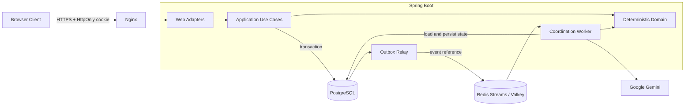

# 새 #107 구현·통합 Worklog

## 서버 develop 병합 승인·열린 PR 정리 (2026-10-18 UTC)

사용자가 Decision Model 포함 검증 통과 뒤 서버 develop 병합을 명시 승인했다. main·운영 활성화·배포·추가 유료 호출과 웹 main 병합은 승인 범위에 포함하지 않는다. 아래 병합 제외 문구는 이전 단계의 이력이다. PR129의67bad4d0가 PR12618cdb5d와 PR122e83d5280를 정확 ancestor로 포함하므로, 독립 준비 리뷰는 최종 필수 CI/충돌/리뷰 확인 뒤 PR129 단일 normal merge를 권고했다. 검증된 source558·workflow·OFF/DENY는 그대로이며, 전체 통합 범위를 취소 수정 한 조건만으로 축소해 설명하지 않는다.

별도 Draft 서버129/웹33을 게시했다. 웹f08aaa98의 exact CI39111519165는 전체 SUCCESS이며 실제 checkout14677b4b의 부모 main9b183978/HEADf08aaa98 및 tree 동일을 확인했다. 서버67bad4d0 CI39111507712는 ARM64 SUCCESS·Quality 진행 중이다. 이 새 승인과 현재 상태만 기록하는 후속 commit 전 unchanged 필수 guard를 확인하고, 후속 HEAD의 CI를 별도로 기다린다. 제품/테스트/fixture/정답 자산과 비용 예약은 변경하지 않는다.

다음 시작점은 최종 HEAD CI/Lifecycle→PR129 normal merge→실제 develop merge SHA·tree·push CI 확인→PR122/126의 간접 merged 여부 재조회와 열린 대체 PR만 근거 댓글 정리다. #123 미완료·모델 품질/운영 가격·threshold/활성화 보류를 유지한다. 실제 merge/정리 결과는 PR 대화·Git 이력·로컬 receipt에 이어 기록한다. 웹은 읽기 전용 포함 관계를 부모에게 보고하며, PR24의 별도 HTTPS 회귀7파일을 보존한다. README#127·Linear 부모 담당·유료 호출0/UNKNOWN 환급0/합산USD2 예약USD1.33185536 유지다.

## #123 UI 계약·분류 평가 준비 재개 (2026-10-18 UTC)

현재 새후보 검증: backend snapshot1조건/web activequestion1조건 최소 수정 후 독립 server7 RED1/controls6→7GREEN/FI2(assert1·5)/매복구7PASS, web7 RED4/controls3→7GREEN/기존67포함74PASS/FIassert4·복구7을 완료했다. 현재웹전체 api/lint/typecheck/build/627unit·425browser+기존skip1/실패·flaky·retry0 PASS다. 원본PR31의집중157/22와중복합산하지않는다. Native14도수정source에서실API154·routeMock0·외부/실AI/OAuth0 PASS, 실제OpenAPI JSON동일·source482/runtime1559/deps216·자산전후동일·정상종료를확인했다. Primary합성provider가TwoStage/classifier/금융graph를우회함을명시한다. 사전정답은기존120불변+새8쌍16/overlay·manifest1d15a4e/독립reviewPASS/structural·PROTOCOL_ONLY·DRAFT/변조거절PASS로봉인했고모델결과는추가하지않았다. 상세는 [UI·평가 준비 검증](ISSUE_123_UI_AND_EVALUATION_VERIFICATION.md)이다. 서버 unchanged전체guard도 exit0/source558전후동일·새214suites/1717중1713PASS·기존4SKIP/실패·오류0으로완료했다. 최종독립게시review도LOCAL PASS/미해결P1P2없음으로봉인됐다. 다음시작점은별도server/web Draft·정확HEADCI다. Commit/PR 동일커밋예정으로기록하며원격상태는Git/PR/로컬receipt에서이어확인한다.

독립 계약 감사에서 NEEDS_CHOICE 취소 후 snapshot의 질문과 웹 활성 controls가 남아 새 입력을 막는 P2를 발견했다. 기존67/core+관련90 unit,22 browser는 현재원본PR31에서 재PASS했지만 이 조합은 기존 oracle에 없었다. 서버#128·웹#32와 별도 격리 branch에 independent regression→최소projection/UI guard를 준비하며, 취소한 질문의 DB 이력·3회상한은 삭제/환급하지 않는다. 기존 PR126/31 원본branch는 변경하지 않는다. 새 native는 수정 source를 대상으로 재준비하고 기존 하네스의 Primary synthetic provider 우회 범위를 명시한다.

부모의 추가 지시로 유료 호출 없이 서버18cdb5d/웹PR31의02a68d8을 원격 재확인하고 UI 상태/질문·선택·직접 수정·제출·마감·비공개 계약 및 기존 시나리오를 역할 분리해 점검한다. 기존 unit620/browser425와 native12는 이전 당시 증거로 보존하고, 이번 집중 재실행이나 새 source의 관통 성공으로 합산하지 않는다. 현재18920/18921/18922 fixture는 미기동이며 현 source 재준비 가능성을 먼저 확인한다. 기존 사전 정답 개발60/holdout60의 요청된8차원 coverage와 양성/음성 기준을 독립 점검하고, 원 corpus/정답/기존 실증·threshold를 고치지 않는다. holdout본문은 prompt/구현 담당에게 공개하지 않는다.

다음 시작점은 기존 테스트/계약 대응표→가능한 로컬·격리 집중 검증→필요한 누락의 최소 독립 검증 및 평가 준비 봉인→리뷰/상태 기록이다. 새 유료호출0·UNKNOWN환급0·누적예약USD1.33185536/합산USD2·보수여유USD0.66814464를 유지한다. 작은 호출계획/상한 고정 전 실제 추가평가0, 임계값 결과맞춤0이다. 제품 추가 수정이 필요하면 격리된 승인 범위에서 진행하며 기존 PR31/다른 브랜치 덮어쓰기·병합·운영활성화·배포0이다. README후속#127은 선행검증이후, Linear는 부모 전용 동기화 담당으로 유지한다.

## 최신 수정 HEAD fresh 15초 경로 검증 (2026-10-18 UTC)

부모가 승인한 정확 HEAD `4101038fd421351affa2a1fcdd5741083cb1a6b6`/source557에서 사전 고정 LIVE-KO-03 한 건을 실행했다. 원문·문맥·LOW2048·500자·공통15초·사전 합성threshold0.8을 바꾸지 않았다. 새 helper의 독립 whole-CLI mock25/25 및 실행 전 ACCEPTED 뒤 root가 07:21:29–07:21:37 UTC에 A/count/generation 각1회만 호출했고 모두 HTTP200, retry/fallback/redirect0이다. 만료 직전 pre-open P2는 최소 수정·같은 독립 재현HTTP0으로 닫았고 원실패와 초기fixture오류를 별도 보존했다.

실제 parser/TwoStage는 NEEDS_CHOICE로 오전08–09/오후20–21 질문과 원문 날짜·의도를 보존한 두 제안을 반환했다. 동일 JVM monotonic 경로7029.248374ms <15초, JVM전체7641.481ms를 구분한다. A rawCLEAR/confidence0.06은 사전 의미 기대와 불일치하며 기존 합성threshold0.8에서 LOW_CONFIDENCE로 생성기에 전달됐다. 이 confidence는 정확도나 CLEAR확률이 아니며 운영threshold는 미선택/OFF다. UI 제출완료·SDK transport·PG원장 운영통합·일반정확도/p50/p95 성공으로 해석하지 않는다. 과거503·15초TIMEOUT·원분류FAIL·수정전parserFAIL은 그대로 남는다.

기존 UNKNOWN 포함 예약USD1.01330944 + 새 사전최대USD0.31854592 = 누적USD1.33185536, USD2 한도 내 여유USD0.66814464를 유지한다. 이번 알려진usage는 A512/0, B530입력·127candidate+533thought=660출력이다. invoice/count fee는 확인하지 않았고 예약을 환급하지 않는다. 새3HTTP 뒤 유료STOP, 누계Decisions7/count3/generation5=15다. 제품source/test/운영설정·병합·배포0, Linear는 부모 전용동기화 담당으로 재시도0이다. 독립 [의미 감사](verification/issue123-fresh-head-two-stage-semantic-review.md)와 [관측·비용 감사](verification/issue123-fresh-head-two-stage-observation-cost-review.md)는 모두 범위 내 PASS·미해결P1/P2 없음으로 봉인됐다. 기록commit 전 unchanged필수guard도07:23:05–14 UTC exit0이며 새fresh1710 실행으로 주장하지 않는다. [기록 최종 게시 리뷰](verification/issue123-fresh-head-two-stage-publication-final-review.md)도 PASS·미해결P1/P2 없음이다. 다음은 같은PR126 기록commit/push·정확HEAD CI다. Commit/PR은 동일후속커밋예정이며 평가대상HEAD4101과 이후기록커밋을 구분한다.

## 최신 USD2 진단 후속 (2026-10-18 UTC)

metadata 후속 로컬 최종검증: 독립 RED26(6assertFAIL/20controlPASS)→Contract1file 최소수정→집중328 GREEN→독립FI3 탐지/매복구/최종26PASS→실제기록 재생·독립의미보존감사PASS→새 unchanged전체guard213 suite/1710(1706PASS·기존4SKIP·실패/오류0)·source557전후일치→[최종독립게시리뷰](verification/issue123-thought-signature-publication-final-review.md)PASS/미해결P1,P2없음을완료했다. 기존원본tests·실제503/TIMEOUT/분류FAIL·수정전parserFAIL은변경0이다. 다음은같은PR126 후속commit/push·정확HEADCI다. Commit/PR은동일후속커밋예정이며정확SHA·원격결과는Git이력·PR126/ignoredpublicationreceipt에보존한다. 아래다음시작점중이미지나간단계는각당시진행기록이다.

코드b3770438/별도Draft PR126을 게시했고 정확HEAD CI39102015533 Quality Gate/ARM64 및 Lifecycle39102015519 모두 성공했다([정확 checkout/tree 근거](verification/issue123-b377-exact-ci.json)). 사용자 추가USD1로 기존모든비용/예약을포함한 Gemini+OpenAI 합산USD2 승인. 기존분류FAIL/STOP·생성503/TIMEOUT·예약0.70918144는유지한다. 비유료 원인점검·동일3111B/count530·사전oracle불변·진단runner 격리mock59/59/독립실행리뷰 뒤 단독B 두 요청만 실행했다. 첫503 high demand 뒤 두 번째200/5195.5ms에서 오전/오후 질문을 관측했고 추가유료0으로중단했다. [독립 의미평가](verification/issue123-usd2-generation-semantic-review.md)는 LTS03–07·LTS08 제안의미PASS/UI미검증이나 현parser가 공식 optional thoughtSignature를 거부해 LTS02 FAIL이다. fresh제품15초 전체LTS01은미실행이다. [관측감사](verification/issue123-usd2-generation-observation-audit.md)상 누계Decisions6/count2/generation4=HTTP12, 알려진usage견적USD0.00612370(2.2배, 청구확정아님)·UNKNOWN포함예약USD1.01330944/여유USD0.98669056를유지한다. 다음 시작점은 새 독립 RED→좁은 metadata 호환 수정→격리 재생/FI→새 전체guard/최종리뷰→같은PR126 후속commit/정확HEAD CI다. b377의556소스/전체guard/리뷰는그시점의봉인이며 새cycle성공으로재사용하지않는다. 원signature값추적/로그0·제품15초/운영설정변경0. 아래USD1중단·질문미확보·미게시기록은각당시이력이며 최신상태는이단락과 [USD2 진단](ISSUE_123_USD2_GENERATION_DIAGNOSTIC.md)을따른다.

## 현재 #123 영속 공통 예산 (2026-10-18 UTC)

최신 metadata 후속: 독립 새26개 RED6/통제PASS20 봉인→Contract1file 최소수정(SHA7d113125…)→집중328 GREEN/기존testinventory불변→actual raw B parser와기록A/count TwoStage replay accepted/HTTP0을완료했다. root 첫 replay의잘못된harness이름 ClassNotFound는setup오류로분리보존했다. 아래 b377 이전개발기록은그때의이력이다. 현재다음시작점은독립FI3·새전체guard·최종게시리뷰·PR126후속commit/정확HEADCI이며기존b377 CI성공은새cycle증거로합산하지않는다.

1단계 PR122 e83d5280의 코드 CI39093790134 Quality/ARM64 및 최신 Lifecycle39094909440은 성공이다. 완료 범위는 #124, 영속 예산·전체 호출·실평가는 #123으로 분리했다. PR122는 Draft·미병합이며 수정하지 않는다. 새 worktree `/workspace/issue123-durable-budget/server`의 feature/issue-123-durable-ai-budget에서 [구현 계약](ISSUE_123_DURABLE_AI_BUDGET_CONTRACT.md)·독립 명세 freeze를 완료했다. 실제 PG 원장/fence94·managed/문맥 포함 dispatch98·최종 생애/같은 방 관통10·기존 provider387 및 실제 V17 catalog72 PASS, 전송/원장 방어 P2 독립 소스 재검토 CLOSED다. core/fence FI4 각탐지·복구/마지막94 GREEN과 provider/관통 FI5 각탐지·복구/마지막109 GREEN을 완료했다. 기록 실응답을 기존 합성 threshold0.8로 재생한 pipeline2도 INITIAL_PASS다. 변경 없는 새 전체 guard는 212suite/1684개 중1680PASS·기존4SKIP·실패/오류0·source556일치로 통과했다. CODE GATE 독립 리뷰도 PASS다. 후속 실제2단계2시도는 각 새A200 LOW_CONFIDENCE→count200530 뒤 첫generation503·후속공통15초TIMEOUT에서 중단했다. 다음 시작점은 관측·503 차단 독립 감사→최종 게시 리뷰·commit/push/Draft/exactCI다. 아직 2단계 commit/push/Draft/정확 HEAD CI는 완료하지 않았다. 아래 앞선 단계의 게시/CI 대기 문구는 당시 이력이며 최신 상태는 이 단락과 맨 아래 #123 후속 기록을 따른다. 원 진단 Decisions4회와 별도 새A2회로 총Decisions6회, Gemini count2·generation시도2(첫HTTP503·후속TIMEOUT/질문미관측), 시도내 자동재시도0·운영 DB/Secret/접근/Decisions 병합/배포0.

## 저비용 결정 모델 공통 경계 준비 (2026-10-18 UTC)

- [AGENT] 최종 새 필수 guard PASS(03:19:49–03:26:17 UTC): 변경 없는 self-tests/ktlintCheck/assemble/test exit0·fresh189 suite/1479개 중1475PASS·기존4SKIP·실패/오류0. source/test/guard512개 before=after=current이며 첫 중단 시도와 구분했다. 분류142+기존18 집중160·pipeline79, 단계별 독립 FI14종의 탐지/각 복구 근거를 보존했다. 최종 독립 local 게시 리뷰 PASS·미해결 P1/P2 없음이며 commit/push/Draft/exactCI는 바로 다음 단계다. Commit/PR은 동일 커밋 예정이고 이후 정확 원격 결과는 PR/Linear·ignored publish receipt에 보존한다.

- [USER] 최신 후속: 이번 실검증 Gemini·OpenAI·재시도/fallback 합산 USD1 이하 예산 승인. 총액 준수를 입증하지 못하면 실행0이며 키 생성·전달·영구 접근 설정/배포는 제외한다. 기존 환경의 두 key 변수는 존재 여부만 값 비출력으로 확인했고 endpoint/계정/세금은 미확인이다. 별도 최신 [실행 계획](ISSUE_107_USD1_EVALUATION_EXECUTION_PLAN.md)을 준비한다.
- [USER] Decisions는 별도 branch/Draft로 유지·develop에 병합0. 기존 네 이슈의 필요한 비-Decisions 변경은 현재 develop과 별도 worktree에서 대조 후 통합/exact merge CI까지 승인됐다. 이미흡수/중복/폐기된 마감 후 흐름은 다시 병합하지 않는다. PR116/117 본문은 부모가 정리했으므로 수정0이다.

- [USER] 설계·mock 구현·독립 TDD/리뷰·commit/push/Draft/exact HEAD CI까지 위임. 유료 평가·키/운영/runtime·병합/배포 미승인.
- [USER] Decisions 1차 충분 CLEAR 통과·의심/정상 낮은 확신은 생성 LLM 재판정(재CLEAR 가능)·보완 선택/직접 수정·마지막 전체 분석 유지의 2단계 개발 방향 승인. 유형 안내 전용 API/SQL/web 확장 없이 분류 port·safe result·standalone OFF adapter·기존 생성 bridge·개발/holdout 평가·누적 예산 설계를 진행한다. 원문/전체마감분석·last CLEAR·기존 caps/fence 유지, 선택 후 재검사 생략0.
- [AGENT] 비-Decisions develop 통합 최종 대조: 실제 미반영 기능0, 추가 merge 불필요. PR115/118/120/121은 조상이며 열린113/116/117/119의 기능은 흡수/새 제출 전 흐름으로 대체됐다. current develop01d00e7f의 실제 merge CI39070926139·두 job 및 checkout 로그 성공을 재확인했다. [독립 대조 보고](verification/issue107-non-decisions-develop-audit.md)에 정확SHA·diff근거·격리를 보존했다. 기존PR 닫기/수정0·Decisions merge0·main/webdevelop변경0이다.

- [AGENT] 원격server develop01d00e7f/main91eb2505·webmain9b183978 대조, clean develop ff-only에서 feature/issue-107-decision-precheck 생성. 기존107 재개방, 다른 PR/branch 직접변경0. 지침/project-architecture·공식 Decisions/Jev 계약·이전인계 확인.
- [AGENT] 고위험 테스트 작성/구현/리뷰 분리. 이전/tmp JDK17/Gradle cache가 없어 환경 준비를 별도 진행하며 환경 오류를 RED로 세지 않는다. 다음은 공통계약 독립 RED·합성검증. 실제모델/OAuth/키/운영호출0.

- [AGENT] classifier 독립 RED: 최초101개 중99 TODO assertion 실패·composition2PASS·오류/skip0, 별도 uncertainty 형식7개 RED7. 원본4test SHA를 바꾸지 않고 보강 파일을 별도 cycle로 고정했다. 구현자는 RED 뒤 새 adapter/contract/port/options만 배치했고 집중 GREEN·pipeline RED는 전역 Gradle lock으로 순차 진행 중이다.
- [AGENT] GitHub #107 맨 위에 채택된2단계 목표·단계 체크리스트·미탐/오탐/오류·refusal/마감/중복·예산 검증/별도 승인 대기를 갱신·재조회했다. 기존96/110과 연결하고 이전body를 보존했으며 중복이슈0이다. 새120개 합성 corpus는 개발60/holdout60으로 분리·구조검증했고 의미oracle 독립검토 진행 중, holdout본문은prompt작성자에게 전달0이다.

- [AGENT] 집중 GREEN: 분류108+기존18=126/126, pipeline73/73 모두 실패/오류/skip0. 원본source/test 지문을 동결했고 각 독립author가 scratch 복사본에서 FI6씩 준비 중이다. 실제 PG budget/全final dispatch·price/threshold binding은 구현하지 않았으며 신규기능 default DENY가 활성화를 차단한다. source의 고정 profile fingerprint를 실제 가격·billed cap 증거로 사용하지 않는다.
- [AGENT] 새120개 사전oracle 독립리뷰 PASS·확정오류0, fixture/정답 수정0·split SHA불변·기존30bytes불변. 일반 분류 경계 보완만 평가문서에 반영했고 holdout본문/개별정답을root·prompt작성자에게 전달0이다. 실제모델정확도·가격/지연 실측 결과가 아니다.

- [AGENT] 독립 교차 리뷰에서 A CLEAR의 Decisions output usage가 기존 생성 결과2048 cap에 걸리는 P2를 발견했다. TS08을 명시하고 기존73 test/RED/FI 이력을 보존한 뒤 수정 Routing+실제 worker6회귀의79개 보완 RED(요구3FAIL/76PASS/error·skip0)를 먼저 확인했다. A terminal output은 N/A/null, 실제 usage는 stage observation에 보존하는 최소 수정만 반영했고 B cap/worker/fencing은 유지했다. 보완79/79 GREEN·실행 전후 전체 main/test5 지문 일치까지 확인했다. A output 복귀 추가 FI1과 필수 전체 guard·최종 리뷰는 다음 확인이다.

- [AGENT] 첫 필수 전체 guard 진행 중 독립 reviewer가 외부 BigDecimal probability의 극단 scale로 합계 연산 자원이 과도해지는 P2를 발견해 해당 실행을 중단했다(exit143·성공 집계0). 원본/log/전 manifest와 interruption receipt를 보존했다. DC06의 내부 decimal precision/scale 상한을 명시하고 기존 테스트를 바꾸지 않은 별도 안전 RED→최소 보완→FI 후 전체 guard를 새로 실행한다. 실제 OOM급 수를 Gradle 주 JVM에서 실행하지 않는다. 새34개 독립 RED는16 genuine assertion FAIL/18 control PASS·오류/skip0이며 기존5개 test/helper는 불변이다. confidence/probability 공통 helper의 precision/scale 검사를 값 비교 전에 추가한 최소 보정만 반영했고 runtime JSON 제약·prompt 변경0이다. 새 집중160/160 GREEN(기존126+숫자34)·source/test 전후 지문 일치까지 확인했다. 독립 cap 제거 FI1에서16 assertion 실패를 탐지했고 정확 복구160 GREEN·원본 source4/test9 지문 일치까지 확인했다. 새 필수 전체 guard를 진행한다.

## 런타임 전달·기본 OFF 제품 코드 준비 재개 (2026-10-17 UTC)

- [USER] 준비 문서 확인 뒤 외부 설정/비용 정책과 독립인 인증 전달 코드·AI 기본 OFF 구성과 입력/출력 제한 준비의 구현·독립 TDD/FI/리뷰·정확 CI·develop까지 명시 승인했다. 실제 SSM/Secret/개인키/호스트 권한·DB·OAuth·유료 호출/main은 제외한다.
- [AGENT] clean develop switch/pull --ff-only 뒤 `fix/issue-107-runtime-readiness`를 생성하고 준비 문서03448bb를21a82f6으로 적용했다. 기존 #107을 후속 코드의 정상 issue lifecycle을 위해 재개방했으며 중복 이슈/기존 PR/다른 브랜치 직접 변경0이다. 아래 문서-only 단계의 '재개방0/제품0'은 당시 이력이다.
- [AGENT] 인증 테스트/구현·catalog 테스트/구현·AI 테스트/구현·독립 최종 리뷰 역할을 분리했다. renderer auth-required/legacy 경계·엄격 JSON/type/CRLF/NUL·원자0600·symlink/실패보존·read-only mount/UID10001·실제 합성 refresh와 승인 catalog17을 먼저 테스트한다. AI는 기본 OFF 실제 바인딩·문서 기반 고정 profile·count4096 gate/사후 known promptUsage 방어·2048 합산 cap/LOW wire·count/gen 공통15초/재시도0을 독립 검증한다.
- [SHARED] 검사 admission6을 변경하지 않는다. 새 count preflight는 최대6 count+6 generation HTTP와 operation별 관측으로 구분하며 기존6을 전체 HTTP6으로 주장하지 않는다. count 값이 실제 billed input과 정확히 같다는 근거·실청구 상한·제품 모임 총10원 충돌·실모델 평가는 미해결이다. 실제 opt-in은 OFF이며 paid 호출0이다.
- [AGENT] 인증54/54(원시NUL4 genuine RED 보완 포함), AI새61+기존18=79/79, catalog26/26, 관련provider/catalog45/45·실제 local Compose fidelity·기존 guard credential refresh GREEN. auth6/provider6/catalog3 FI15종을 assertion으로 탐지·정확 원복했고 원본 제품/테스트 지문이 일치한다. Compose JSONfalse 생략의 독립 oracle 보정은 원본/재구성RED/최종GREEN을 구분했다. 수정 없는 필수 전체 guard exit0: fresh179 suite/1,258개 중1,254PASS·기존4SKIP·실패/오류0, source491 before=after=current. V8전체37/37·Nginx 합성 실행도 exit0이며 최종 독립 게시 리뷰 PASS·미해결 P1/P2 없음(`docs/verification/issue107-runtime-readiness-independent-review.md`). 게시/새CI/develop merge는 다음 단계다.
- [AGENT] 전체 Node140/140 PASS. 최초2건의 standalone javac 경로 누락은 실행 환경 오류로 분리하고 JDK17 경로를 지정한 동일 전체 검사에서 통과했다. 기존 성공으로 실패를 덮거나 유효 RED로 표시하지 않는다. CI는 새 auth54/catalog 계약·artifact marker를 연결했고 직전 실제 Quality Gate17분43초에 신규 검증 시간을 더해 제한을20→30분으로 늘렸으며 기존 검사는 유지했다.
- [AGENT] 전체 guard와 보조 검사 근거: `.tdd/verification/issue107-runtime-readiness-{final-gate,source-manifest,supplemental}.json`. Nginx 첫 로컬 권한 오류와 Node JDK 경로 오류는 성공 실행과 분리했다. FI history의 정확한 `.diff`/`.patch`는 원본 데이터로 보존하며 source diff check에서 해당 archive만 제외한다.
- [SHARED] optional String `/config/precheck-provider-enabled`는 정확 true/false만 환경변수 `MEETME_PRECHECK_PROVIDER_ENABLED`로 전달한다. 미등록/조회 실패는 false, malformed 성공 응답은 전체 교체 거부이며 refresh에도 유지된다. 실제 Parameter 생성/읽기/true 등록은 수행하지 않았다. 기존 OAuth 공개 설정 완료 인계와 별개로 runtime 자격 증명·서명 파일·실로그인·운영 전환이 남았다.

## develop 이후 아침 승인·활성화 준비 (2026-10-17 UTC)

- [AGENT] 서버 develop `bb996482a3090739a8ce02c8b093561e2c5c58a2`·정확 merge CI39064886318 성공, 웹 Draft PR31 HEAD02a68d8·CI39063558547 성공을 유지한다. main·원본 PR/브랜치는 변경하지 않았다.
- [AGENT] 별도 `docs/issue-107-main-activation-readiness`를 clean develop switch/pull --ff-only 뒤 만들었다. 제품/테스트/인프라 코드0, 준비 문서만 변경한다. 기존 #107은 develop 자동 lifecycle로 CLOSED이며 이 문서 준비를 위해 새 중복 이슈나 재개방·이전 PR 변경을 하지 않는다.
- [AGENT] 실제 bean은 default false 생성자 옵션만 사용하며 production opt-in 바인딩이 없음을 확인했다. 동일 GenerateContent 전용 thinking guide에서 합산 cap 근거를 찾아 기존 'Interactions만 근거 있음' 판단을 정정했다. thinkingBudget0 지원/실청구 검증으로 확대하지 않으며 실제 옵션 false·실제 호출0을 유지한다.
- [AGENT] 독립 provider 경계/평가 설계 리뷰에서 지원 profile·production 바인딩·OFF 호출0·LOW wire 변경의 별도 TDD, 정답 누출 금지·고정 분모·물리 호출 상한/timeout 비용 예약을 확인했다. [평가 준비안](ISSUE_107_REAL_MODEL_EVALUATION_PLAN.md)에 generation30/retry0/count최대30·조건부USD0.32256·현재 최대비용 미입증·중단/측정 명세를 보존했다. p50/p95/정확도 실측값은 없다.
- [SHARED] PRD 모임당 총AI10원과 새 호출 예산의 최악 비용 충돌은 부모 결정 대상으로 보존한다. 한도/500자/마감/참여 정책을 변경하지 않았다. wire·활성화/인증 전달 제품 코드는 다음 독립 TDD 단위이며 문서로 구현 완료를 대체하지 않는다.
- [AGENT] [외부 안내](ISSUE_107_EXTERNAL_READINESS_RUNBOOK.md)에 완료한 Google/Kakao 공개 설정 재요구 없이 변수 이름·안전 입력 위치·RS256/JWKS·UID10001/read-only mount·DB/PITR·복구·최소 사용자 순서를 정리했다. 운영자 요약은 기본 OFF·빈 allowlist 유지이며 core 출시 차단 조건이 아니다. 감사 schema/cleanup은 별도라는 한계도 기록했다.
- [AGENT] 클라우드 연결 종료 알림 뒤 실제 shell/Git 접근 정상·문서 변경 보존·실행 중 테스트/native/browser0·18920/21/22 listen0을 확인했다. 기존 Gradle daemon은 중복 실행/종료하지 않았다. production·OAuth·Secret·DB·paid 호출/변경0.
- [AGENT] 독립 최종 문서 리뷰의 차단 결함0. provider 단독 평가의 queue/save 지연은 N/A로 보완했다. 고정 fixture30/ASK10/NOASK20·산식·7문서 상대 링크·diff check PASS, develop 대비 제품/테스트/인프라 변경0. 수정 없는 canonical commit guard(self-tests/ktlintCheck/assemble/test) exit0. 문서만 바뀌었으므로 기존 up-to-date 테스트 결과를 새 fresh 실행 수로 주장하지 않는다. 원본·receipt는 ignored `.codex/tdd-evidence/issue107-morning-readiness/`에 보존. Commit/PR: 동일 문서 커밋 예정. 기존 CLOSED #107을 재개방하거나 Draft/병합된 PR을 변경하지 않으며 이 문서 브랜치의 별도 PR/CI 완료를 주장하지 않는다.

## 현재 범위와 승인

- 사용자가 D1/D2 승인: CLEAR 후 완료 집계, 시각/수동 마감은 마지막 accepted 동결. pending 수정은 이전 accepted, 최초 미확인/미응답은 이번 결과 미반영. AI/답변 때문에 마감 연장0. 마감 직전 입력 미반영 가능 고지 및 경합 회귀 필수.
- 독립 TDD→구현→격리 provider/PG/proof/browser→FI→전체gate→독립최종리뷰→commit/push/Draft/exactCI→서버develop 병합/exactmergeCI까지 승인. main은 이후 조건부 승인되었으나 운영DB migration·Secret·실OAuth·유료실모델은 미승인이고 readiness 충족 전 main을 보류한다.
- 웹develop 원격 없음. 웹develop 생성·CI변경은 부모가 명시 보류. 기존 main 경로의 조건부 승인과 운영 readiness 보류를 유지한다. 로컬구현/검증·필요최소안 준비는 계속한다.

## develop 실제 반영

- PR115 exact c06b60a9833ae77e5fce9cfef5719ab2f37470ff의 기존CI·독립리뷰와develop비배포·동일예상tree를확인했다. 첫merge자동검토는과거Draft/CI한정승인만인식해거절. 부모의실제최신대화승인·동일HEAD1회재시도지시에따라재조회후정상mergeAPI를한번재시도했다. 우회/admin/강제push0.
- PR115의 일반merge 성공: `59e39bea8db58e17de119be353cb673fb68d9d98`. Git fetch와PR재조회로merged/closed확인, 양parent3232128+c06b60a와tree58cef138c1ea515139edd40237751596c7dfdc68(기존c06 HEAD tree동일)확인. 최신mergeSHA의pushCI는진행관찰중이며성공으로추정하지않는다.
- 다음순서:115 mergeCI성공→118 exactbd8818625aa51480e3a06c1fa17d3e223fa1cfbe→그mergeSHA CI. 113단독선행은익명HOST fixture37실패를유발하므로피한다. PR118이deadlineguard·37개적응회귀·원본증거archive를포함한다. PR113원본da225d8commit은조상이아니며기능흡수/증거보존관계를구분하고PR을임의닫지않는다.

## 로컬 작업트리와 역할

- /workspace/issue107-baseline-integration/server, feature/issue-107-baseline-integration-prep, HEAD bd88186. 부모develop/mainffpull후분리했다. 기존107/110은공통c06이후delta만3way적용해중복109을피함. 원래PRbranch변경0. catalog/역사test9충돌은일단strict110기준으로표시해compile가능하게하고최종V1..16·역사catalog는독립oracle로보정중.
- 웹같은branch명, HEAD e9e81ef. 독립구현자가29/28delta통합, 실제4충돌을hunk단위해결중/새DTO연결대기. 최종OpenAPI는통합서버에서재생성한다.
- server_precheck_tests: 공개계약독립HTTP/PG/경합/보안test·유효RED
- server_precheck_impl: durablecandidate/check/worker·V16·최소기존hunk, RED후구현
- web_precheck_tests / web_precheck_impl: 독립웹oracle와구현분리
- precheck_provider_impl: 개인검사provideradapter, root가독립transporttest작성
- baseline_merge_review: 독립병합순서검토완료, 현재독립catalog/역사fixture테스트설계
- root: 통합·기록·catalogproduction·provider독립tests·최종게이트/독립리뷰·원격단일담당

## 현재 한계와 복구 시작점

- 기존개별CI성공은현재결합/새제품통과근거가아님. 현재새feature GREEN/전체gate/독립최종리뷰/게시미완료.
- Gradle실행환경준비완료:기본home쓰기권한/directDNS/컴파일실패는RED아님. writable GRADLE_USER_HOME=/tmp/meetme-gradle-home·전역flock /tmp/meetme-gradle.lock 사용, 프록시/로컬PG/Redis준비중.
- 기존UXLibrary다운로드403은우회/반복하지않고미검증자료로유지. 설계기록은 /workspace/issue107-pre-submit/server/docs/ 의PRE_SUBMIT문서·독립리뷰를참조한다. 해당준비ZIP libfile_a12f10504fd88191a3cc041f8b4589fb는정책승인전이력이며이파일의최신승인이우선한다.
- 아침원격develop테스트URL·현재실행SHA미확인, 문서상웹staging없음. localhost격리시나리오만예비준비하며실제OAuth/paidprovider사용0. 준비물은독립기반review에기록.

- 최신 사용자 조건부 main 승인으로 앞의 main 미승인/웹develop 대안은 당시 단계 이력이다. 웹develop/CI추가 없이 기존main경로를유지하되 운영DB/Secret/권한/유료호출은별도승인유지. 실제renderer에AUTH전달·RSA/JWKSmount가없고인증blank시AUTH_UNAVAILABLE이므로main을먼저합치지않는다. 상세조건은 ISSUE_107_MAIN_READINESS.md.

## 18:22 UTC 진행

- 로컬 Temurin17.0.20.1+1을 official image digest fe947d993c32dd9cf651a4353a6ed723c2370b3a9d034ea4cab4775404ea531a 에서 준비했다. 프로젝트 JVM 설정 변경0. system CA truststore로 TLS 유지, 전역 Gradle lock 사용. main Kotlin 컴파일 통과; 테스트 setup/compile 실패는 RED0으로 구분한다.
- 승인 정책을 반영한 설계/32 acceptance+6 policy 명세·30개 의미평가 fixture·독립 설계 review를 현재 작업트리에 보존했다. 실제 모델 calls0, accuracy/p50/p95 미측정.
- catalog 독립 12개 GREEN·역사38개/Python1 GREEN·결함3종 탐지. 실제 V16 생성 뒤 실제소스publication/PG 포함 최종게이트가 남는다.
- 웹 신규 독립 테스트 진행 중. UUID fixture 보정은 기존 지문과 구분하고 재구성 skeleton RED를 시간순 최초 RED로 주장하지 않는다. 최종 source/schema/browser/독립 review 전 게시하지 않는다.
- blind 응답 실제 필드는 {replaced:true}; saved:true 간이표현은 계약이 아니다. 신규 protocol에서는 candidate 보존이며 확인완료와 구분한다.

## 18:27 UTC 실제 병합·provider RED

- PR115 merge59e39bea의 exact push CI39057006651 전체 SUCCESS 확인. 다음 PR118 exactbd881862를 정상 merge API로 병합했다: merge `9ec4c6ce7381c9fb2594f98a2112e0cc22b988f9`, 부모59e39bea+bd881862, tree6e598f417cb5e19053160572e4fb2b7bb34e6930은 검증된 bd HEAD tree와 동일. exact push CI39058071664 진행 중. main/deploy0.
- provider transport 독립 15개: 컴파일 성공 후 미구현 TODO에 대한 유효 MISSING_BEHAVIOR RED15/15(오류0) 확인, 최종 test SHA·raw log SHA·XML·예상 실패를 `.tdd/red/issue-107-pre-submit-provider.json`에 고정. 이전 컴파일/setup실패는 유효RED에서 제외했다. 유료/external model 호출0.

- 서버 독립 실제PG/HTTP 48개 실행에서 유효 assertion RED44개를 고정했다. plain TODO 예외2·V16 부재 LEGACY setup오류2는 유효RED에서 제외. 3개 독립 테스트 파일 지문/실패목록/원본 log 지문은 .tdd/red/issue-107-pre-submit-http.json. 본문/V16 구현 착수, 테스트 작성자와 구현자 분리 유지.

## 18:39 UTC 격리 검증 진행

- 최초 실제PG/HTTP48개(19+25+4) GREEN, 실패/오류/skip0. 초기RED44와비assertion/fixture4를구분했다. source변경후이므로최종전체gate와별개이며원본XML/log는precheck-first-green에보존한다.
- provider16 GREEN 및메타데이터provider/model1줄추가후재GREEN. scratch 독립fault5종이7 assertion실패로탐지되고각복구16GREEN. 최종의미정확도/유료실모델검증0.
- provider frozen test P01 methodchain자동format으로722→874 지문변경발견. 한chain줄바꿈/후행comma외변화0을exactdiff로검증했다. 원본chronological RED와722테스트를history보존하고새874의재구성RED15를별도표기(사후supplement이며시간순최초RED주장0). 현재지문으로freshGREEN·독립review를연결한다.
- 웹최종UI독립리뷰snapshot67GREEN·11faulttypes/15assertion탐지/각복구. API最終schema·전체gate·실제backend/browser·최종source결합은후속필수다.
- native test-onlyfreshPG/Redis·합성OIDC/RS256·provider 환경이loopback18920/18921/18922에서기동됐다. 공개staging/운영아님. 실제HTTPbrowser실행은독립작성자수행중이며완료추정0. 상세 ISSUE_107_LOCAL_SCENARIO.md.

## 18:44 UTC develop 병합 검증

- PR118 merge9ec4c6ce의 실제develop pushCI39058071664가전체SUCCESS. Quality Gate117470073617와ARM64BuiltImage117470073856의checkout `git log -1 --format=%H`가9ec4c6ce전체SHA와동일함을원본joblog에서직접확인했다. `docs/verification/issue-118-develop-merge-ci.json`에run/event/branch/actualcheckout근거보존. PRHEAD bd881862의이전CI39054407191와구분한다.
- PR115도merge59e39bea의pushCI39057006651+실제checkout별도근거보존. 정상developpush가자동CI를시작했고보호규칙/권한/워크플로경로변경0. main·운영쓰기0.

- 공개공식문서읽기로providerreadiness를추가확인했다. 3.8모델의thinkingBudget0비활성화와GenerateContent합산과금2048상한은확인되지않았고,Interactions API의다른파라미터보장을전용하지않는다. capfalse/mainhold유지,실호출0. 출처/현재공식가격/추론한계는 docs/verification/issue-107-provider-official-readiness.md. 최대비용·속도·정확도는미측정이며후속비용측정안도총cap확정후구체화한다.

## 18:51 UTC 전체 회귀·오프라인 계약

- 최초원본 full 1168개:288실패/기존skip4/오류0. 독립분류287개는새protocol기본값과기존PUT역사fixture충돌,1개는아키텍처정확모듈목록의precheck누락. 원본기대/소스tar/SHA/XML/log보존후역사방만명시LEGACY로scope화하고승인모듈1개만추가한다. 새default/409/보안assertion을낮추거나전체testprofile을LEGACY로하지않는다.
- offline CI Node117개재실행PASS. 첫115PASS/2FAIL은JAVA_HOME미지정으로javac경로가없던환경오류였고제품/테스트수정0으로JDK17지정후117PASS. 현재SQL16메타데이터추가SHA까지고정한근거는 .tdd/verification/issue107-integrated-offline-node.json. V8persistentguard는별도로실행중이며완료추정0.

## 19:16 UTC 최종 통합 검증

- 서버 최종 집중95개 실제PG/HTTP/proof/retention 회귀가 실패0·오류0·skip0으로 통과했고 독립 작성자가9XML·44 source/test 지문 불변을 직접 감사했다. 직전94PASS/PS06 1FAIL은 새 동일원문제안 거부 계약과 충돌한 2차 합성 fixture였다. expected NEEDS_EDIT/실패코드/미완료/accepted0는 유지하고 두 proposal만 현재raw와 다르게 정합했다. 원본/정확diff/지문supersession은 `.tdd/history/issue-107-pre-submit-index.json`에 이식했다.
- provider18 GREEN, NULguard 제거 독립FI에서2 실제assertion 탐지/복구18 GREEN 추가. 기존5 fault유형과 별도 기록하며 실제모델0.
- 실제backend/browser 독립12개 PASS, API route mock·외부요청·실제모델0. 다만 후속 필수ktlint에서 값이 동일한 문자열2개 길이만 정리하므로 해당 native 증거를 이전snapshot으로 보존하고 최종정확source 재freeze/재실행한다. 실제deadline scheduler tick 누락 하네스는 실제서비스1회control로 보완, CLOSED/frozen기대 유지.
- unchanged TDD guard 초회는 mainktlint 길이2건에서 중단해 전체test에 도달하지 않았다. 보존된9XML95는 직전focused이며 full 통과로 세지 않는다. 문자열 값/분기 동일한 최소분할 뒤 같은필수guard를 fresh 실행한다.
- 로컬 Node117·V8guard37·Compose secret fidelity·DBcredential refresh·원본Nginxruntime exit0. Nginx 초회는materialized0600 파일mode, 다음은DockerCLI의proxy자동주입/BusyBoxhealth로 실패했다. publicconfig0644복원과 이번검사만private빈DOCKER_CONFIG로 원본script/securityflags그대로 성공. 실제운영검증으로 주장하지 않는다.
- 독립core FI6/snapshot검토와웹전체표준620unit·426browser discovery 검사가 진행중. 완료/skip을 최종집계한 뒤에만 게시한다. main readiness 보류 및 actualmodel/운영접근0 유지.

## 19:34 UTC 최종 로컬 게이트

- unchanged mandatory `tdd_guard` PASS: 19:25:32~19:32:06 UTC, 새177XML 1,197개 중1,193PASS·기존4SKIP·실패/오류0. self-tests·ktlintCheck·assemble·전체test를 실제수행했고417source/test/hook이before=after=current이다. `.tdd/verification/issue107-final-server-gate.json` 및 독립 `.tdd/reviews/issue107-independent-final-full-guard-check.json`. 이전3style실패는test미도달로구분했다.
- 웹전체표준 api/lint/typecheck/unit620/build PASS, desktop/mobile 전체426중425PASS·기존skip1·실패/flaky/retry0. 최종serverformat후actualnative12/12 재PASS(19:26:14Z), runtime/sourceManifest03bb749...·source/assets불변, routeMocks/external/model0. 독립웹로컬게시범위승인완료, source127현재일치.
- provider P03 argument형식만정리해최종지문0a31로변경했다. 최초722/중간874와정확diff는history보존. 새지문사후재구성은baseline18GREEN→no-transportCLEARstub에서13assertionRED·2NoSuch(P01/P14의requestprecondition)제외→정확finalsource복구18GREEN. 초기driver의모두assertion가정은거부하고13만유효RED로저장했다. 최초15는TODO도달혼합기록이며canonical은TDD_TODO_REACHED/원본상세보존으로정합했다. 현재13을시간순최초RED로주장하지않는다.
- 새canonicalRED/FI는기존schema7필드·UTCZ로분리하고상세/chronology는history/verification에보존했다. 전체87RED readonlyaudit의기존/구통합기록28개schema drift는현재새증거로승격하지않고기록그대로유지한다. 전면schema/과거기록정리는하지않는다.
- 연결종료알림뒤실제파일읽기·쓰기및기존full/FI/provider프로세스생존확인,중복실행0. 19:27:55 UTC nativeAPI/control/preview3포트모두정상종료확인.
- 잔여:독립coreFI마지막cancel/복구·backendformat재구성3cycle/최종통합승인→commit/push/DraftPR→exactpublishedCI→승인serverdevelop일반merge/exactmergeCI. mainreadiness보류·실모델/OAuth/운영/Secret0.

## 19:38 UTC 게시 전 마감

- 독립coreFI6종각1실제assertion탐지·각정확복구GREEN완료. 초기35source중원래대비형식2파일변경은숨기지않고값동일독립검토+최종guard로연결했다. 별도schema7field canonical과최종FI review를보존했다.
- 독립backend현재지문사후3cycle RED7→정확복구GREEN7(Worker/Privacy2,Defense1,Rate4),0errors/skip. 현재4testSHA및guard417불변을저자가직접감사했다. 정확한과거제품skeleton이아니며이사후근거를최초RED로소급하지않는다.
- 최종91RED readonlyschemaaudit에서새current records전부VALID. 과거28개drift는기존/구이슈이력으로보존한다. `.gitattributes`에이번107history의`-text`만추가해checkout줄바꿈으로원본archiveSHA가바뀌지않게했다. source/test/guard/SQL변경0.
- 로컬필수/독립검증완료뒤최종리뷰마감·게시준비. 새원격branch/PR은아직없고원본PR117/119/28/29브랜치변경/닫기/forcepush0. PR115/118의develop일반merge·정확mergeCI성공은앞단계실적이며새기능CI와별개다.

- 19:40 UTC 독립최종로컬게시승인확정: server-core/최종integration·backend재구성provenance·provider/canonical·catalog·web/실서버최종source를결합감사했고승인범위는기존허용commit/push/Draft이다. 게시후exactHEAD CI를merge전게이트로구분한다. `issue107-independent-server-core-review.json`, `issue107-final-integration-review.md`, `issue107-independent-backend-format-replay-check.json` 참조. main/실모델활성화/운영준비는승인범위에추가되지않는다.


## 2026-10-18 UTC — 1단계 봉인·#123 영속 공통 예산 착수

PR122 HEAD `e83d5280c7c236c99d64165893632920882527fe` 코드 CI39093790134의 Quality Gate/ARM64가 모두 성공했다. Quality checkout synthetic `f2cd9f92fda64f2ea36446cf4dc523d03141c78a` tree는 HEAD와 동일하며 ARM64 직접 HEAD checkout을 로그로 확인했다. 실제 완료한 adapter/bridge/합성 검증 준비를 #124로 분리해 `Closes #124`, #107/#123은 Refs로 유지했다. Refs-only Lifecycle39094466469 실패를 실제 범위 분리로 보정한39094821627은 성공이며 workflow/보호규칙은 변경하지 않았다. PR은 Draft·미병합이다. #107 본문 갱신 API는 전체 기록 교체 위험으로 자동검토 거절되어 재시도하지 않으며 새 이슈/PR에 최신 연결을 보존한다.

다음 작업은 #123 영속 PG 모임 원장·최종 분석/fallback/HOST 재시도 등 전체 물리 dispatch 연결이다. clean develop01d00e7f ff-only 갱신 후 새 `feature/issue-123-durable-ai-budget`를 만들고 검증된 e83만 ff-only 상속했다. 독립 예산 DB01–24 및 전체 dispatch 41묶음 명세/구현 설계를 작성했으며, OFF 중 미계상 이력 UNKNOWN·기존30일 방 삭제 유지/새원장cascade·물리 전송 직전 single-use gate의 계약을 freeze 중이다. 이 기록 시점 새 소스/테스트 구현과 RED는 아직 없다. 금액/가격·청구 증명·활성화/소진 UX는 선택하지 않는다. 실제 모델0회·합산 USD1 비용 증명 차단·키/운영/병합/배포0. 다음 시작점은 공개 계약 freeze와 독립 PG/네트워크 RED다.


## 2026-10-18 UTC — #123 계약 freeze·catalog 독립 RED/GREEN/FI

독립 설계 리뷰 freeze PASS·미해결 P1/P2 없음. 신규 계약은 FINAL generation=실제runVersion(상수0으로 대체하지 않음), CONFIGURATION nonretryable, final SDK32MiB snapshot resource ceiling(청구 cap 아님), 기존 kind별 마감 guard·마지막 lock 뒤 fresh expiry, immutable 실제 송신 bytes·관측 실패의 제품 success 금지를 확정했다. 초안 DB06/20/21/24/10 보정은 독립 작성자가 RED 전에 원본/diff/이유로 보존했다. 실제 금액/운영 quote/활성화 경로는 추가하지 않는다.

V17 catalog는 임시 합성 fixture11개 중 유효 assertion RED7/controlPASS4/준비오류0을 먼저 봉인했다. root의3 Python 최소 패치 후11/11GREEN, 독립 source review PASS·격리 FI3종(publisher 누락17/host 역사16/명시 승인 우회)을 각각 탐지하고 매번11GREEN·원본 지문 복구했다. 신규 test는 기존CI test entry에서 require하며 workflow/보호규칙은 변경하지 않았다. 실제 V17 SQL의 VC12·실제PG와 필수 전체 gate는 아직 미실행이다. Budget/dispatch compile skeleton과 독립 신규 tests를 추가 중이며 동작 구현은 해당 RED 뒤만 진행한다. 실제 모델/운영/병합/배포0.


## 2026-10-18 UTC — #123 집중 GREEN·독립 소스 보완

원장 initial8+money44의 frozen6test 지문으로 실제PG focused52 PASS/실패·오류·skip0을 확인했다. V17 SHA `912b8f227e6ea7c20fc05cf96d705982fb9737c5051c7c07e771494df482834b`는 이 단계에서 불변이며 실제 SQL 포함catalog72 PASS와 별도다. 독립 source review는 P1없음·P2 3건(foreign reservation 잠금/공유profile 대기 뒤 quote expiry/누적합 overflow의 알려진 C 보존)을 발견했고 새 파일 RED 전에는 수정하지 않는다.

게이트/5물리HTTP/TwoStage 집중78 PASS·기존provider387 PASS/실패·오류·skip0, frozen6test 및 10source 지문 일치다. 독립 fixture 검토에서 locale와fake physical ID충돌을 고쳐 원본76/locale76 이력·수정이유를 보존했고 fixturecontrols2 PASS 뒤 현재78의 RED/GREEN을 새로 봉인했다. 독립 리뷰의 전송 직전 permit wall/effective monotonic 재검사 P2도 별도 새RED로 보완한다. 실제PGfence/Worker·Processor 문맥/managedconstructor 보완은 다음 통합 cycle이며 아직 전체 gate/최종 리뷰/게시 완료가 아니다.

Application이 adapter의 gate/property에 의존하지 않도록 pure AiDispatchModePort와 기존 생성자 끝 nullable seam만 skeleton으로 추가했다. OFF는 과거 request context=null 동작을 유지하고 ON의 mode는 금융 허가가 아니며 실제 quote/dispatch 권한이 별도로 필요하다. 새로운41 fence/coverage/회계 방어 및 managed/orchestration/clock tests의 준비·컴파일 실패는 RED0으로 분리한다. 모든 유료모델/운영/Decisions merge/배포0을 유지한다.

### 전송 만료 보완·외부 상태 기록 경계

전송 직전 permit wall/effective monotonic 검사의 새 독립 assertion RED2 뒤 gate만 최소 수정했다. 기존78+신규2=80 GREEN/실패·오류·skip0, frozen7test SHA를 유지했고 독립 재검토에서 DISPATCH-P2-01 CLOSED를 확인했다. `docs/verification/issue123-dispatch-write-review.md`와 `.tdd/history/issue123-dispatch-write-deadline-green/receipt.json`을 따른다. FI·전체 guard·managed/context/fence는 별도 남아 있다.

Linear JIN-72에 이번 집중 검증 진행을 prepend하는 작업은 자동 승인 검토가 해당 목적지의 구현·테스트 상세 게시 명시 승인 부족으로 거절했다. 재시도/우회 없이 기존 Linear 기록을 보존했고 추가 게시 허가 질문을 남겼다. 이 차단은 로컬 구현·검증·Worklog 기록에 적용되지 않는다. 실제 모델0·운영/병합/배포0을 유지한다.

### #123 추가 통합·최소 실제 smoke 준비

원장 실제 PG 기존52+회계 방어3+coverage7+foreign1+기본 authority 구성1=64 GREEN/실패·오류0을 확인했다. 독립 소스 재검토의 기존 CORE-P2 세 건도 source상 CLOSED이며 FI·전체 guard는 남는다. managed 구성·mode·Worker 문맥·기존 OFF trace를 포함한 집중98(기존80+13+3+2)도 실패·오류·skip0이다. 실제 DB fence·최종 생애9·같은 방 개인검사→자동마감→최종 분석 관통1은 별도 검증 중이며 이 수치에 포함하지 않는다. fixture 준비 오류와 유효 assertion RED는 이력에서 분리한다.

부모 최신 지시에 따라 전체 영속 원장 완성을 실제 smoke의 선행 조건으로 삼지 않는다. 기존 키를 비밀값 비출력으로 사용한 OpenAI `GET /v1/models/gpt-6-luna`와 Gemini `GET /v1beta/models/gemini-3.8-flash` 메타데이터 조회는 각각 HTTP200이다. 이는 조회 접근만 확인하며 추론 요청/응답·실제 endpoint 사용 권한·청구 검증은 아니다. 실제 추론은 아직0회, 합산 USD1 승인은 유지한다. 새 credential handoff·키/결제/운영 설정 변경0이다.

짧은 새 한국어 합성 입력·현재 분류 질문1·실제 HTTP1·retry/redirect/fallback/count/tools0의 Decisions smoke payload2431B를 고정했다. 일반 Luna 문맥 한도와 long/region 배수를 적용한 USD0.231은 명시적 추론을 포함한 보수 quote이며 Decisions 전용 billed hard cap으로 표시하지 않는다. 별도 공식 검토는 count 없는 Gemini GenerateContent1의 전체 입력 한도/출력2048·Standard 요율 기반 token quote≤USD0.794112를 제시했다(`docs/verification/issue123-minimal-smoke-gemini-cost.md`). count의 FAQ GetTokens 명칭 대응은 추론으로 구분했다. 계정별 세금/환산/결제 수수료를0으로 가정하지 않으며 USD1 계산 범위(API사용요금 또는 부대비용 포함) 질문은 대기 중이다. 실제 호출은 명확한 실행 근거가 확보될 때만 진행한다.

### 04:52 UTC — 최소 실제 Decisions smoke 성공

부모의 최신 지시에 따라 모델 전체 context 대신 실제 고정2431B의 일반 BPE byte 상한에 프로토콜 여유를 더한65,536token으로 보수 산정했다. 공식 token-counting guide의 local role/boundary 누락 가능성을 고려한 여유이며 서버 hard cap/정확 token count라고 주장하지 않는다. input USD0.10/M·long/region2.2배를 적용한 token quote는USD0.01441792, 기존USD1의 나머지USD0.98558208은 세금/결제 등 추가비용 여유로 남겼다. 계정별 비용을0으로 만들거나 새 금액·키·결제를 승인하지 않았다. tiktoken의 Luna 매핑 부재·선택적 vocabulary 다운로드 proxy403은 우회 없이 N/A로 기록했다. 독립 sanity 검토도 이 단일 소액 견적의 합리성과 한계를 확인했다.

고정 새 한국어 절대 날짜/시간/장소 사례의 실제 `POST /v1/decisions` 1회는 HTTP200·choice CLEAR·confidence0.83·input518/output0/total518·약1011.1ms다. retry/fallback/count/tools0, Gemini 추론0이다. 실제 응답 raw SHA `6ff769bca931fcc9bbb816512daf7f044ec2c146b73668e8b3e1df98d3492798`는 현재 production `AmbiguityClassificationContract`의 read/usage/parse를 추가 API 없이 통과했고 usageComplete=true다. threshold0은 raw 응답 검사용 seam일 뿐 운영 confidence 선택이 아니다. 보고 usage의 기본 단가 환산USD0.0000518(2.2배 보수USD0.00011396)은 invoice/세금 완결 증명이 아니며 여유를 반환하지 않았다.

실제 모델 총1회다. 1표본의 정확도/p50/p95를 만들지 않으며 운영 flags/OFF·authority DENY·Decisions 미병합을 유지한다. 다음 실제 평가는 기존 corpus/holdout을 읽지 않는 독립 신규 한국어4개 사전oracle 동결→동일USD1 누계·최대4개 추가 HTTP·무재시도 계획으로 한정한다. 추가 실행 전 manifest를 고정하고 불일치/오류/불명 usage면 중단한다.

### 04:55 UTC — 한국어 진단 불일치에서 중단

신규 독립4case oracle SHA `47390e74ed16237ce3dd9e9fb0002d304827c22e4592a8965f3151a8fcfd2552`와 최대합산5HTTP manifest를 먼저 고정했다. 추가3회는 주말 종일CLEAR/0.88, 문맥상오후3~5시CLEAR/0.79, 오전오후미지정8~9시rawCLEAR/0.06이다. 마지막은 사전NEEDS_REVIEW와 달라 FAIL/STOP을 유지하고 부정·예외4번째 사례는 호출하지 않았다. 기존smoke포함 총4회/input2061/output0·4응답 production parser offline PASS다. 기본 공개 단가 환산USD0.0002061/2.2배보수USD0.00045342는 최종invoice가 아니며 추가비용 여유는 반환하지 않았다.

같은 모호 사례 기록을 가정threshold0.1로 offline검사하면 기존 parser가 INDETERMINATE/LOW_CONFIDENCE를 반환한다. 운영 임계값을 정하거나 raworacle실패를 성공으로 바꾼 것이 아니고 실제 B생성을 호출하지 않았다. [실제 진단](ISSUE_123_LIVE_DECISIONS_DIAGNOSTIC.md)·[독립 결과 감사](verification/issue123-live-korean-review.md)에 지문/latency4표본/미실행과 한계를 남겼다. 기존corpus/holdout재열람·프롬프트튜닝·재시도0이며 Decisions 운영활성화/병합/배포0이다.

### #123 실제 PG 통합·core/fence 독립 FI 완료

최종 min2-cohort를 정합한 real fence30+기존core64=94 GREEN/실패·오류·skip0, scoped 전체475file 전후 지문이 같다. 같은 방 개인3+1 HTTP→자동마감→최종1 HTTP의 관통1은 초회PASS이고 최종 분석/HOST retry/correction/DLQ9와 합쳐 최신10/10 GREEN이다. DLQ fixture의 구정렬컬럼 created_at을 V1정본 occurred_at으로 고친1token은 원본/diff/이유로 보존하고 기존 RED를 소급 수정하지 않는다.

core/fence 격리FI4는 baseline94→cap등호허용/중복dispatch app+SQL CAS 제거/UNKNOWN환급/실제account binding우회를 각각 genuine assertion으로 탐지했다. 각 exactrestore의 선택1/1/1/13 GREEN과 마지막94 GREEN·원본475file불변을 확인했다. FI canonical7field·schema/FormatChecker PASS이며 real fence의 중복 parameterized 표시명만 원래 failure stack의 상위method를 붙여30unique로 정합했다(결과/시각/테스트지문0변경). 다음은 provider/관통 독립FI5·current RED provenance 정합→최종 독립 리뷰/필수 전체guard→승인된게시다.

- [AGENT] 05:17 UTC 새 기록 응답 회귀2 INITIAL_PASS: 실제 classifier와 TwoStage가 raw CLEAR/confidence0.06을 LOW_CONFIDENCE로 처리하고 합성 생성기1회의 NEEDS_CHOICE/CLEAR 결과를 보존한다. threshold0.8은 e83 기존 테스트 값이며 운영 null/OFF 유지·추가 실제 호출0/누계4. 원장94/FI4·dispatch109/FI5 봉인 이후 새 테스트1파일만 추가했고 기존 제품/테스트 변경0이다. active #123 RED10개·FI3개 schema와 현재 testFiles26지문이 일치한다. 원본 hook 전체 guard와 최종 독립 리뷰를 시작했다.

- [AGENT] 부모 후속: 최초 분류 진단 FAIL/STOP을 보존하면서 전체 guard/리뷰 뒤 별도 실제 저확신 2단계 생성 재확인 목표를 준비한다. 사전 oracle·기존 합성 threshold0.8·전체 payload/count·출력2048/LOW·최대 추가3HTTP·동일USD1 누계/중단 조건을 실행 전에 고정하며, 현재 추가 호출0/총4다. 운영 정책/코드·기존 corpus/실패 oracle는 변경하지 않는다. 실제 생성 결과의 의미 평가는 별도 독립 검토한다.

- [AGENT] 첫 #123 전체 guard 05:18:57–05:26:33 UTC exit2: fresh212 suite/1684개 중1679PASS/1assertionFAIL/기존4SKIP/error0, source556 before=after. 유일 실패는 legacy upgrade 테스트의 신규 ai_room_budgets0 기대와 V17의 과거3방 HISTORICAL_UNKNOWN seed 계약 충돌이다. 제품/SQL 결함 또는 유효 RED로 세지 않는다. exact XML·guard/source manifest는 ignored `issue123-durable-budget-first-guard-failed/`, tracked `.tdd/history/issue123-first-full-guard/`에 보존했다. 독립 작성자의 unknown 상태·null 활성화 필드·금액0·예약/관측0 정합 보정과 집중 검사 뒤 전체 guard를 새로 실행한다. 새 실제 AI 호출0/총4 유지.

- [AGENT] legacy oracle 정합2 INITIAL_PASS+ktlint PASS26s, 독립 inverse diff/SHA 검토 PASS·기존 assertion/SQL/제품 변경0. 05:29 UTC 변경 없는 전체 guard를 새로 실행했다. 실제2단계 후속은 독립 oraclec69/plan368b 동결·A2397/count3172/gen3111B·최대추가3HTTP·2048/LOW·공통15초·각single-use, 누적 보수예약USD0.39063552/추가여유USD0.60936448로 준비했고 하네스/비용/독립 실행 전 검토를 연결한다. 새 API호출0/총4, fullguard/review통과뒤만호출한다.

- [AGENT] 새 필수 fullguard 05:29:32–05:36:40 UTC exit0: 수정 없는 hook self-tests/ktlintCheck/assemble/test, fresh212suite/1684개 중1680PASS·기존4SKIP·실패/오류0. source556 before=after/current, manifest3103634acd501621a7133b3168460570d47334672724a2d95cfadc751c2a2072. 첫 실패1684/1FAIL과 합산하지 않는다. 새 실제 모델 검증은 이후 CODE GATE 봉인 뒤 실행하며 현재누계4다.

- [AGENT] CODE GATE 독립 리뷰 d2dd9321 PASS 뒤 고정 plan368b/oraclec69를 05:37:50 UTC 한 번 실행했다. 실제TwoStage→새A200/.06/LOW_CONFIDENCE(in512/out0,855ms)→count200/530(225.9ms)→generation503(347.8ms)에서 중단·retry/fallback0. JVM전체2177.7ms. 총Decisions5/in2573/out0, count1/gen시도1·성공생성응답0. evalwrapper CONFIGURATION은 callback실패 요약이며 실제 공급자 원인은503이다. 성공 생성 응답/usage 증거를 확보하지 못해 질문의 의도 보존 독립평가는 차단됐고 의미PASS/오류로 단정하지 않는다. 원래rawFAIL/STOP보존/threshold정책변경0. 관측Decisions만 baseUSD0.0002573/보수2.2x0.00056606, Gemini청구/생성usageUNKNOWN·총예약USD0.39063552/추가여유USD0.60936448 유지·환급/fees0가정0. 구조화 관측 `.tdd/verification/issue123-live-two-stage-observed.json` 및 실제생성차단 문서·single-usehistory에 보존하고 독립감사를 요청했다.

- [AGENT] 관측 감사 표현 보정: callback은503 오류 본문을 저장하지 않았다. 성공한 생성 질문/usage 증거가 없다는 뜻이며 공급자503 본문이 비었다고 주장하지 않는다.

- [AGENT] 완료된 영속 원장/전체 전송 권한 기술 범위를 실제 [#125](https://github.com/meet-me-duo/meet-me-server/issues/125)에 분리했다. 새 PR은 Closes#125, #107/#123/#124는 Refs로 두고 운영 가격/confidence·실제 생성 의미 검증/활성화가 남은 #123을 닫지 않는다. PR122/e83·server develop01d00e7f/main91eb2505 및 다른 브랜치는 변경0, 신규feature remote ref는 아직없음. 다음은 관측 독립감사/최종 게시 리뷰 뒤 commit/push/Draft/exactCI이며 Commit/PR은 동일커밋예정이다.

- [AGENT] 부모503 bounded retry 명시 후 기존UNKNOWN/hold0.39063552 유지·같은3HTTP 견적0.31854592를 더한0.70918144/추가여유0.29081856 산술을 독립 확인했다. 그다음같은full시도1.02772736은USD1초과로금지. 최초503후7분이상간격의새dir/planb4fe·sameoraclec69/3payloadexact/threshold.8/harness757/내부15s·retry0를준비했고정적실행review후1회만실행한다. 현재attempt2추가calls0/기존누계7HTTP보존. 제품/test556불변·새guard불필요한문서/격리검증후속이다.

- [AGENT] 부모가 요청한 bounded 별도attempt2를 고정planb4fe/독립실행리뷰8c48 뒤05:47 UTC 한 번 실행했다. A200/.06LOW/in512out0/394.6ms→count200530/245.3ms→GEN공통15초TIMEOUT childkill. JVM전체15538.3ms(준비포함), 생성HTTPstatus/개별지연/질문/usage는미관측이며genconsumedSTARTED_UNKNOWN_HELD그대로보존·늦은청구환급0. 누계D6/in3085/out0·count2·gen시도2/성공0=평가HTTP10(모델metadata2별도), 알려진D만baseUSD0.0003085/2.2보수USD0.00067870. 기존hold전부유지+총예약0.70918144/추가여유0.29081856. 다음동일full견적0.31854592를추가하면1.02772736으로USD1보다0.02772736초과해추가dependent실제호출중단. 원503/분류FAIL/STOP·oraclec69/threshold.8·prompt/2048LOW/15초변경0, actualquestion의도보존평가여전히불가. `.tdd/verification/issue123-live-two-stage-attempt2-observed.json`과history에보존했고독립감사후게시최종화한다.

- [AGENT] 2026-10-18 최종 게시 리뷰 PASS `issue123-phase2-publication-final-review.md` d545f2fa, 미해결 P1/P2 없음. 원본 fullguard1684=1680PASS/기존4SKIP·556지문·RGR/FI/수정이력·실진단503/TIMEOUT/UNKNOWN와 Closes#125 범위를 모두 봉인했다. Commit/PR: 동일 커밋 예정. 다음 시작점은 feature/issue-123-durable-ai-budget의 의도된 코드·필수 테스트·상태기록 stage/commit/push→별도 develop 대상 Draft→정확 HEAD CI다. 커밋 이후 정확 SHA·PR URL·각 job checkout/tree와 최종CI는 해당 PR/#125/#123의 상태 및 ignored `.codex/tdd-evidence/issue123-publication/result.json`에 보존한다. 현재 실제 생성 질문 의미/운영threshold·가격·활성화·최종 청구 입증은 미완료이고 추가 실제 호출은 예산상중단·Decisions merge/deploy0이다. Linear JIN-72 추가 갱신은 기존 automatic approval review의 민감 구현정보 공개 권한 부족 거절로 보류하며 새승인없는재시도0이다.


## 2026-10-20 README 목적 정리 이력 — PR138

- [USER] README는 처음 보는 사람이 서비스와 문제 해결 흐름을 이해하는 소개로 정리한다. 변경·테스트·인계 기록은 기존 상세 문서로 옮기고 승인된 흐름도와 실제 지원 범위를 유지한다.
- [AGENT] README의 비용 산식·토큰/정산·confidence·운영 연결 상세와 검증 상태는 [main 준비 문서](ISSUE_107_MAIN_READINESS.md)의 최신 절로 이동한다. 제품 Kotlin·prompt/schema·정책·마이그레이션·이미지는 변경하지 않는다. 정확 문서 후속 HEAD/CI는 PR138과 PR136을 따른다.
- 아래는 이전 README에서 옮긴 상세 원문이다. 설계 기준은 [Architecture](ARCHITECTURE.md), 현재 제품 설명은 [README](../README.md)를 따른다. 마지막의 ‘로그인 없는 방 생성’, ‘소셜 로그인 Post-MVP’ 목록은 이전 MVP의 이력이며 현재 통합 코드의 지원 범위나 운영 준비 완료를 뜻하지 않는다. 기존 지연/품질·키/DB 미확인을 완료로 바꾸지 않는다.

### 이전 README의 설계·배포·검증 상세

## 백엔드 설계 하이라이트

### 1. AI와 핵심 의사결정의 경계

- Gemini Structured Output을 닫힌 조건 유니온으로 제한하고 공급자 응답을 서버에서 다시 검증합니다.
- LLM이 좌표, 후보 점수와 최종 선택을 만들지 못하게 합니다.
- 인접 장소에는 같은 `AREA_n` 키를 부여하고, 멀리 떨어진 장소는 다른 키로 구조화합니다.
- 시간 교집합, 장소 그룹 교집합과 Plan A/B/C 계산은 프레임워크 독립적인 Domain에서 수행합니다.
- 구조화 성공 후 일부 의미 조건만 반영할 수 없으면 `PARTIAL`, 공급자 기술 장애가 지속되면 입력을 보존한
  `ANALYSIS_DELAYED`로 분리합니다.

### 2. 유실과 중복 전달을 견디는 비동기 파이프라인

참여자의 제출 요청에서 외부 AI를 호출하지 않습니다. 원본 제출은 불변 버전으로 먼저 저장하고, 입력 수집
종료 시점의 최신 버전만 하나의 방 전체 배치로 고정합니다.

- PostgreSQL 트랜잭션 안에서 조율 작업과 Outbox를 함께 기록합니다.
- Relay가 작업 참조만 Redis Streams로 발행하고 Worker가 PostgreSQL에서 원문을 조회합니다.
- PostgreSQL의 처리 lease와 상태를 기준으로 중복 실행을 막습니다.
- Redis Pending 또는 데이터 유실 뒤에도 PostgreSQL에서 작업을 재발행할 수 있습니다.
- 첫 전달을 포함해 5회 실패한 poison message는 PostgreSQL에 먼저 영구 실패를 기록한 뒤 참조형 DLQ로
  이동합니다.

Redis는 전달과 호출 제한을 담당하지만 영구 비즈니스 데이터의 최종 기준은 PostgreSQL입니다.

### 3. 계정과 게스트 소유권

- 서버가 256비트 불투명 guest credential을 다음 속성의 cookie로 발급합니다.
  `Secure HttpOnly; SameSite=Lax; Path=/api`
- 원문 credential은 응답 body나 브라우저 저장소에 노출하지 않고 PostgreSQL에는 SHA-256 digest만 저장합니다.
- 방 소유권이 확인된 `HOST`만 마감·재분석·후보 확정을 수행합니다.
- 공유 초대 코드는 방 접근 수단일 뿐 참여자 또는 주최자 권한이 아닙니다.
- 계정의 방 소유권과 검증된 게스트 소유권을 구분합니다. 다른 기기 재로그인과 명시적 게스트 연결은
  소유권을 다시 검사하며 이름이나 이메일의 일치만으로 참여 기록을 병합하지 않습니다.
- 상태 변경 요청은 정확한 허용 Origin을 검증하고 Redis 기반 호출 제한을 적용합니다.
- 로그에는 원본 자연어·cookie·좌표·외부 API key를 기록하지 않습니다.

### 4. Aggregate 우선 헥사고날 아키텍처

```text
com.meetme.server
├── meetingroom/{domain,application,adapter}
├── participant/{domain,application,adapter}
├── submission/{domain,application,adapter}
├── coordination/{domain,application,adapter}
├── shared
└── config
```

각 Aggregate가 자신의 Domain, Use Case, Port와 Adapter를 함께 소유합니다. 의존 방향은
`adapter → application → domain`이며 Domain은 Spring, Komapper, Redis와 외부 SDK를 알지 못합니다.
Web DTO, 외부 공급자 DTO, Domain 모델과 Komapper 영속 Record도 분리합니다.

## 시스템 구조



## 기술 스택

- **Language:** Kotlin 2.3.21, Java 17
  - null 안전성과 명확한 도메인 모델, 안정적인 JVM 생태계
- **Framework:** Spring Boot 4.1.1, Spring MVC, Validation
  - 동기 JDBC 기반 유스케이스와 HTTP 경계 구성
- **Persistence:** PostgreSQL 18, Komapper JDBC 7.0.0, Flyway
  - SQL 제약·트랜잭션 중심 데이터 정합성과 명시적인 스키마 이력
- **Async / Rate limit:** Redis Streams, ElastiCache Serverless for Valkey
  - 비동기 전달, Pending 복구, DLQ와 공개 API 호출 제한
- **AI / Place:** Jev 1.14 개인 분류, GPT-6 Luna 개인 보완, Gemini 3.8 Flash 전체 분석과 Luna fallback
  - 개인 확인 필요 판단과 필요한 보완 질문을 구분하고, 전체 원문의 조건·장소 그룹 구조화는 마감 뒤 수행
- **API:** springdoc-openapi, RFC 9457 Problem Details
  - 실행 코드에서 생성되는 프론트엔드 계약과 언어 중립 오류 코드
- **Test:** JUnit 5, Spring Boot Test, Testcontainers
  - 순수 Domain부터 실제 PostgreSQL·Redis 통합 경계까지 검증
- **Observability:** Actuator, Micrometer Prometheus, JSON logs
  - health·지표와 상관관계 ID 기반 운영 진단
- **Infrastructure:** Docker, Nginx, Terraform, AWS
  - 재현 가능한 이미지·인프라와 관리형 영구 데이터 서비스
- **CI/CD:** GitHub Actions, AWS OIDC, ECR, SSM
  - 장기 AWS Access Key 없이 main CI 성공 commit을 자동 배포

## 운영 배포

제출 MVP는 비용과 구현 복잡도를 고려해 서울 리전의 단일 EC2에서 Nginx와 Spring Boot 컨테이너를
실행합니다. 영구 데이터와 작업 전달 계층은 호스트 수명주기에서 분리했습니다.

- **Compute:** EC2 `t4g.small`, ARM64 애플리케이션 이미지
- **Data:** RDS PostgreSQL 18 `db.t4g.micro`, Single-AZ, 7일 자동 백업
- **Stream / Cache:** ElastiCache Serverless for Valkey
- **Edge:** Route 53, ACM exportable certificate, Nginx TLS reverse proxy
- **Artifact / Deploy:** ECR image digest, S3 release contract, Systems Manager
- **Secrets:** RDS managed secret와 SSM Parameter Store `SecureString`
- **IaC state:** versioning·암호화를 적용한 S3 backend와 native lock file

배포는 다음 순서를 따릅니다.

```text
main merge
  → CI: ktlintCheck + assemble + test + 운영 구성 회귀 검사
  → CI 성공 commit의 SHA로 ARM64 image build·ECR push
  → 같은 image로 Flyway migration 선실행
  → SSM을 통한 EC2 application 교체
  → app·Nginx health 및 공개 /healthz·/v3/api-docs 검증
```

GitHub Actions는 OIDC로 AWS 임시 자격 증명을 발급받습니다. 배포는 tag가 아닌 image digest를 고정하며,
실패하면 이전 digest로 애플리케이션을 되돌립니다. Flyway migration은 자동 downgrade하지 않으므로 운영
스키마는 이전 애플리케이션과 호환되는 단계적 변경을 우선합니다.

## 테스트와 검증 전략

- **Domain:** 시간대/DST, 연속 시간 교집합, 장소 호환 그룹 교집합, Plan A/B/C와 동률 규칙
- **Application:** 트랜잭션 경계, 최신 제출 고정, 중복 종료·확정의 멱등성과 권한 분기
- **Persistence:** H2 대신 Testcontainers PostgreSQL에서 Flyway fresh/upgrade와
  실제 제약 검증
- **Async:** 중복 Stream 전달, 처리 lease, Pending 회수, 재발행과 poison DLQ 순서
- **External adapters:** Gemini schema·응답 상한·재시도와 Kakao 다중 페이지·동명 장소·timeout 계약
- **Web / Security:** cookie 속성, Origin, 타인 입력 비공개,
  401/403/409/429/503과 OpenAPI 계약
- **Architecture:** 소스 경로와 package 일치, Domain 프레임워크 독립성과 역방향 의존 방지
- **Deployment:** ARM64 image, raw secret 전달, 비루트·read-only 컨테이너와
  실제 Nginx 기동 회귀 검사

핵심 동시성·보안·외부 Adapter 테스트는 정상 사례만 확인하지 않고 의도적인 결함을 주입해 기존 테스트가
이를 탐지하는지도 검증합니다.


### 이전 README의 로컬 연동 상세

### 2. 선택적인 외부 연동 설정

애플리케이션은 외부 key 없이도 기동하고 정형 시간 입력 흐름을 실행할 수 있습니다. 자연어 분석과
Gemini 장소 호환 그룹까지 확인하려면 `.env.example`을 참고해 실행 프로세스에 다음 환경 변수를 주입합니다.

```properties
GEMINI_API_KEY=
```

실제 값은 Git, 채팅, Issue, PR과 로그에 남기지 않습니다. 로컬 보관이 필요하면 Git에서 제외된
`.env.local`을 사용하고 IDE Run Configuration 또는 현재 terminal session에서 애플리케이션 프로세스에
전달합니다.

### 3. 애플리케이션 실행

```shell
./gradlew bootRun --args='--spring.profiles.active=local'
```

Windows PowerShell에서는 다음 명령을 사용합니다.

```powershell
.\gradlew.bat bootRun --args="--spring.profiles.active=local"
```

로컬 API는 `http://localhost:8080`, Prometheus 지표는 `http://localhost:8080/actuator/prometheus`에서
확인할 수 있습니다.


### 이전 README의 범위/다음 단계 이력

## 구현 범위와 다음 단계

### 제출 MVP에 포함

- 로그인 없는 방 생성·참여와 브라우저 세션 기반 HOST 권한
- 자연어·수동 가능 시간 제출과 최신 입력 복원
- 비동기 Gemini 시간·장소 그룹 구조화
- 결정론적 Plan A/B/C·`NO_MATCH`·`PARTIAL` 계산
- 분석 지연 재요청, 후보 확정과 결과 공유
- Redis 호출 제한, 30일 데이터 정리와 Prometheus·JSON 로그
- Terraform AWS 인프라와 main 기반 자동 CI/CD

### Post-MVP 또는 운영 준비 과제

- Google·Kakao 로그인과 Google Calendar 연결·방별 ON/OFF
- 실제 좌표·이동시간 검증이 필요할 때 지도 공급자 재선정
- Grafana Cloud 중앙 로그·지표·대시보드와 자동 알림
- 합의된 성능 목표 기반 부하 테스트
- 이전 image digest rollback과 RDS 시점 복구 리허설
- 다중 인스턴스·무중단 배포 요구 발생 시 ECS·ALB 재평가

현재 상태와 완료 근거는 [Implementation Plan](../implementation_plan.md), 사용자 개입이 필요한 외부 설정은
[User Intervention Guide](USER_INTERVENTION.md)에서 추적합니다.

## 2026-10-21 develop README 전체 구현 대조 — PR138

develop `d5fce878`의 README 전체318행을 기준으로 정리했다. PR138에 추가한 비용 절만 제거한 것이 아니며, 오래된 로그인 없는 HOST/소셜 로그인 Post-MVP 목록과 단일 Gemini 시스템도·운영/검증 상세를 옮겼다. 통합 흐름의 활성화 상태는 main 준비 문서로 구분한다.

현재 AuthController의 Google/Kakao 경로, AmbiguityClassifierConfiguration의 관리형 Jev 바인딩, PrecheckProviderConfiguration의 Luna/TwoStage 구성, CoordinationWorker의 Outbox lease, DeterministicCandidateMatcher의 후보/인원 범위와 build.gradle.kts·compose.yml·application-local.yml을 대조했다. 최종 README는74행이며 Plan C의 최대2명 제외/최소2명과 JDK17 toolchain도 명확히 했다. 비용·검증 기록은 소개문으로 되돌리지 않는다. source·정책·승인 SVG는 변경하지 않으며 병합 후 정확 develop README/이미지 지문과 CI는 PR136 및 전달 receipt로 검증한다.
