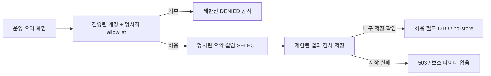

# #110 운영자 요약 조회

> 실제 #109 통합 후속: 이 문서의 계약 대역·미적용 패치 기록은 과거 검증이다.
> 현재 서버는 PR115 `c06b60a9833ae77e5fce9cfef5719ab2f37470ff`의 실제
> `CurrentAccountPort`·인증 interceptor에 연결했다. 최신 구현·검증·제한은
> [ISSUE_110_HANDOFF.md](ISSUE_110_HANDOFF.md)를 기준으로 확인한다.

2026-10-17 사용자 재개·세부 결정 위임 기준이다. 목표일은 2026-10-18이며 시각은 지정되지 않았다.
이 문서는 구현 계약과 검증 경계를 기록하며 실제 운영자 등록·권한 적용·배포 승인이 아니다.
원격 #110 본문의 2026-10-15 Backlog 기록보다 이번 재개 위임이 우선한다.

## 확정 범위와 기존 구현 재사용

- 일반 HOST·회원·비회원과 분리된 명시적 운영자 allowlist를 사용한다. 기본값은 비활성화와 빈 allowlist이며 누구에게도 자동 권한을 주지 않는다.
- #109의 `account.domain.AccountPrincipal(accountId: UUID, displayName: String)`과 `account.application.port.output.CurrentAccountPort.currentAccount(): AccountPrincipal?`가 검증한 `accountId`만 인가 입력으로 사용한다. Authorization 누락은 미인증이고 잘못된 Bearer는 401이며 게스트로 fallback하지 않는다. 이름·이메일·HOST 역할·초대 코드·요청 헤더의 ID는 운영자 근거가 아니다.
- #109 계정·참여 소유권 구현을 복제하지 않는다. #110 내부 `OperatorIdentityPort`는 이 공통 계정 ID를 연결하는 경계이며, 연결된 구현이 없으면 모두 거부한다. 테스트 대역은 테스트 소스에만 둔다.
- 기존 #20 Micrometer·JSON 로그와 #96/V10 실행 예산·승인 이력, V8 수정 라운드를 우선 재사용한다. 공급자별 로컬 호출 시간·실패 분류는 기존 `externalApi` 계측에 있으며 이를 중복 구현하지 않는다.
- 승인된 내부 계측 첫 단위의 4제품·2테스트와 RED/GREEN·변이·전체 게이트 근거는 보존한다. `SubmissionService.kt`, 참여자·RoomLifecycle·인증 CORS·소유 resolver는 이 변경에서 수정하지 않는다.
- 운영자 명령, 재분석·삭제·수정, 원문·응답 열람, 외부 telemetry 등록·전송, 실제 운영 조회는 제공하지 않는다.

## 조회와 감사 경계

인가가 대상 UUID·페이지 조건 검증과 비즈니스 조회보다 먼저다. 거부된 호출은 방·실행의 존재 여부를 조회하지 않는다.
잘못된 원시 경로·query·cursor는 오류 응답이나 감사에 복사하지 않는다. 조회 예외는 고정 오류로 바꾸며 DB 메시지·스택·원문을 응답하지 않는다.
감사 append는 조회 트랜잭션과 분리해 내구 저장한다. 감사 실패 시 성공 데이터는 반환하지 않는다. 감사 쓰기는 조회의 유일한 데이터 쓰기이며 방·시도·제출·Outbox를 변경하지 않는다.

| GET 경로 | 결과 |
| --- | --- |
| `/api/operations/rooms` | 현재 방 설정·상태 요약 페이지 |
| `/api/operations/rooms/{roomId}` | 현재 방 요약, 과거 버전을 포함한 실행 페이지, QUEUED/REUSED 수정 라운드 수, legacy 시도 수 |
| `/api/operations/invocations/{invocationId}` | 해당 실행에만 소속된 승인 시도와 공급자별 사용량 확인 범위 |

페이지 크기는 기본 20, 1~100이다. 검증된 timestamp+UUID 기반 keyset을 내림차순으로 사용하고 limit+1 조회로 다음 페이지를 판정한다.
cursor는 최대 256문자이며 인증 capability가 아니다. 잘못된 UUID·크기·cursor는 인가 후 고정 400으로 처리한다.
모든 운영 응답은 오류를 포함해 `Cache-Control: no-store`를 사용한다.

고정 오류 코드는 `OPERATOR_UNAUTHENTICATED`(401), `OPERATOR_FORBIDDEN`(403), `OPERATOR_NOT_FOUND`(404),
`OPERATOR_INVALID_QUERY`(400), `OPERATOR_UNAVAILABLE`(503)다. 인증 외부 계약의 예외 타입 연결은 #109 통합 검증 대상이다.

## 최소 표시 정보와 의미

| 정보 | 표시하는 사실 | 표시하지 않거나 단정하지 않는 내용 |
| --- | --- | --- |
| 방 | 내부 UUID, 생성 시각, 모임 방식·시간대·검색 구간·마감 설정, 현재 수집/마감 상태, 참여/제출 수, HOST 제출 존재, 활성 run 상태 | 목적/이름/초대 코드/소유자/참여자별 원문. 방 생성과 HOST 제출 완료를 같다고 보지 않음 |
| 실행 | invocation ID·run ID·STRUCTURING 시점 버전, 기록 시각·승인 카운터·같은 run 내 순번·수정 라운드 연결 | 현재 run.version과 equality join하지 않음. 종결·winner를 최종 후보 게시 성공이나 READY로 바꾸지 않음 |
| 승인 시도 | provider/model/policy, 기록된 시작/종료 시각, 제한된 실패 분류, nullable usage·USD 추정값, 실행 내부 INITIAL/RETRY/FALLBACK | provider 응답·`owner_token`·body/헤더·실제 HTTP 건수. 임의 실패 문자열은 `OTHER` |
| 사용량 | provider별 확인/미확인 수와 알려진 token·USD 소계 | unknown→0, 일부 소계→전체 비용·청구액. 분모는 `RECORDED_ADMISSIONS` |
| 수정/재사용 | V8의 QUEUED와 REUSED 수를 분리 | 페이지 재방문을 새 분석이나 영속 REUSED 이벤트로 세지 않음 |

현재 방 설정은 조회 시점 정보이며 과거 실행의 설정 스냅샷이라고 표시하지 않는다. `recorded_elapsed_millis`는 저장된 벽시계 시각 차이로 승인 대기·저장을 포함할 수 있다. 미완료나 음수 간격은 null이며 실제 공급자 HTTP 소요시간이 아니다.

V10 단독 이력에는 영속 dispatch/HTTP 증거가 없다. V15 관측이 없는 시도의 `parser_dispatched`와 `client_calls`는 null이다.
`http_request_count`는 계속 null이다. V15는 공급자 수신이나 청구 횟수를 입증하지 않는다.
invocation 연결이 없는 과거 시도는 legacy 수로 분리한다. 없는 이력을 호출 0회로 표시하지 않는다. Gemini→OpenAI 폴백 승인과 새 논리 실행/수정 분석은 별도 차원이다.
모든 합계는 해당 invocation의 행만 사용하며 알려진 0은 보존하고 미확인 합계는 null로 둔다. USD는 `BigDecimal.toPlainString`의 십진 문자열이다.

## 접근 감사와 보존

`V14__add_operator_access_audits.sql`은 #110 예약 번호다. #109의 V11 계정·소유권 migration은 수정하지 않는다.
`operations_access_audits`의 허용 컬럼은 서버 생성 `id`, `occurred_at`, 검증된 `actor_user_id`(accountId 또는 null),
고정 `route`, 검증된 UUID `target_id`(또는 null), 고정 `outcome` 여섯 개다.
쿠키·토큰·키·IP·user agent·원 경로·query·cursor·비즈니스 스냅샷은 저장하지 않는다.
대상 방/계정에 FK를 두지 않아 기존 삭제를 막지 않으며 감사가 원문이나 방 이력의 별도 사본이 되지 않게 한다.

초기 감사 보존 목표와 코드 기본값은 30일이고 설정 가능하다. cutoff보다 **엄격히 이전**인 행만 제한된 batch로 지우며 cutoff와 같은 행은 남긴다.
정리 서비스는 `meetme.operations.audit-cleanup-fixed-delay`(기본 `PT1H`)로 스케줄러에 연결된다. `cleanup-enabled=false`는 삭제를 막는다.
기존 방 데이터의 생성/최초 마감 기준 30일과 V10 cascade 정리는 바꾸지 않는다.
실제 보존 설정·운영자 초기 계정은 외부 적용 전에 별도 확인한다. 이 작업에서 실제 감사 정리나 운영 migration을 실행하지 않는다.

설정 prefix는 `meetme.operations`이며 `enabled=false`, `operator-user-ids=[]`(검증된 accountId 목록),
`audit-retention-days=30`, `audit-cleanup-batch-size=100`, `cleanup-enabled=true`를 사용한다.
계정 ID를 채팅·로그에 복사하도록 요구하지 않으며 실제 환경 등록은 별도 확인한다.

## 웹과 공통 인증 통합

`/operations`는 방 페이지와 분리한다. 목록→방→실행의 얇은 요약과 로딩·권한 없음·일시 불가·빈 결과를 제공한다.
DOM·공유 QueryClient·localStorage/sessionStorage에 원문·인증정보를 저장하지 않는다. 임의 오류 detail이나 객체 전체를 렌더링하지 않는다.
늦은 응답·화면 전환·API 교체·인증 revision 변경은 이전 보호 화면과 진행 요청을 폐기한다.
#109의 메모리 Access Token supplier와 인증 revision을 주입하는 경계를 두되 별도 로그인·Refresh·권한 부여 UI를 복제하지 않는다.
공통 인증 store의 실제 연결 전에는 운영 인증 통합 성공으로 표시하지 않는다.

## V15 로컬 transport 관측

`NaturalLanguageBatchRequest.observationContext`는 영속 승인 뒤 정확한 invocation/attempt UUID만 전달한다.
공급자 payload에는 포함하지 않는다. 승인 대기 중 제한 시간이 만료되면 명시적 미진입(false/빈 호출)을 기록한다.
두 공급자의 요청별 OkHttp listener는 callStart 순서, 단조 경과 나노초, COMPLETED/FAILED와 선택적 HTTP 상태만 수집한다.
COMPLETED는 HTTP 503이나 이후 파싱 실패의 HTTP 200도 포함할 수 있다. URL·헤더·본문·오류 메시지는 수집하지 않는다.
미종결 호출·256회 초과·문맥 부재는 완결 관측으로 저장하지 않는다.

완결 snapshot은 단일 daemon worker와 128개 제한 큐에 전달한다. 파서/processor는 DB 저장을 기다리지 않는다.
포화·종료·프로세스 중단·저장 실패는 관측 누락이며 조회에서 미확인으로 남는다. 큐 대기는 측정한 call 시간에 포함하지 않는다.
운영자 조회 시점에 비동기 저장이 아직 끝나지 않았을 수도 있다. 이 큐는 영속 메시지 전달이나 exactly-once 보장이 아니다.
전용 Hikari pool은 비즈니스 datasource를 변경하지 않고 최대2/최소0, 획득250ms, PG connect1초/socket2초를 사용한다.
저장 transaction2초·statement1초·lock500ms와 원자적 parent/child 쓰기, 정확한 승인 row lock, 동일 재기록 멱등/상충 거부를 적용한다.
기존 시도 삭제의 cascade를 따르며 원래 방 보존을 연장하지 않는다.

실행별 `transport_observed_attempt_count`와 `transport_unknown_attempt_count`는 승인 counter와 실제 연결 행을 보수적으로 대조한다.
`known_client_call_count`는 관측된 값만의 소계다. `parser_dispatch_count`와 `client_call_count`는1개 이상 승인에서 모든 관측이 확인되고
승인 counter·연결 행 수가 일치할 때만 수치다. 관측이 없거나 부분이면 null이다. 미확인0과 확인된0을 구분한다.
시도별 `client_calls`는 null(미확인), 빈 배열(확인된 무호출), 제한된 호출 목록 중 하나다.

## #109 통합 패치의 적용 경계

`docs/verification/issue-110-account-109.patch`는 아직 적용하지 않은 연결 코드다. #109의 공통 타입을 이 저장소에 중복 정의하지 않았다.
`CurrentAccountPort.currentAccount()?.accountId`만 사용하고 `AUTH_ACCESS_INVALID`를401, 나머지 인증 장애를503으로 변환한다.
패치의 `AuthFailure.code` 접근자는 실제 #109 소스에서 확인해야 하는 추가 가정이다. 실제 타입·필터 순서·공통 오류 handler와 통합 검증이 남아 있다.
격리 계약 probe가 통과해도 실제 #109 통합 성공은 아니다. 웹도 메모리 supplier와 authRevision 주입 경계만 있고 실제 store 연결은 남아 있다.

인증 callback query의 code/state가 Nginx 오류 로그에 들어갈 수 있다는 #109 리뷰 지적은 공통 인증/프록시 담당과 통합 확인한다.
앱의 마스킹이나 #110 DTO만으로 프록시 오류 로그 비노출을 보장하지 않는다. 이 세션은 실제 Nginx 설정을 변경하지 않는다.

## 완료와 검증 기록

독립 테스트 작성 → 컴파일된 RED → 최소 GREEN → 실제 PostgreSQL·웹 대역 → 생성 OpenAPI 정합 → 전체 gate → 독립 결함 주입 순서로 검증한다.
대역 인증은 테스트 전용이며 실제 계정 지정·운영 권한 변경이 아니다. 서버와 웹의 최종 결과는 완료 후 별도 검증 기록에 남긴다.
내부 계측의 기존 674 PASS/skip4는 이전 단위 결과이며 이 후속 단위의 새 전체 결과로 재사용해 주장하지 않는다.
